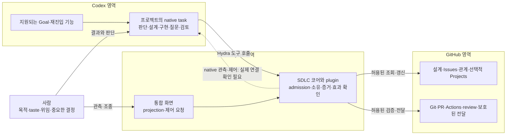

# Hydra v1.0.0: 플랫폼 활용과 책임 경계

Revision: 5 · 상태: 권고안·검토 후보 · 2026-10-19 · 관련 작업: Issue #3

이 문서는 [제품 기준](../product/mvp-design.md)을 달성하기 위해 기존 플랫폼에 맡길 일과
Hydra가 보완할 일을 선택한다. [SDLC 통합 설계](sdlc.md)의 책임을 실제 배치 후보로 연결하는
결정 기록이다. 상세 schema·API·TC를 중복 정의하지 않으며 현행
[구현 계약](../engineering/github-workflow/spec.md)을 변경하지 않는다.

이번 단계의 결과는 권고·대안·비용·상세 계약의 연결이다. 기본 경로의 읽기 도달과 전체 native
제어·질문·재시작 qualification은 구분하며, 후자의 실제 통합 검증은 NOT RUN이다.
이 문서만으로 구현·설치·예약 실행이나 새 자격·요금 경로를 승인하지 않는다.

[대화·관측·조종 시나리오](../product/interaction-scenarios.md)를 호출 경로 선택의 입력으로
사용한다. Codex는 주 대화·원격 응답·자연어 제어 창구, Hydra 화면은 통합 관측·명시적 제어
창구이며 같은 코어를 사용한다. 원격에서 같은 대화에 접근하는 기능과 외부 Hydra 프로세스의
native API 접근은 별개다. W1의 조회 결과만으로 질문/답변 왕복이나 실행 중 제어를 입증하지 않는다.

## 1. 선택의 기준

사용자는 프로젝트별 책임을 한 번 맡긴 뒤 실제 진전·다음 행동·필요한 결정·남은 의무를
Hydra에서 확인하고 조종할 수 있어야 한다. 그 경험을 만드는 가장 작은 구조를 고른다.

| 기준 | 선택에 미치는 영향 |
| --- | --- |
| 정본은 하나 | 외부 시스템이 관리하는 사실을 Hydra에서 따로 편집·동기화하지 않는다. |
| 기존 설계와 사용 방식 존중 | Issue 형식·Projects 사용 여부 때문에 유용한 요구를 버리거나 문서를 다시 쓰게 하지 않는다. |
| 권한과 사실 분리 | 이벤트·Issue 관계·모델 판단·현재 연결 가능 여부는 새 실행 권한이 아니다. |
| 실패 뒤 책임 복원 | 최소 데이터라는 이유로 소유권·미확인 효과·수용한 실행 범위를 잃지 않는다. |
| 실제 지원 범위에 맞는 구현 | 도구 노출, 문서화된 API, 설치된 기능, 실제 target에서의 동작을 구별한다. |
| 충분한 자율성과 제한된 개입 | 기존 위임 안에서 계속 진행하고 중요한 제품·권한 판단만 사람에게 연결한다. |

앞의 정본·권한·복구 조건은 편의나 속도로 상쇄하지 않는다. UI 구성, 내부 함수 분해,
작업별 agent 수와 세션 길이는 이 조건 안에서 선택할 구현 재량이다.

## 2. 권고하는 최소 배치

**프로젝트의 Codex 작업이 판단과 실행을 맡고, Hydra가 결정적 SDLC 도구와 통합 관측·제어를 제공한다.**
GitHub는 업무·설계·코드·전달의 정본이다. 조정은 역할이며 새 상주 에이전트나 프로젝트마다
고정된 coordinator 세션을 만드는 요구가 아니다. 기존 책임을 수행 중인 적절한 native task를 재사용한다.

이 그림은 제품 대표 흐름에 실행 주체를 덧붙인 배치 후보다. `Codex → Hydra 도구`와
`외부 Hydra → Codex native 관측·제어`는 서로 다른 연결이다. 전자의 구현 구조가 후자의
실제 접근을 입증하지 않는다. 점선의 호출 주체·인증·owner·조회 범위는 W1에서 확인한다.
점선은 직접 API 호출을 지정하지 않는다. 지원되는 native 주체의 매개도 동일한 결과와
권한·복구 보장을 확인한 뒤 선택할 수 있다.
화면·plugin·CLI는 같은 코어의 guard를 사용하며, 화면을 위해 별도 workflow engine을 만들지 않는다.

| 결과·사실 | 정본·실행 주체 | Hydra에 남는 책임 |
| --- | --- | --- |
| 목적·taste·위임 | 사람의 결정과 프로젝트의 수용된 문서/기록 | 현재 작업과 허용 범위를 연결하고 변경 영향을 구분 |
| 업무·부모/자식·의존 관계 | GitHub Issues와 지원되는 native 관계 | 원본 조회, 해석·수용 경계, 필요한 선행 산출물의 충족 확인 |
| 계획·우선순위 | 프로젝트가 선택한 외부 계획 원본; Projects는 선택 사항 | 원본의 의미를 매핑하고 하나의 우선순위로 해석 |
| 판단·작업 수행 | Codex native task | 정확한 작업 배정, 권한·소유 확인, 후보 결과 검증 |
| 질문·답변·실행·예약 | 원래 Codex 표면 | 허용된 projection, 정확한 질문/실행 연결, 지원되는 제어의 read-back |
| 테스트·리뷰·병합·배포 | 프로젝트의 TC와 GitHub 검사·보호된 전달 및 해당 배포 시스템 | 기준 판본·producer·실제 결과를 대조해 완료/대기/실패/미확인 판정 |
| 자원·실제 종료 | 기존 workspace/process/native provider | owned·inactive·보존 조건 확인 후 해당 provider의 정리 수행 |

## 3. 선택과 대안

### 업무 관계: native 관계를 기본 정본 후보로 선택

부모/자식과 blocked-by는 GitHub native 관계를 우선 사용한다. 자체 binding에 동일 관계를
다시 편집 가능한 목록으로 두는 안은 이중 수정·불일치 해결 비용 때문에 권고하지 않는다.
단, 실제 실행 주체의 조회·변경·pagination·교차 repository 접근은 확인 전이다.

**현재 업무의 부모와 이번 실행을 위임한 목표는 다른 사실이다.** 사람이 parent를 바꾸면
현재 관계는 즉시 새 원본을 따르지만, 기존 attempt의 위임·scope가 자동으로 바뀌지는 않는다.
마찬가지로 native dependency는 작업 사이의 관계이고, 필요한 산출물·revision·검증 조건은
프로젝트 설계와 수용한 실행 계약이 정의한다. Issue가 closed라는 이유만으로 충족하지 않는다.

Binding에는 원문/설계 revision, 요구·실제 위임·선행 산출물 조건과 attempt의 연결을 남긴다.
현재 관계·Issue 상태·Projects 필드·CI 결론의 사본은 만들지 않는다. 이전 실행의 근거를
대사하는 데 필요한 참조와 digest는 보존한다. 이는 필드 확정이 아니라 최소 의미의 선택이다.
참조와 digest만으로 과거 수용 의미를 복원할 수 없다면 versioned spec이나 기존 인증된 채택
기록에 필요한 결정 내용을 보존한다. mutable 원문을 가리키는 것만으로 복구 가능하다고 보지 않는다.

기존 v1 intake는 별도 호환 경로로 유지한다. native 관계와 legacy block을 동시에 정본으로
쓰지 않는다. 새 경로의 지원 부족은 자동 custom tracker fallback의 이유가 아니다. 읽기·분석은
가능한 범위에서 계속하고, 해당 관계에 의존하는 효과만 보류한다. 전환은 W2 상세 계약이 소유한다.

### 계획: Projects를 선택적 원본으로 연결

Projects를 사용하는 프로젝트는 지정한 field를 계획·우선순위의 정본으로 쓸 수 있다.
사용하지 않는 프로젝트는 기존 Issue/정책에 있는 우선순위를 유지한다. 한 프로젝트에서
어느 원본을 따를지 하나로 정하며, 다른 보기는 해당 원본을 표시한다.

모든 프로젝트에 Projects를 강제하는 안은 온보딩과 권한 요구를 늘리므로 선택하지 않는다.
Hydra 자체 backlog를 추가하는 안도 선택하지 않는다. 필드 의미·쓰기 주체·자동화는 연결 시
확인하며, `Done`·우선순위 변경은 실행 위임이나 완료 증거가 아니다.

### 실행: native 중심을 유지하고 요청·결과의 연결을 먼저 확인

Native task는 실제 모델 작업·질문·검토를 수행하고 Hydra 도구를 호출한다. Goal은 위임된
결과를 수행하는 실행 문맥으로 사용하며 GitHub 목표의 별도 정본이 되지 않는다.
같은 task가 여러 작업을 수행하거나 다른 task가 책임을 이어갈 수 있다. 재사용 여부는
소유권·문맥·격리 필요성에 따라 정하고 매 단계마다 세션을 생성하지 않는다.

외부 UI의 native 관측·계속하기·중단은 동일한 실제 owner에 도달하는 지원 경로를 확인한 후
얇은 adapter로 연결한다. 직접 호출과 지원되는 native 주체를 통한 매개는 배치 후보이며,
제품 요구는 어느 경로든 정확한 대상에 요청이 도달하고 원본 결과가 돌아오는 것이다.
현재 대화에 있는 앱 도구를 외부 서비스 API로 가정하지 않는다.
새로 띄운 App Server가 기존 desktop task를 소유한다고 가정하지도 않는다.
각 native 도구의 호출 주체와 사용자 지시·승인 전제도 그대로 적용한다. Hydra에 목적을 위임한
사실만으로 해당 도구의 별도 생성·메시지·실행 제한이 해제됐다고 가정하지 않는다.

Hydra 소유 App Server, SDK worker, managed API는 별도 실행 소유권·설치·인증·비용·사용자
경험을 만드는 대안이다. 현재 native 요구를 만족하지 못한다는 근거가 있을 때 비교할 후속
선택지이며 자동 fallback으로 넣지 않는다. 직접 호출이 불가하더라도 native 매개 경로를
평가한다. 매개 방식도 실행 중 중단 요청의 도달, 턴 종료 뒤 재진입, 원본 결과의 회수와
연결 복원을 입증해야 한다. 다음 tool 호출 때의 admission 확인만으로 실행 중단을 보장하지
않는다. 화면 링크·수동 메시지 전달·모델의 성공 보고만 가능한 경우에는 부분 지원으로 표시한다.
그 부분 성공으로 전체 control tower 요구가 충족됐다고 판정하지 않는다.

### 재진입: 실제 대기에서만 지원되는 wake를 사용

현재 턴에서 가능한 유효한 행동은 이어간다. 턴을 마친 뒤에는 원래 질문의 답변, 실제 지원되는
사건 또는 위임된 native 예약으로 재진입한다. wake는 최신 상태를 다시 볼 이유이며 실행 권한이 아니다.
중복 wake·자신의 progress 갱신·새 사실이 없는 대기는 새 작업·질문·세션 생성으로 이어지지 않는다.

별도 Hydra scheduler는 추가하지 않는다. 다만 native 예약이 모델을 호출하는 방식이면
변화 없는 예약 실행에도 비용이 생길 수 있다. native 예약 재사용과 무모델 event 감지를
같은 보장으로 표현하지 않는다. 실제 host/app 가용성·지연·중복·catch-up·비용을 확인하고
기존 위임에 맞는 최소 wake를 선택한다. 새 cadence나 지출 한도를 임의로 정하지 않는다.

### 전달: 저장소의 보호된 경로를 따른다

기존 direct merge 경로를 유지하되, queue가 필요한 repository를 지원하려면 enqueue·통합 SHA의
검사·실제 merge를 연결하는 별도 증거 계약이 필요하다. queue를 모든 프로젝트에 강제하지 않으며
queue가 필수인 저장소에서 direct merge로 우회하지 않는다. 현재 코드의 queue 지원은 미입증이다.

Actions의 실행·artifact·rerun과 GitHub review/protection을 재사용한다. Hydra는 별도 CI 또는
review system을 만들지 않고 정확한 revision·producer·필수 결과를 확인한다. deterministic TC/CI,
의미·taste의 독립 평가, 실제 설치/외부 연결 관측은 서로 다른 주장에 대한 증거다.

## 4. 최소 데이터와 복구에 필요한 예외

Hydra의 영속 allowlist는 기존 연결 설정·admission 설정·bounded ownership ticket으로 유지한다.
Projection은 메모리 캐시이며 삭제 가능해야 한다. 최소화는 복구 근거를 제거한다는 뜻이 아니다.

| 복원해야 할 사실 | 원래 소유 위치 | 없거나 서로 다를 때 |
| --- | --- | --- |
| 수용된 작업·설계·위임과 실행 시도 | GitHub의 원문 참조와 인증된 기존 progress/binding | 새 해석으로 진행 중 attempt를 덮지 않고 영향 범위 보류 |
| 외부 효과의 의도·대상·실제 결과 | 해당 효과의 기존 intent 기록과 실제 GitHub/native/provider | 요청 응답 유실을 실패로 단정하지 않음. 재조회로 확정 전 중복 실행 금지 |
| private native task와 work/attempt 연결 | 지원되는 native 원본과 최소 host 소유권 | 제목 일치나 시간 경과로 인수하지 않음. 미복원은 unknown |
| pause/stop과 host 실행 소유 | Hydra admission·기존 owner ticket 및 실제 provider | admission 차단과 실제 실행 종료를 구분. unknown owner 해제 금지 |
| 미완료 정리 | 원래 작업의 발견 가능한 progress와 provider 사실 | Issue가 닫혀도 잔여 책임 유지. foreign/dirty/active/unknown 자원 보존 |

구체 효과별 의도 저장 위치·읽는 주체·복구 조회는 기존 EX/NC 계약을 보완해 명시한다.
그 위치를 확인하지 못한 명령에 새로운 로컬 journal을 붙여 지원된 것처럼 만들지 않는다.
public 기록에는 native ID·private 대화·로컬 경로·secret을 넣지 않는다. 비신뢰 본문·댓글·
모델의 성공 주장은 해석할 데이터이며, 그 내용만으로 실행 권한·shell 코드·검증 통과를 인정하지
않는다. GitHub 검사·리뷰 등 원본 결과는 producer·revision·권한을 확인해 증거로 사용한다.

Hydra의 guard는 Hydra를 거치는 효과를 통제한다. 사용자가 원본에서 직접 수행하는 동작이나
다른 실행 경로를 전부 막는 host 보안 경계로 과장하지 않는다. 외부 변경은 다음 관측에서
대조하고, 필요한 격리는 실제 sandbox·credential·repository 보호 계층에서 확인한다.

## 5. 실패 사례와 검증 연결

아래는 상세 시험을 대체하지 않는 선택 검증의 초점이다. D/L/O 정의와 기존 사례 ID는
[검증 설계](../engineering/mvp/verification.md)가 소유한다. 전부 이번 실행 결과가 아니다.

| 사례 | 기대 동작·금지 결과 | 기존 검증 연결 |
| --- | --- | --- |
| 사람이 실행 중 parent/dependency/priority 수정 | 현재 관계와 기존 위임을 구분, 영향받는 다음 효과만 재판정. scope 자동 확대 금지 | WR-D·L15/19·O04 |
| native 조회 일부 실패 또는 관계 권한 없음 | 가능한 원본은 표시, affected 효과만 hold. 빈 목록·종료·선행 충족으로 변환 금지 | NC-D04·CP-D·O01/06 |
| 외부 생성/전달 성공 뒤 응답 유실 | 같은 의도/대상으로 원본 대사. 중복 Issue/task/PR 금지 | NC-D05·VF-D06·O03/04/05 |
| 형식이 다른 버그 보고에 위험 지시가 섞임 | 유용한 요구는 해석, 권한·secret·보호 변경은 독립 차단 | R02/03·L11–17·O03 |
| 중복 wake·stale 답변·turn 종료 | 현재 책임과 원래 질문만 재개, 유효한 다음 행동은 진행. 무조건 hold도 실패 | NC/EX-D·L07/18·O01/04 |
| queue 필수인데 queue 증거 없음 | 해당 전달은 지원 부족으로 보류. direct 우회나 PR CI만으로 성공 금지 | EX-D·O05를 queue 경로로 보완 |
| Stop 뒤 active child 또는 정리 실패 | 실제 실행·정리 미완료를 유지, 원본과 산출물 보존 | NC-D07/08·O04/06 |

LLM은 다음 작업의 유용성·설계 충실성·질문의 필요성을 평가한다. identity·현재 권한·
소유권·중복 effect·증거 revision 등 결정적으로 판정 가능한 조건은 TC/guard로 검증한다.
실제 provider 연결·재진입·중단·정리 성공은 mock이나 문서 검토로 대체하지 않는다.

## 6. 상세 설계로 넘기기 전에 확인할 것

전체 기능의 조작 계약과 공통 의미를 먼저 정렬하는 순서는
[구현 계획 §1.1–2](../engineering/mvp/plan.md#11-지금-먼저-닫을-설계와-구현-시작-조건)가 소유한다.
아래는 그 과정의 플랫폼 확인 항목이다. W1b의 최소 조회와 관련 구현 뒤 단계별 실제 수용을
구분하며, 전체 질문·중단·복원·정리 실증을 그 기능 구현의 선행 조건으로 두지 않는다.

| 순서·담당 역할 | 결과와 끝의 조건 | 막는 범위 |
| --- | --- | --- |
| 1. Native 연결 담당: W1a/W1b | 먼저 W1a 사전 조사에서 직접/매개 경로의 호출 주체·지원 표면·단절 지점을 비교. 다음 W1b에서 선택한 경로의 같은 허용 task를 조회하고, 단계별 실행·중단·복원을 관측. NC runbook/O01·O04 재사용 | 선택 경로에 의존하는 adapter, private 연결 복원, 전체 제어 지원 선언 |
| 2. 작업 계약 담당: W2a/W2c | native 관계와 선택적 계획 원본의 접근·변경·부분 조회를 확인하고 legacy 전환 및 최소 binding을 결정 | 새 업무 관계 schema·의존 실행 판정. W1과 독립 분석 가능 |
| 3. 실행/검증 담당: W4/W6 | 실제 질문·wake·응답 유실·종료·정리 및 보호된 전달을 해당 기존 O 사례에서 관측 | 자동 연속 실행·전달·종료의 제품 수용 |

새 환경을 만들기 전에 이미 허용된 target과 도구를 확인한다. 실행할 시험은 정확한 대상,
허용 효과·비용·중단·정리 조건을 구체화한다. 기존 권한으로 가능한 검증은 반복 승인 없이
진행하고, 새 자격·비용·제품 의미가 필요한 부분만 구체적인 결정으로 연결한다.

정적 명세 확인은 실제 연결 성공이 아니다. 먼저 요청 전달·실행 중 제어/턴 뒤 재진입·원본
증거 회수라는 세 질문으로 경로를 좁힌다. 전체 adapter나 8단계 시험을 한 번에 시작하지 않는다.
실증의 결론은 pass 또는 정확한 제한이어야 한다. 직접 또는 매개로 동일 owner에 도달할 지원 경로가 없으면
첫 번째 배치를 구현 가능하다고 확정하지 않는다. 원본의 연결 정보가 복원되지 않거나 wake가
필요한 가용성을 충족하지 못하면 해당 선택만 다시 검토한다. 독립적인 읽기·TC 설계까지 막지 않는다.

## 7. 기존 후보와의 정합성·변경 기록

이 문서는 책임 배분의 권고와 대안을 소유한다. 아래 상세 후보에 필드·실행·복구 의미를
연결했다. 구현은 해당 scoped revision의 검토·수용 뒤 진행하며 schema version 번호를
올리는 것만으로 실제 정책이나 운영을 전환하지 않는다.

| 소유 위치 | 상세화한 경계와 남은 확인 |
| --- | --- |
| WR §4/5/9/10 | current 관계와 fixed 위임·입력 조건 분리. project-v2의 명시적 legacy/native 단일 source와 기존 v1 보존. native 관계·선택적 Projects의 실제 adapter 자격은 별도 |
| CP 및 EX | source별 projection, project CAS와 효과 dispatch 경계, versioned 좁은 command, 결정의 exact intent·read-back·소비와 legacy 호환. 실제 구현·전환은 미실행 |
| NC §2.4와 EX의 native/wake | A reader의 typed 진단은 질문/사람/caller 자격이 아님. 실제 원본 연결과 재진입은 별도 capability이며 무변화 예약의 무비용 실행을 보장하지 않음 |
| EX 전달·정리와 검증 O05/O06 | direct/queue 지원 조건, integration revision·enqueue·merge, paused/stopped 중 삭제 보류와 후속 cleanup-only 계약의 경계. source와 권한을 확인하지 않은 효과는 지원으로 광고하지 않음 |
| 계획 §1.4·Goal | A reader/B CAS/C 원본 연결/D 좁은 적용/E 실제 왕복. 독립 WR·검증·전달 작업은 첫 O를 기다리지 않음 |

2026-10-18: 제품 방향과 기존 실행 계약을 유지하면서 플랫폼 활용의 권고·대안·불이익·
반증 조건을 작성했다. native 관계 우선, 선택적 Projects, native 실행과 외부 제어 연결의 분리,
최소 복구 근거, queue의 조건부 지원을 명시했다. 실제 연결·코드·설치·운영 검증은 NOT RUN이다.

문서 검토: GitHub 관계/호환과 권한/복구의 두 관점에서 별도 검토했다. 외부 입력 전체를
검증 증거에서 배제하는 넓은 표현을 수정해, 비신뢰 주장과 producer·revision을 확인한 원본
결과를 구분했다. 관련 문서의 링크·anchor·공백과 새 내용의 private 경로 유입 검사는 통과했다.
이는 문서 정합성 검토이며 코드·보안 감사나 실제 연결 검증의 완료 기록은 아니다.

Revision 2: 다음 단계의 필요성을 재검토해 직접 외부 호출을 제품 필수 조건으로 해석한
표현을 수정했다. 직접/매개 모두 같은 관측·제어·복구 기준을 적용하며, 정적 사전 조사와
대상을 정한 실제 qualification을 분리했다. 실제 연결 검증은 계속 NOT RUN이다.
