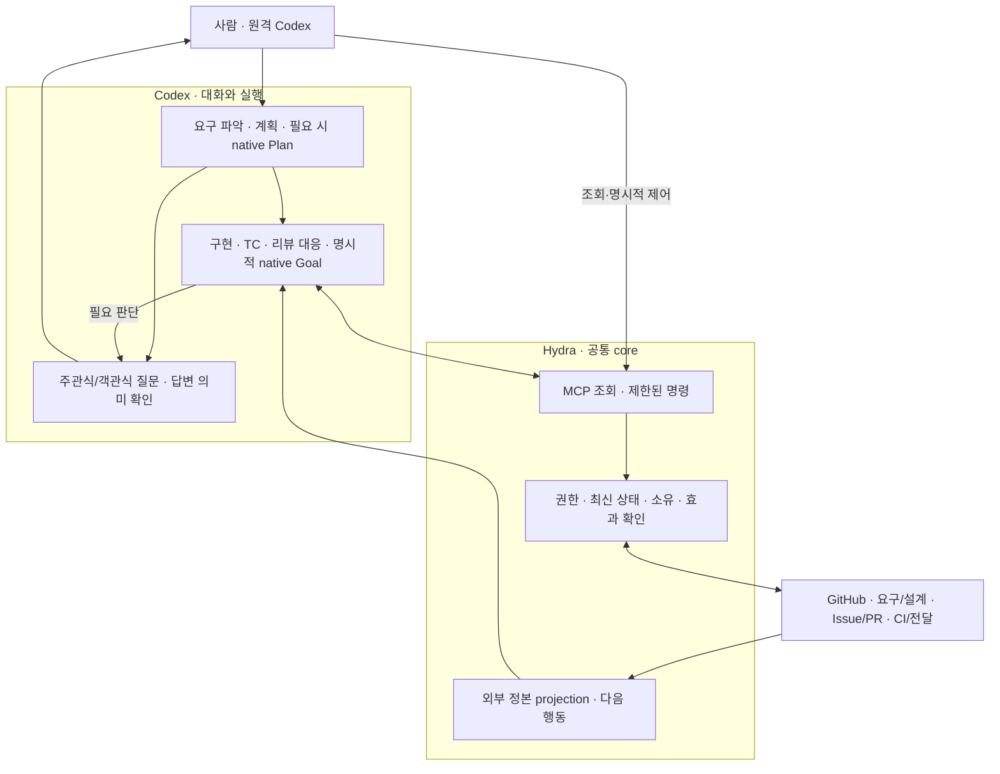

# Hydra SDLC 통합 설계

Revision: 5 · 상태: 검토 후보 · 2026-10-19 · 작업 기록: Issue #3

이 문서는 [제품 목적](../product/mvp-design.md)을 실행 가능한 운영 구조로 연결한다.
GitHub·Codex·Hydra의 책임, 정본, projection, 명령, 수명주기, 시나리오, 검증과 구현 순서를
한곳에서 정의한다. 현행 계약의 유지와 새 제안을 구분하며 구현·설치·운영 성공을 선언하지 않는다.
이번 작성은 중단된 코드 구현이나 외부 실행을 재개하지 않는다.

플랫폼 재사용의 선택·대안·확인 조건은 [플랫폼 활용과 책임 경계](platform-boundaries.md)가
소유한다. 이번 Revision 3는 WR의 단일 source 선택, NC의 호출 문맥 진단, CP의 제어·효과
경계, EX의 결정·복구 계약과 연결한다. [정합성·변경 기록](platform-boundaries.md#7-기존-후보와의-정합성변경-기록)은
설계의 정렬과 실제 capability 확인을 구분한다. 아래 운영 불변조건과 현행 수용 계약은 유지한다.

구현할 schema·호환·TC·운영 runbook은 [v1.0.0 상세 계약](../engineering/mvp/spec.md),
작은 결과 단위와 선행 관계는 [구현 계획](../engineering/mvp/plan.md)이 소유한다.
이 문서는 전체 책임과 흐름을 설명하며 하위 계약의 필드를 다시 정의하지 않는다.

제품 전체의 대표 다이어그램은 [책임 영역과 전체 흐름](../product/mvp-design.md#책임-영역과-전체-흐름)을
참조한다. 아래 구조와 상세 계약은 그 그림의 책임 경계를 구체화한다.

## 1. 목적과 최소 구조

사람이 목적·기준·taste·권한을 정하면, Hydra에서 전체 개발 상태를 이해하고 조종할 수 있고,
Codex가 해당 프로젝트의 설계를 따라 필요한 작업을 수행하여 검증된 결과까지 이어간다.
기존 설계가 충분하면 실행하고, 부족한 부분만 구체화한다. 작업 종료 뒤에도 목표와 남은 책임을 확인한다.

**작업 기록은 GitHub Issue를 사용한다. Hydra는 외부 정본을 연결하는 control plane이다.**
Hydra 안에서 목표·작업·의존 관계·실행·질문·검증·전달·정리를 확인하되 그 데이터의 두 번째
정본을 만들지 않는다. 각 시스템이 이미 잘하는 기능을 재사용하고, 연결에 필요한 보장만 구현한다.

| 시스템 | 목적·소유하는 사실 | 수행하는 일 | 다른 시스템의 책임 |
| --- | --- | --- | --- |
| GitHub | 프로젝트 설계 revision, 목표/작업 Issue, 코드·PR·리뷰·CI·merge 사실 | 버전 관리, 협업 기록, 검사와 보호된 전달 | 에이전트의 판단·native 실행 상태를 대신 결정하지 않음 |
| Codex | native task/session, 대화·질문·답변, 실행 관측, native 예약 | 설계 해석·작업 분해·TC·구현·독립 검토·다음 행동 판단 | 판단 결과로 권한·테스트·실제 전달을 자체 인증하지 않음 |
| Hydra | 연결 설정, admission 설정, 최소 실행 소유권; 외부 사실의 projection | 자격·identity·증거 확인, 명령 조정, 재대조·복구·정리, 통합 관측/제어 | Issue tracker·대화 저장소·모델 실행기·CI·예약 엔진을 중복 구현하지 않음 |

프로젝트별 제품 의미와 평가 기준은 그 프로젝트가 소유한다. 공통 지식·브랜드는 필요한
읽기 문맥이며 작업 상태 저장소가 아니다. 특정 프로젝트의 제품 기능을 Hydra 코어에 넣지 않는다.

~~~mermaid
flowchart LR
  U[사람: 목적·기준·위임·조종] --> H[Hydra control plane]
  G[GitHub: 설계·Issue·코드·증거] -->|조회·revision| H
  C[Codex: 판단·task·질문·실행] -->|관측·결과 후보| H
  R[기존 자원 관리: workspace·process] -->|소유·실제 상태| H
  H -->|검증된 기록·전달 명령| G
  H -->|유효한 배정·지원되는 제어| C
  H -->|소유 확인 후 보존·정리| R
  H -->|원본 근거·다음 행동·필요 결정| U
~~~

### Codex에서 끝까지 운영하는 흐름

필수 사용자 창구는 원격 Codex다. 사람은 요청·질문 답변·진행 수정·상태 조회·Pause/Resume과
중단 결과 확인을 Codex에서 수행하고 Hydra MCP가 공통 제어 core로 연결한다. Hydra 앱은 보조
projection/최소 제어이며 필수 원격 시나리오의 로컬 우회로가 아니다.

Plan은 설계 모드, Goal은 명시적으로 맡긴 지속 목표의 native 실행, 예약은 외부 사건/미래 대기다.
실제 지원 조건은 CS/NC, 질문 해석·적용은 EX, MCP 효과는 CP가 소유한다. 원격 연결 단절이나
host 부재는 적용 unknown이며 독립 원격 앱·새 scheduler를 기본으로 추가하지 않는다.

## 2. 어디에 무엇을 저장하는가

자율 동작의 책임은 제품 설계의 발견·제안, 위임 작업 진행, 운영 복구로 나눈다. 이는 실행기
세 개나 고정 coordinator를 뜻하지 않는다. Codex는 원래 책임에서 판단하고 GitHub는 작업과
전달 원본을 보존하며 Hydra는 실제 qualified 연결의 효과 guard와 projection을 제공한다.
관계 준비는 P10의 native 등록 주체, 현재 관계 검증은 P11, main 검증 실행 보존은 P14가 맡는다.
실제 지원 경로와 버전의 정본은 NC의 기능별 판정이며 전체 인계 순서는 구현 계획 §0이다.

외부 정본 원칙은 원본을 찾을 수 있다는 보장을 대신하지 않는다. native의 책임 연결을 복원할
수 없는 경우 현재 자동 경로는 미확인/미지원으로 남긴다. 새 최소 locator가 필요하다는 증거가
나오면 저장 주체·노출·보존·삭제·권한·복원 시험을 별도 결정하고, 이 설계에서 숨은 map을 도입하지 않는다.

| 대상 | 정본과 식별 | Hydra가 보유하는 범위 |
| --- | --- | --- |
| 프로젝트 | GitHub repository numeric ID, 보호된 프로젝트 계약 SHA | 등록된 연결과 허용 경계; 프로젝트 내용은 조회 |
| 목표 | 공개 가능한 목표 Issue + versioned 목적/설계 참조 | 원본 참조와 집계 projection |
| 작업 | 해당 저장소 Issue의 repository ID + issue number | 기존 progress를 조회한 상태; 별도 작업 row 없음 |
| 상세 설계·TC·계획 | 프로젝트의 기존 versioned 파일과 요구사항 참조 | 필요한 범위와 revision을 읽음; 문서 복제 없음 |
| 실행 시도·배정 | 해당 Issue의 인증된 Hydra progress comment: attempt/step/head/spec/policy/intake | 현재 처리 중 메모리와 기존 host ownership ticket |
| native 세션·질문·예약 | Codex의 원래 task/session/schedule | 허용된 private 조회와 화면 연결; transcript/예약 DB 없음 |
| 코드·전달·검증 | Git, GitHub PR/check/review/merge와 실제 검증 결과 | 참조와 검증된 요약; CI 로그·Git 객체 복제 없음 |
| workspace·process | 기존 lifecycle provider와 실제 Git/OS 사실 | 최소 owner ticket 및 읽기 결과; 별도 자원 대장 없음 |
| 제어 설정 | Hydra의 global/project admission mode와 revision | Hydra 고유의 최소 영속 설정 |

Hydra의 영속 allowlist는 설치/연결 설정, admission 설정, 실행 중복 방지를 위한 bounded
ownership ticket이다. credentials는 기존 자격 관리 경로에서 사용하고 설정·projection에 복제하지 않는다.
업무 progress는 기존 방식대로 외부 Issue에 기록하며 로컬 workflow DB, event journal,
state branch, 목표/Issue mirror를 추가하지 않는다. Git worktree의 실제 수정 파일은 중복 추적 데이터가 아니다.

v1.0.0 projection 캐시는 프로세스 메모리에만 둔다. 캐시를 버리거나 Hydra를 재시작해도 외부
작업 기록이 사라지지 않는다. 재시작 시 원본과 최소 ticket을 대조한다. 저장되지 않은 private
출력은 소실될 수 있으므로 필요한 검증을 다시 수행한다. 캐시를 실행·완료 근거로 승격하지 않는다.

## 3. 목표·작업·세부 단계

**목표:** 원하는 결과·제외 범위·기준·위임·종료 조건이다. 여러 작업을 묶을 때 기존 목표
Issue를 재사용한다. 작은 단일 결과는 작업 Issue가 목표 역할까지 맡아 별도 부모를 만들지 않는다.
장기 목표 Issue는 집계 책임을 가지며 실행용 ready 상태로 자동 전환하지 않는다.
native goal을 사용할 경우 같은 제품 목표 상태를 복제하지 않고 해당 Issue의 목표를 수행하는
실행 문맥·계속하기 조건으로 사용한다. native turn/goal 종료가 제품 목표 달성을 덮어쓰지 않는다.

**작업:** 독립적으로 검토·전달·복구할 수 있는 결과다. 하나의 작업 Issue는 현재 계약의
한 owned branch/PR 흐름을 가진다. 독립 PR이 여러 개 필요하면 하위 결과를 분리한다.
TC 작성·함수 수정·리팩터링·검증 명령은 작업 내부 단계이며 매 단계마다 Issue나 세션을 만들지 않는다.

**관계:** 목표의 요구사항 참조 → 작업 Issue → accepted spec → TC/평가 → 코드 revision →
전달/관측 증거를 연결한다. 원문 ID가 없으면 문서·revision·section으로 식별한다.
기존 문서·계획·TC를 Hydra 양식으로 재작성하지 않는다.

목표-작업의 현재 관계는 WR에서 선택한 GitHub 원본으로 읽고, 실행 시 수용한 위임 목표·
선행 산출물 조건은 해당 attempt의 고정된 계약으로 보존한다. 현재 parent나 blocked-by의
변경이 과거 위임·scope를 바꾸지는 않는다. legacy와 native 관계를 동시에 정본으로 삼지 않는다.
컨벤션은 작성 기본값이며 자유 형식·외부
제안도 해석한다. 원문, 해석 후보, 채택한 실행 계약, 실제 위임을 구분한다. 형식 차이만으로
거절하지 않으며 유용한 사실과 위험한 지시가 섞이면 사실을 살리고 효과는 독립 guard로 검증한다.

실행 시도는 수용한 source/binding revision에 연결한다. 원문이 바뀌면 영향과 실제 권한을
다시 대조하며 기존 시도에 새 범위를 조용히 덮어쓰지 않는다. 진행 checklist 때문에 원문을
수정하지 않고 기존 progress/comment를 사용한다. 동등한 수정과 새 요구의 처리·기존 v1
호환은 [작업 기록 계약](../engineering/mvp/contracts/work-records.md)을 따른다.
목표의 목록은 자식 링크의 보기이며 자식 작업의 실행 상태를 복제하지 않는다.
같은 작업이 여러 목표를 돕더라도 실행 소유자는 하나이며 다른 목표는 결과를 참조한다.

새 작업 등록은 다음 계약을 따른다.

1. Codex가 원래 요구와 기존 작업·증거를 대조하여 결과 단위와 의존성을 제안한다.
2. 동일한 목표 revision·요구 범위·결과 단위의 기존 Issue를 먼저 조회하고 재사용한다.
3. 새 등록이 필요하면 안정된 결과 식별자와 공개 가능한 생성 의도를 기존 목표 기록에 먼저 남긴다.
4. 허용된 GitHub 경로로 한 번 생성하고 원본을 재조회한다. 응답 유실 시 같은 식별자를 조회하며,
   생성 여부를 확정할 수 없으면 보류한다. 여러 후보가 있으면 자동으로 하나를 선택하지 않는다.
5. 실행 위임은 프로젝트 계약과 실제 위임을 확인한다. 부모의 존재나 Codex의 제안만으로
   ready label·권한을 만들지 않는다. 명시된 지속 위임은 범위 안에서 재사용하며 반복 승인하지 않는다.

최초 목표 또는 목표를 겸하는 단일 작업 Issue가 아직 없으면, 등록을 요청한 기존 Codex
task에 대상 repository와 공개 가능한 생성 의도·한 번 발급한 create_key를 먼저 남긴다.
create_key는 임의의 공개-safe 식별자이며 native task ID를 포함하지 않는다. 이를 최초 Issue의
생성 marker에 넣고, 응답 유실 시 같은 repository·인증된 작성자·create_key로 원본을 조회한다.
native 준비 기록이나 전체 조회 범위를 복원하지 못하면 자동 재시도하지 않는다. 생성 확인 후
GitHub Issue가 작업 정본이 되고 native 기록은 그 생성 요청의 근거로만 남는다.

목표/관계/결과 식별자의 자동 처리와 작업 생성의 멱등 경계는 현행 Issue 실행기 위에 필요한
**확장 설계**다. 기존 다섯 실행 도구가 이미 이 기능을 제공한다고 가정하지 않는다.
도구별 편의 기능보다 이 제한된 등록 계약을 먼저 구현하며 임의 GitHub 명령 실행기를 추가하지 않는다.

## 4. Projection: Hydra에서 무엇을 보는가

최소 화면은 **전체 개요 → 목표/작업 상세 → 필요한 결정과 제어**다. 분리된 tracker 화면은 없다.

| 보기 | 표시할 내용·근거 |
| --- | --- |
| 전체 | 프로젝트별 목표, 실제 진전, 실행 관측, 대기/장애, 필요한 결정; 각 원본의 조회 범위 |
| 목표 | 목적·기준·설계, 요구별 충족 증거, 작업 의존 관계, 남은 결과와 다음 행동 |
| 작업 | spec/TC, 현재 단계, 실제 task와 workspace 연결, PR·CI·리뷰·전달·정리 |
| 결정 | 질문 원문을 볼 수 있는 native 경로, 공개 가능한 요약, 판단 주체·영향·해결 여부 |
| 자원/제어 | 소유한 실행·예약·workspace, admission 설정, 제어의 요청/적용/실제 효과 |

연결된 권한 범위의 필요한 내용은 Hydra 안에서 읽을 수 있게 표시하고 원본 이동도 제공한다.
자료의 복제 편집기는 만들지 않는다. native 세션 ID·private 문맥은 허용된 local/native
표면에서만 사용하며 GitHub나 공개 로그로 보내지 않는다. 접근 불가 항목은 그 상태와 이유를 보여준다.

각 projection의 최소 공통 필드는 source, resource identity, source revision,
observed_at, availability, coverage, reason이다. availability는 current / stale / unavailable /
unsupported로 구분한다. current도 관측 시점의 사실이며 이후의 무변경을 보장하지 않는다.
결합한 사실마다 출처를 보존하고, 전체가 한 시점의 원자적 snapshot인 것처럼 표시하지 않는다.
원본이 revision을 제공하지 않으면 null로 남긴다. 관측 시각을 원본 변경 방지 토큰으로 사용하지 않는다.
coverage는 complete / partial / unavailable로 구분하고 목록 범위·잘림을 표시한다.
전체 조회가 확인되지 않으면 '모두 정리됨'이나 전체 active 수 0을 표시하지 않는다.

- 새 응답이 이전 응답을 역전시켜 덮지 않도록 요청 세대와 source revision을 대조한다.
- runtime/config/project binding이 바뀌면 다른 연결에서 얻은 기존 projection을 무효화한다.
- 한 원본 조회 실패는 다른 정상 원본을 지우지 않는다. 실패를 빈 목록·0 active·완료로 바꾸지 않는다.
- read-only projection은 Issue 생성·wake·상태 전이·ticket 해제·정리를 수행하지 않는다.
- CI/리뷰 결과는 실제 producer와 SHA를 확인한다. 모델 설명·progress의 성공 문자열은 증거가 아니다.
- 사람이 GitHub나 Codex에서 바꾼 사실은 다음 조회에 반영한다. Hydra 캐시에서 원본으로 역동기화하지 않는다.

## 5. 조작: 명령과 관측을 분리하기

화면·native 호출·CLI는 동일한 command guard를 사용한다.

~~~text
명령 의도 + 대상 identity + expected revision
  → 현재 원본/권한/소유/제어 설정 재조회
  → 유효하면 효과 의도를 정본에 기록
  → 해당 시스템의 지원 API로 한 번 실행
  → 원본 read-back
  → applied / waiting / rejected / unknown
~~~

expected revision은 UI가 본 사실과 현재 사실의 불일치를 탐지한다. 불일치하면 stale로
반환하고 새 사실을 보여주며 사용자의 명령을 새로운 scope로 조용히 변환하지 않는다.
관측 불가나 응답 유실은 unknown이다. 조회 후 안전하다고 확인한 같은 의도만 기존 제한 안에서 재시도한다.
동일 결과 식별자로 요청이 반복돼도 완료된 외부 효과를 다시 실행하지 않는다.
원본이 조건부 갱신을 지원하면 그 기능을 사용한다. 지원하지 않으면 현재 대상의 재조회와
소유권/직렬화로 가능한 보장 범위를 명시한다. 안전한 대사를 제공할 수 없는 파괴적 명령은
Hydra에서 실행하지 않고 원본의 지원되는 조작 경로와 제한을 보여준다.

| 명령의 목적 | 효과의 소유자·필수 확인 |
| --- | --- |
| 목표/작업 등록·변경 | GitHub, 실제 위임·원문 revision·중복·intake 계약 |
| 실행 배정·후속 단계 | Hydra의 기존 begin/checkpoint/verify, exact attempt/step/head/spec/policy |
| native 실행·질문·재개·예약 | Codex의 지원되는 기능, 기존 task·권한·실행 관측 |
| PR·리뷰 요청·병합·close | Hydra의 기존 delivery 경로 → GitHub 보호 규칙·exact head/base·read-back |
| Pause/Stop/Resume | Hydra admission 설정; native 실행 제어는 별도 지원 capability와 종료 관측 |
| workspace/task/schedule 정리 | 각 원래 소유 시스템, 종료·소유·보존·후속 책임 확인 |

Codex는 구현 후보를 만들지만 구현 branch의 commit/push/PR/merge를 경쟁 경로로 수행하지 않는다.
Hydra가 이미 소유한 효과는 기존 결정적 경로로만 수행한다. 설계/Issue 준비와 구현 전달의
쓰기 경계를 구분한다. 외부 시스템의 보호 승인·자격·요금·배포 정책을 Hydra가 우회하지 않는다.

## 6. 수명주기: 하나의 상태 문자열로 합치지 않기

아래는 제품 의미이며 기존 phase 필드를 전면 교체하라는 뜻이 아니다. 원본 필드를 매핑하고
누락된 의미만 호환 가능한 최소 확장으로 추가한다.

| 축 | 의미와 종료 조건 |
| --- | --- |
| 목표 | active / achieved / cancelled; 모든 결과 증거와 남은 책임으로 판정 |
| 작업 단계 | prepare → design/review → implement → verify/review → deliver → observe → result complete |
| admission | allowed / paused / stopped; 새 효과의 허용 여부 |
| 실제 실행 | unobserved / running / ended / unknown; provider 관측 근거 필요 |
| 대기 | human / external / resource / unknown과 원인·소유자·다음 재관측 조건 |
| 전달 | candidate / published / merged / post-merge verified / deployment observed; 필요한 범위별로 확인 |
| 정리 | none / pending / complete / unknown; 결과 완료와 별도 책임 |

정상 루프는 관측 → 기존 설계/증거 대조 → 다음 유효한 작업 선택 → 실행 → 검증/전달 →
목표 재평가다. 이미 가능한 행동은 같은 턴에서 계속한다. 복구·미확인 효과의 대사를 새 작업보다
우선하고, 그 뒤 의존성·우선순위를 고려한다. 미확인 소유권이 host를 점유하면 새 writer를 막는다.
한 작업의 제품 질문이나 외부 CI 대기는 독립 프로젝트를 막지 않는다.

작업 완료는 그 작업의 acceptance를 충족한 결과다. 목표 달성은 부모 요구의 증거를 다시
평가한 결과이며, 자식 Issue가 모두 닫혔다는 사실만으로 선언하지 않는다.
배포가 포함된 목표는 merge만으로 완료할 수 없다. 일회성 목표가 끝나면 새 유지보수 위임을 만들지 않는다.

## 7. 세션·재진입·질문의 정확한 책임

같은 목표의 기존 operating task를 재사용한다. 한 task는 여러 작업/assignment를 순서대로
다룰 수 있고 한 작업은 재시작 후 새 task에서도 이어질 수 있다. task ID를 작업 identity로 쓰지 않는다.
독립 리뷰·독립 위임·문맥 격리가 필요할 때만 허용된 새 task를 만든다. 파일·TC·poll마다 만들지 않는다.
host-wide 한 개의 native assignment 또는 CLI worker 제한과 기존 자원 provider를 유지한다.

배정에는 repository/Issue/attempt/step/head/spec/policy/intake를 연결한다. 배정 발행은
native 실행 시작 증거가 아니다. 시작 응답 유실 시 기존 task/assignment를 먼저 확인하며
unknown에서는 중복 생성·재배정을 하지 않는다. 늦은 결과는 자신의 step만 끝낼 수 있다.

active native task를 실제 관측하고 private한 assignment 연결을 재조회하는 능력은 Codex가
제공해야 한다. 그 연결을 복원할 수 없으면 수동 확인이 필요한 unknown으로 남긴다.
숨은 session journal·새 DB·비공식 desktop RPC로 미지원 capability를 감추지 않는다.

재진입은 현재 task의 사용자 답변, 지원되는 실제 사건, 이미 위임된 native 예약을 사용한다.
새 스케줄러를 만들지 않는다. 변화가 없으면 같은 작업·질문·세션·알림을 반복 생성하지 않는다.
native 예약이 모델 호출을 포함하면 변화 없는 재관측에도 비용이 발생할 수 있다. 실제 지원되는
event와 예약의 호출·가용성·비용을 확인하며 무모델 polling을 제공한다고 가정하지 않는다.
사용자 답만 기다리면 기존 질문과 재진입 경로를 보존하고 해당 목표의 불필요한 예약을 중지한다.
예약 변경은 현재 실행을 중단하거나 admission을 바꾸는 것과 별개다.

질문은 진행 중 작업을 checkpoint한 뒤 실제 native 질문으로 전달한다. 실제 답변에서 공개
가능한 결정 요약과 현행 exact-attempt resolution을 기록하고 원래 단계로 재개한다.
준비 단계의 질문은 가짜 실행 시도를 만들지 않는다. 내부 구현 선택은 에이전트가 처리한다.
중요한 제품/계약 변경은 영향·대안과 함께 판단 대상으로 올린다. chat 답변은 보호 승인을 대체하지 않는다.

## 8. 실패·복구·정리의 공통 규칙

외부 효과마다 요청 전, 요청 후 응답 전, 응답 후 기록 전, 기록 후 재진입을 구분한다.
의도와 실제 결과를 대조하기 전에는 같은 효과를 반복하지 않는다. 불명확한 상태는 성공·실패로 추측하지 않는다.
일시적 오류의 기존 bounded retry 후에는 원인 진단으로 전환한다. 설계/기준을 낮춰 통과시키지 않는다.

Pause/Stop은 새 admission을 막고 안전한 checkpoint를 보존한다. 이미 외부에서 진행된 효과는
기록과 read-back으로 대사한다. 현재 계약의 좁은 stopped-checkpoint 예외 이외에는 차단된
gate를 우회하지 않는다. 실제 native 종료가 확인되지 않으면 stopped라고 표시하지 않는다.
취소는 새 개발 책임을 끝내되 결과 보존·미확인 효과·정리 책임은 남긴다.

paused/stopped gate에서는 현행 계약대로 retirement/deletion도 금지한다. 이때에는
관측·보존과 cleanup pending을 유지하고, 허용된 재개 또는 해당 정리 권한이 충족된 뒤
정리를 수행한다. 좁은 stopped-checkpoint 예외를 자원 삭제 권한으로 확대하지 않는다.

결과가 완성돼도 정리가 남아 있으면 기존 작업의 발견 가능한 관리 표식을 유지한다.
새 설계에서는 active 표식을 실행 중의 뜻이 아니라 Hydra가 아직 책임을 갖는 뜻으로 사용하며,
정리 완료 후에만 제거한다. 작업 Issue가 닫혀도 해당 표식으로 다시 조회한다.
표식이 외부에서 제거된 경우 기존 최소 owner ticket/provider 목록과 대조하고 orphan/unknown으로
표시한다. 완전한 조회 범위를 확인하지 못하면 정리 완료·Quit 가능을 선언하지 않는다.

worktree는 owned·inactive·보존 완료를 확인해 기존 provider로 retire한다. native task는
미해결 질문/실행이 없고 결과를 원본에서 재발견할 수 있을 때 지원 기능으로 보관한다.
예약은 해당 책임이 종료됐을 때만 제거한다. foreign·dirty·active·unknown 자원은 보존한다.
정리 실패는 원래 작업에 남기며 작업을 처음부터 다시 구현하거나 새 Issue를 반복 생성하지 않는다.

## 9. 시나리오 계약

D는 결정적 TC, L은 독립 판단 평가, O는 실제 설치/외부 실행 관측이다.
아래의 기대 결과와 금지 효과를 각 작업의 상세 TC로 내린다.
이 표는 고정된 사례의 전부가 아니다. 각 요소에 대해 표현·권한·내용·시간·동시성·외부 장애·
모델 오판·자원·완료의 변화 축을 먼저 점검하고 정상 진행과 금지 효과를 함께 검증한다.
구체적인 도출 기준은 [상세 설계 §4](../engineering/mvp/spec.md#4-시나리오를-선제적으로-도출하는-규칙)를 따른다.

| ID | 사건/현재 상태 | 기대 결과와 남는 책임 | 금지 효과 | 검증 |
| --- | --- | --- | --- | --- |
| S01 | 프로젝트 신규 연결 | 원본/계약/권한/검증 연결, 누락을 명시 | 등록을 구현 위임으로 간주 | D/O |
| S02 | 충분한 설계·계획·TC | 재사용해 미충족 요구부터 진행 | 재작성·재승인·중복 구현 | D/L/O |
| S03 | 목표만 있고 설계 부족 | 허용된 준비, 필요한 계약 구체화 | 임의 제품 결정·ready 권한 생성 | D/L/O |
| S04 | 기존 구현, 검증 증거 부족 | 검증부터 수행해 수정 필요 판단 | 자동 완료·전면 재구현 | D/L |
| S05 | 새 작업 제안 또는 생성 응답 유실 | 기존 결과 식별자로 조회·재사용/보류 | 중복 Issue/권한 확대 | D/O |
| S06 | 의존성 미충족/순환/조회 실패 | 이유·해결 주체 표시, 독립 작업 진행 | closed만으로 산출물 충족 추정 | D/L |
| S07 | 같은 목표에 중복 wake/동시 begin | 현재 책임을 재조회, 한 배정만 허용 | 중복 writer/task | D/O |
| S08 | 배정 반환, native 실행 미관측 | 발행/실행 미확인으로 표시·대사 | running/ended 단정 | D/O |
| S09 | A의 늦은 결과, 현재 B | A를 거절/기수용 확인, B 유지 | B 변경·소유 해제·전달 | D |
| S10 | 구현 세부만 미정 | 계약 안에서 에이전트가 결정 | 내부 선택을 인간에게 반복 질문 | L/O |
| S11 | 제품 의미·실패 보장 충돌 | 영향 작업 보류, 근거/대안 제시 | 기준을 조용히 변경 | D/L |
| S12 | 사람이 답변/옛 답변/침묵 | 실제 현재 질문에만 연결해 재개 | 침묵 승인·stale 답 적용 | D/L/O |
| S13 | TC 실패·환경 실패·반복 결함 | 구분·재현·원인 분석·회귀 TC | 임의 기대값 완화·무한 패치 | D/L |
| S14 | TC 통과, 필수 요구 누락 | 독립 설계 충실성 검토에서 미완료 | green만으로 완료 | L/O |
| S15 | spec/policy/intake/head 변경 | 기존 효과 보존 후 현행 계약대로 재검토 | 오래된 증거·scope 자동 교체 | D/L |
| S16 | 리뷰/CI 진행·실패·위조·stale | producer/SHA를 대조해 대기/수정/unknown | 이름이 green이라는 이유로 전달 | D/O |
| S17 | push/PR/merge 응답 유실 | 기록된 의도로 실제 원격 상태 대사 | force·중복 PR·merge 재실행 | D/O |
| S18 | 병합 뒤 main 실패/미확인 | 완료 보류·진단, 원래 전달 사실 보존 | pending으로 무한 대기·임의 rollback | D/O |
| S19 | 배포 포함/미포함 목표 | 프로젝트의 별도 위임·관측 범위 준수 | merge=deploy·무단 production 효과 | D/L/O |
| S20 | Pause/Stop과 실행·효과 경합 | admission과 실제 종료를 분리해 보존 | 제어 응답을 종료 증거로 사용 | D/O |
| S21 | 앱/host 종료·timeout·재시작 | GitHub/native/provider/ticket 대사 | 시간 경과로 종료/인계 추정 | D/O |
| S22 | 목표 취소·수동 Issue close | 새 실행 중지, 미확인 효과·정리 유지 | 기록 삭제·취소=성공 | D/O |
| S23 | 일부 source unavailable/늦은 UI 응답 | source별 stale/unknown, 정상 부분 유지 | 빈 목록·과거 성공을 현재로 표시 | D/O |
| S24 | stale 화면에서 명령 | 최신 identity/revision 확인, 거절/재조회 | 오래된 snapshot으로 효과 실행 | D/O |
| S25 | 외부 사람이 Issue/PR/task 변경 | 실제 원본과 scope/소유 대사 | 캐시 역동기화·외부 작업 자동 채택 | D/O |
| S26 | 자격/자원 부족·secret/private 결과 | 영향 범위 보류, 안전한 요약만 노출 | 자격 복사·private 공개·새 요금 경로 | D/L |
| S27 | 서로 다른 프로젝트/정책/자원 충돌 | 정본·기준 격리, 공유 writer 제한 | 프로젝트별 코어 분기·타 정책 적용 | D/L/O |
| S28 | child 완료, 목표 미완료 | 같은 목표의 다음 요구 선택 | child close=goal achieved | D/L/O |
| S29 | 목표 결과 충족, 정리 미완료 | 결과/정리를 구분해 기존 책임 발견 | 표식 조기 제거·dirty 삭제 | D/O |
| S30 | 일회성 목표와 정리 모두 완료 | owned 예약/task 종료·보관, 조용히 종료 | 새 유지보수·작업을 자동 위임 | D/L/O |

모든 경우를 문자열로 열거했다고 완전성을 주장하지 않는다. 상태 축 × 사건 × 외부 효과의
네 실패 지점을 조합하고, 반복·역순·취소·revision 변경을 포함한 생성적 TC로 공통 불변조건을 검증한다.
미정 전이는 효과를 허용하지 않고 이유와 해결 주체를 남긴다. 지원하지 않는 capability도 unknown과 구별한다.

## 10. 검증과 CI

구현 방법은 [구현·TC·CI 기준](../engineering/mvp/implementation-method.md)을 따른다.
요구에서 독립 기대값을 도출하고 의미 있는 RED → 구현 → GREEN/회귀 → 독립 검토를 수행한다.

- D: 순수 판단/상태표, 실제 producer-consumer 계약, 임시 Git, 필요한 실제 process,
  effect journal 역할을 하는 기존 progress/read-back의 fault injection. 운영 credential·모델 호출 없이 CI 재현.
- L: 기존 설계 준수, 작업 크기·우선순위, 질문 필요성, 완료 충분성. 사례·rubric과 candidate를
  분리하고 모델·prompt·tool revision과 불확실성을 기록한다. 모델이 자기 기준을 낮추지 못하게 한다.
- O: 실제 Codex task 생성/재개/종료, 질문/답변, 예약 재진입, GitHub 보호 전달, 실제 정리.
  mock·source test·설치 성공을 이 증거로 대체하지 않는다.

각 S 시나리오는 spec 요구, TC/eval, 코드 revision, 실제 결과와 연결한다.
PASS / FAIL / NOT RUN / BLOCKED를 보존한다. TC ID 존재만으로 의미 충족을 자동 인정하지 않는다.
최종 head/base의 필수 CI·보안·독립 리뷰, 보호 병합, main 검사, 설치 관측을 각각 확인한다.
CI는 매 작업에 포함하며 마지막 일괄 정비 단계로 미루지 않는다.

## 11. 작은 구현 단위와 순서

아래는 결과 단위 계획이다. 실제 Issue는 기존 기록을 대조한 뒤 필요한 것만 만든다.
각 단위는 현재 소스와 수용 revision, 입력/출력·실패 계약, 정확한 TC·명령을 고정한 뒤 구현한다.

| 단위 | 목적과 변경 책임 | 선행 | 완료 증거 |
| --- | --- | --- | --- |
| W1 native 연결 qualification | 호출 문맥·source 읽기부터 시작해 실제 task 조회·재개·종료·private 연결 복원·예약 범위를 단계별 확인 | 각 단계의 작은 adapter·guard와 교차 진행; W1 전체를 구현 선행 gate로 두지 않음 | D/O: 최소 진단과 실제 실행·재진입·중단을 별도 판정 |
| W2 목표/작업 계약 | project/github/skill에서 기존 설계·목표·작업·결과 식별/위임/의존 관계를 연결 | 없음, W1과 독립 설계 가능 | S01–06·15·27; 현재 progress 호환, 중복 생성/권한 확대 거절 |
| W3 projection/명령 공통 계약 | control/progress/operations와 UI의 source identity·freshness·부분 실패·guard 연결 | project CAS·GitHub 읽기는 독립; native 항목만 해당 W1 source 필요 | S08·23–26; 실제 Python→Rust→UI 계약, read-only 무효과 |
| W4 실행·재개·질문 | native/coordinator/workspace/skill에서 exact 배정·소유·대기·wake 연결 | 첫 흐름은 기존 intake와 최소 호환 gate 재사용; 실제 native 효과는 해당 W1 자격 필요 | S07–12·20–22; native O와 기존 ownership 회귀 |
| W5 설계 준수 구현·검증 | runner/workspace/skill에서 accepted spec→TC→구현→독립 리뷰 연결 | 매 관련 W에 함께 구현; W2/W4 전체 완료를 기다리지 않음 | S02–04·10–16; 누락 요구 탐지·spec 변경 재검토 |
| W6 전달·정리·다음 결과 | 기존 github/project/runner/provider의 delivery·cleanup discovery·goal 재평가 보강 | 결정적 guard는 독립; 실제 전달·정리만 해당 source·권한·W4/W5 증거 필요 | S17–19·28–30; 실제 protected 전달과 정리 실패 복구 |
| W7 통합 control plane | 기존 Mac app에서 목표/작업/실행/결정/증거/정리를 원본 projection으로 연결 | W3–6 | 서로 다른 일반 프로젝트 두 개의 종단 흐름, 실제 화면·설치 관측 |

같은 파일·host 자원을 동시에 수정하지 않는다. 독립 설계/조사는 병렬화하되 실행 소유권을 지킨다.
공통 타입과 producer/consumer는 같은 후보에서 검증한다. 기존 전달 엔진을 전면 재작성하지 않는다.

## 12. 현재 계약과 차이·완료 판정

유지: GitHub 작업 정본, 기존 다섯 native 실행 도구, Codex 모델 실행, 단일 host admission,
기존 lifecycle provider, 정확한 revision의 CI/리뷰/전달, private 공개 경계.
추가로 필요한 설계/구현: 목표-작업 관계와 멱등 등록, 전 범위 projection, native 책임 연결
qualification, 정리 중 책임의 재발견과 목표 전체 완료 판정.
새 tracker/DB/모델 서비스/스케줄러는 추가하지 않는다.

현재 native 시작·중단, 전체 schedule 조회 범위, 자동 세션 생성·보관은 이 저장소의
운영 증거에서 아직 입증되지 않았다. W1은 이 공백을 첫 단계에서 실제로 해결하는 작업이다.
미지원이면 기존 지원 표면 안에서 가능한 제품 범위를 명시하고, 목표에 필요한 capability가
없는데도 UI나 mock으로 v1.0.0이 동작한다고 선언하지 않는다.

v1.0.0 수용은 기존 설계가 있는 경우와 목표만 있는 경우 모두에서 위임→작업→실행→질문/복구→
검증/전달→다음 요구→완료/정리가 이어지고, Hydra에서 원본 근거와 제어 결과를 확인하는 것이다.
서로 다른 프로젝트와 장애/재시작을 포함해야 한다. 한 PR 또는 하나의 정상 시연만으로 수용하지 않는다.

참조:

- [현행 GitHub workflow](../engineering/github-workflow/spec.md)
- [Native 실행 계약](../engineering/native-codex/spec.md)
- [목표와 재진입](../engineering/proactive-continuation/spec.md)
- [운영 상태와 미확인 경계](../engineering/operating-continuity/spec.md)
- [현재 운영 증거의 범위](../engineering/operating-continuity/verification.md)
- [Admission과 제어](../engineering/mac-control/spec.md)
