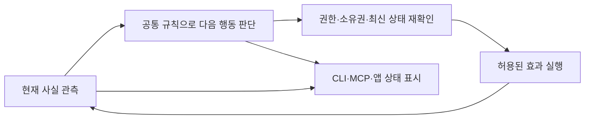
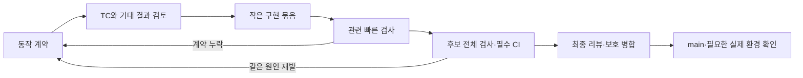

# Hydra 설계·TC·CI 개선안

작성일: 2026-10-18 · 상태: 제안 · 관련 작업: [Issue #3](https://github.com/openboa-ai/hydra/issues/3), [PR #8](https://github.com/openboa-ai/hydra/pull/8)

이 문서는 개선 방향과 실행 순서를 검토하기 위한 초안이다. 기존 승인된 구현 계약을 대체하지 않으며, 중단된 구현·배포·예약 실행을 재개하지 않는다.

이 문서의 범위는 기존 결함과 설계·검증 품질 개선이다. 전체 v1.0.0의 목적·책임·자율 동작·문서 구조는 [v1.0.0 제품 설계 후보](../../product/mvp-design.md)에서 검토한다. 아래 P0–P4 순서는 전체 제품의 개발 순서를 확정하지 않는다.

## 1. 목표와 진단

목표는 기능 하나를 추가할 때 정상 동작뿐 아니라 중단·재시작·중복 요청·불확실한 결과를 같은 규칙으로 설명하고 검증하는 것이다. 테스트 수보다 요구사항을 실제로 판정하는 능력과 수정 반복 감소로 평가한다.

현재는 검토된 명세, 요구사항별 acceptance, 자동 테스트, 보호된 전달 절차가 있다. 문제를 “TC가 전혀 없음”으로 진단하지 않는다. 최근 세 결함에서는 서로 다른 사실을 합치는 기준과 실제 반환값 사이의 계약이 충분히 검증되지 않았다.

| 관찰된 결함 | 보완해야 할 설계·TC |
| --- | --- |
| deadline/signal 중단을 사용자 Pause와 같은 대기로 안내 | 중단 원인과 admission 상태를 분리하고 다음 행동을 원인별로 검증 |
| 일반 Issue가 128개를 넘으면 Hydra 작업이 가려짐 | 발견한 입력 수와 인증된 작업 수를 분리하고 관련 없는 입력 증가에 대한 불변성 검증 |
| 전달 완료 뒤 정리 실패를 전체 완료로 안내 | 전달 결과와 남은 자원 책임을 분리하고 재시작 후 정리 복구까지 검증 |

명세에 예외 조항을 계속 덧붙이기보다 현재 유효한 핵심 규칙으로 통합한다. 문서 길이나 파일 크기만으로 품질을 평가하지 않는다.

## 2. 목표 구조: 관측·판단·효과·표시의 책임 분리

판단 부분은 가능한 한 외부 입출력이 없는 함수로 만든다. 입력은 현재 사실과 사건, 출력은 다음 행동·이유·필요한 증거·제안된 효과다. 이 출력만으로 실행 권한이 생기지 않는다. 효과를 수행하는 기존 경계에서 권한과 소유권을 다시 확인한다.

기존 Runner 전체를 한 번에 교체하지 않는다. 중복되거나 모순된 판단 한 묶음을 먼저 분리하고, 같은 TC로 기존 경로와 새 경로를 비교한다. CLI와 native 실행의 서로 다른 의미는 유지한다.

| 사실의 종류 | 정본·책임 | 보존할 구분 |
| --- | --- | --- |
| 목표·위임·명세·전달 근거 | 각 프로젝트의 GitHub 기록과 승인된 계약 | 다른 프로젝트의 기준으로 완료 판정하지 않음 |
| 실행 허용 | 호스트·프로젝트 admission 설정 | 허용은 실제 실행 시작의 증거가 아님 |
| 실행 소유권·실행 여부 | 기존 coordinator와 확인된 실행 증거 | 미확인 상태를 종료·0개로 바꾸지 않음 |
| 사용자 질문·답변 | 해당 native task와 정확한 작업 시도의 결정 기록 | 채팅 답변은 GitHub CODEOWNER 승인이 아님 |
| 자원 정리 | 기존 lifecycle provider와 정확한 소유권 | 전달 완료와 작업 공간 정리 완료를 분리 |
| 공통 문맥·프로젝트 문맥 | 공통 참조와 프로젝트 계약의 역할을 구분 | 문맥 revision 확인과 실제 적용을 구분 |
| 화면·상태 힌트 | 위 사실로부터 파생 | 별도 workflow 정본이나 실행 권한이 되지 않음 |

새 workflow DB, 세션 journal, 별도 scheduler는 이 개선안의 전제가 아니다. 기존 GitHub 기록·호스트 설정·소유권·provider 경계를 유지한다.

## 3. 구현 전에 확정할 최소 계약

하나의 변경은 다음 여섯 항목을 설명할 수 있어야 한다. 수명주기·권한·외부 효과가 바뀌는 작업에 적용하며, 단순 문구 수정까지 같은 절차를 강제하지 않는다.

1. **사용자 결과:** 어떤 한 가지 흐름이 달라지는가.
2. **소유자와 정본:** 누가 판단·실행·복구하고 어떤 기록을 신뢰하는가.
3. **상태 전이:** 현재 사실과 사건에 따라 어떤 행동을 선택하는가.
4. **불변조건:** 어떤 순서에서도 절대 깨지면 안 되는 규칙은 무엇인가.
5. **실패·복구:** 응답 유실, 중단, 재시작, 중복 호출에서 무엇을 보존하고 재확인하는가.
6. **완료 근거:** 어느 TC와 어떤 실행 증거로 완료를 판정하는가.

중단 원인, admission, 실행 증거, 전달 상태, 정리 의무를 하나의 “완료/대기” 값으로 압축하지 않는다. 전체 조합을 무작정 열거하지 않고 실제로 상호작용하는 축과 금지된 조합을 검토한다.

현재 계약과 충돌하는 새 의미가 필요하면 먼저 해당 결정을 해결한다. 같은 승인 범위의 구현 선택마다 새 사용자 승인을 받는 절차는 추가하지 않는다.

## 4. TC 구성과 최초 검증 범위

TC는 코드 함수의 현재 반환값을 복사하지 않고 요구사항에서 도출한다.

각 TC는 `ID / 요구사항 / 사전 사실 / 사건 순서 / 기대 결과 / 금지 효과 / 재시도 결과 / 관측 수단`을 가진다. 기대 결과를 검토한 뒤 구현한다. 기대값을 바꿀 때는 구현 변경인지 요구사항 변경인지 구분한다.

| TC | 시나리오 | 판정 기준 |
| --- | --- | --- |
| TC-01 | admission은 running, 실행이 deadline/signal로 중단 | control change를 기다리지 않음. 원인 재확인 경로를 유지하고 새 실행을 자동 시작하지 않음 |
| TC-02 | 명시적 host/project Pause 또는 Stop | 해당 범위의 admission을 차단하고 실제 control change를 대기 조건으로 표시 |
| TC-03 | 전달 성공 후 정리 실패·응답 유실·재시작 | 전달 사실과 정리 의무를 함께 보존. 실제 provider 상태를 확인하고 동일 자원만 복구. 재구현·재PR·재병합·재close 없음 |
| TC-04 | 일반 Issue 추가·위조 progress·일반 Issue 순서 변경 | 기존 byte/page/time 한도 안에서 조회가 완료되면 인증된 Hydra 작업 집합과 소유권 판단이 영향을 받지 않음. 위조 기록은 작업 예산을 소모하지 않음. 조회 한도 초과는 확인 가능한 범위만 보존하고 partial/unknown으로 처리 |
| TC-05 | 인증된 작업 수가 프로젝트/전체 상한 N−1, N, N+1 | 정확한 상한은 허용. 초과·부분 조회에서는 확인된 범위를 보존하고 불완전함을 표시. 종료를 증명하지 않음 |
| TC-06 | 동일 작업에 중복·늦은 결과가 도착 | 정확한 attempt/step만 소비. 이미 소비한 결과로 새 작업이나 효과를 만들지 않음 |
| TC-07 | 실행 소유권이 불확실한 상태에서 재시작 | 기존 소유권과 편집을 보존. 시간 경과만으로 takeover 또는 삭제하지 않음 |
| TC-08 | 결정 대기 후 오래된 답변과 현재 답변이 도착 | 현재 권한·attempt와 일치하는 결정만 원래 단계로 연결. 계획 질문은 가짜 실행 기록을 만들지 않음 |
| TC-09 | admission 변경과 실행 효과가 경합 | 차단 확인 뒤 새 효과가 시작되지 않음. 이미 진행 중이던 효과는 결과를 확인하며 불확실한 재실행을 하지 않음 |
| TC-10 | 낮은 revision·unreadable 상태·늦은 UI 응답 | 최신 관측 경계를 따르고 과거 응답이 허용 상태를 복원하지 않음. runtime 변경 시 다른 관측을 혼합하지 않음 |
| TC-11 | 지원되지 않는 native 제어·불명확한 schedule coverage | 지원·실행·종료를 성공으로 표시하지 않음. 필요한 소유권 증거가 없으면 Quit을 보류 |
| TC-12 | 공개 결과와 비공개 실행 문맥의 연결 | 공개 payload·로그에 비밀값·private 경로·원문이 섞이지 않음. 기존 trusted secret 검사 유지 |

**첫 적용은 TC-01~05로 제한한다.** TC-06~12는 기존 테스트와 대응시켜 빠진 연결만 확인하고 각각 관련 후속 변경에 포함한다. 모든 TC가 현재 구현·통과된 것처럼 보고하지 않는다.

검증 방법은 세 층으로 구성한다.

- **판단표 테스트:** 동일 사실에 대해 기대한 이유·행동이 나오는지, 모순된 사실은 보수적으로 처리하는지 확인한다.
- **연결 테스트:** 실제 Runner·GitHub adapter·lifecycle 반환값을 소비 경로에 전달한다. 결과와 함께 발생한 효과 목록을 검사한다. 실제 Git/프로세스 검증이 필요한 경계는 mock 결과만으로 대체하지 않는다.
- **순서·입력 변화 테스트:** 일반 Issue를 추가하거나 중단·재시작·늦은 응답 순서를 바꿔도 불변조건이 유지되는지 확인한다. 실패 seed와 최소 재현 순서를 남긴다.

기대 결과를 만드는 기준 모델은 테스트 대상의 판단 함수를 다시 호출하지 않는다. 구현 전 TC 검토자가 기대 결과를 확인한다. 과거 결함의 재현 TC는 가능한 범위에서 이전 소스에 실패하고 수정 소스에 통과하는지 확인한다. 관련 없는 환경 실패는 재현 성공으로 세지 않는다.

기법 참고: [Hypothesis stateful tests](https://hypothesis.readthedocs.io/en/latest/stateful.html). 새 라이브러리 도입은 필수 조건이 아니며, 기존 테스트 도구로 표현 가능한 범위를 먼저 사용한다.

## 5. CI와 검증 증거

| 단계 | 언제 실행 | 필요한 결과 |
| --- | --- | --- |
| 빠른 계약 검사 | 관련 코드를 편집하는 동안 | 해당 판단표·실패 재현·연결 TC의 빠른 피드백 |
| 후보 검증 | 변경 묶음의 코드와 TC가 준비됐을 때 | 해당 후보의 필수 전체 회귀, 통합 검사, lint·build·secret 검사 |
| 최종 PR 검증 | 실제 최종 head/merge candidate | 현행 필수 CI와 코드·보안 리뷰가 최종 후보에 연결돼야 함. 변경된 범위를 검증하지 않은 이전 결과로 대체하지 않음 |
| 전달·운영 확인 | 병합·설치 등 해당 효과 이후 | main 검사와 실제 효과의 확인. 설치·native 제어·예약 진척은 각각 관측 필요 |

기존 required checks, CODEOWNERS, trusted scanner, 보호 병합은 유지한다. 현재 검사 구성을 약화해 빠르게 통과시키지 않는다.

변경 없는 후보는 같은 전체 검사를 의미 없이 반복하지 않는다. 소스·의존성·환경 변경, 새 실패 또는 미해결 우려가 있으면 필요한 검사를 다시 수행한다. 고정된 실행 횟수로 재검증을 금지하지 않는다.

CI 결과에는 요구사항 → TC → 실제 실행 결과를 연결한다. PASS / FAIL / NOT RUN / BLOCKED / NOT APPLICABLE을 구분하고, N/A에는 이유를 남긴다. 해당 변경의 필수 TC가 누락되거나 NOT RUN/BLOCKED이면 준비 완료로 집계하지 않는다. 후속 범위의 미구현 기능은 명시적으로 남긴다. 연결표가 존재한다는 사실만으로 TC의 의미가 충분하다고 판정하지 않는다.

수동·패키지 검증이 필요한 TC에는 실행 환경, 후보 identity, 관측 결과와 한계를 남긴다. 테스트 수·커버리지 비율·스크린샷 하나를 전체 운영 완료로 사용하지 않는다.

## 6. 책임과 리뷰 반복 제어

구현 담당은 한 명이 해당 변경을 통합한다. 별도 검토 역할은 구현 전에 TC의 기대 결과와 빠진 상황을 확인하고, 후보가 준비되면 실제 변경을 검토한다. 여러 에이전트의 동시 수정으로 소유권을 분산하지 않는다.

PR 경계는 독립적으로 이해·검증·되돌릴 수 있는 동작 결과로 잡는다. 파일 수만으로 나누지 않으며, 서로 의존하는 계약·구현·테스트를 억지로 분리하지 않는다.

같은 원인의 결함이 두 차례의 수정 검토에서 반복되면 해당 부분의 추가 패치를 잠시 멈추고 다음을 기록한다: 누락된 규칙, 이를 놓친 TC, 관련된 다른 경로, 수정할 계약. 이는 제안된 진단 전환 기준이며 리뷰 생략·지적 무시·자동 병합 기준이 아니다. 명백한 구조적 누락은 첫 발견에서도 같은 방식으로 처리한다.

일반적인 구현·검증·리뷰 수정은 승인된 범위에서 진행한다. 제품 의미, 새로운 권한·비용·운영 효과 또는 기존 보호 규칙의 변경만 정확한 결정으로 올린다.

## 7. 적용 순서와 완료 조건

| 순서 | 범위·담당 | 산출물 | 다음 단계로 넘어갈 조건 |
| --- | --- | --- | --- |
| P0 | 설계 담당 + 독립 TC 검토 | 최근 세 결함을 통합한 상태·판단표, 불변조건, TC-01~05의 기대 결과 | 모순된 의미·정본·소유권이 해소되고 구현 없이도 예제 결과를 판정 가능 |
| P1 | 테스트 담당, 구현 통합 담당과 협의 | 기존 회귀와 연결한 실행 가능한 TC-01~05, 효과 관측, 요구사항 대응표 | 이전 결함 재현과 경계값·실패·재시작 변형을 확인. 아직 고치지 않은 동작의 실패는 명시 |
| P2 | 구현 통합 담당 + 최종 검토 | 현재 PR의 관련 수정, 필요한 검증 연결, 검증 기록 | 현행 필수 검사와 해당 TC 통과, 미해결 리뷰 처리, 필요한 사람 승인·보호 병합·main 확인 |
| P3 | 설계·구현 담당 | 한 판단 묶음씩 책임 분리, 명세의 현재 규칙 통합 | 같은 계약 TC가 전후 동작과 의도된 차이를 설명. 기존 기록·API·소유권 호환성 보존 |
| P4 | 운영 흐름 담당 + capability 검토 | native 세션·질문·wake·정리 흐름의 별도 명세와 작은 실증 | 확인된 native API와 정확한 세션 소유권에 근거한 실제 흐름 관측. 불가능한 부분은 구현 약속 대신 미지원으로 명시 |

P0와 P1이 첫 실행 묶음이다. P2에 전체 구조 개편이나 새 자율 기능을 섞지 않는다. 각 단계는 필요한 작은 PR로 전달하며, 일괄 대규모 재작성은 하지 않는다.

P4는 다음 세 개의 독립적인 수용 흐름으로 나눈다.

1. 같은 목표에 반복 wake가 와도 기존 세션·할당을 확인하고 중복 생성하지 않기.
2. 실제 질문과 답변을 정확한 작업에 연결하고 원래 단계로 재개하기.
3. 완료 뒤 더 할 책임이 없는 세션·예약·작업 공간을 각각의 권한과 소유권으로 정리하기.

세션을 식별·재진입·종료할 수 있는 공식 capability와 private 연결 정보의 보관 위치는 P4 명세에서 먼저 해결한다. 현재 다섯 MCP 도구나 admission 버튼이 그 기능을 이미 제공한다고 가정하지 않는다.

## 8. 현재 PR과 보존 방침

2026-10-18 조회 기준 PR #8은 head `0c82a34a23eedff4d6ea540af74218357ae3c1bc`, open·unmerged 상태다. 이 head의 CI 성공과 이후 로컬 수정의 검증 여부는 별개다.

기존 후보와 로컬 네 파일의 수정안(`control.py`, `progress.py`, 관련 두 테스트)은 보존한다. 이 초안 작성은 해당 수정의 검증 완료나 업로드를 뜻하지 않는다.

재개 시에는 P0/P1 결과로 기존 수정안을 평가하고 필요한 부분을 사용한다. 현재 PR에는 그 범위의 수정·TC·검증 기록만 반영하는 방안을 우선한다. 구조 개선과 새로운 proactive 기능은 후속으로 분리한다. 실제로 분리 가능한 변경이 확인되더라도 기존 PR·브랜치·증거를 자동 삭제하거나 다시 쓰지 않는다.

## 9. 개선 효과 판정

첫 적용에서 아래 값을 기준선으로 기록하고, 이후 독립적인 변경 두 건에서 비교한다. 숫자를 맞추기 위해 결함의 분류나 TC 기대 결과를 낮추지 않는다.

- 필수 TC 중 미검증 항목 수와 이유: 전달 시 해당 범위의 필수 항목은 0건.
- 사전에 명세·TC로 다룰 수 있었으나 최종 리뷰에서 처음 발견된 동작 결함 수.
- 같은 원인으로 반복된 수정 횟수와, 반복 시 설계 진단으로 전환했는지.
- 실제 코드 수정 시간과 로컬 검사·CI·리뷰 대기 시간을 구분한 총 소요.
- 정상 흐름, 중단, 재시작, 불확실한 응답 중 실제로 관측한 범위.

첫 개선의 완료는 TC-01~05와 현재 수정의 전달 근거가 연결되고 같은 원인의 누락을 탐지할 수 있게 된 상태다. 전체 세션 자율 운영의 완료는 P4의 별도 증거가 있어야 한다.

## 근거 문서

- [Hydra collaboration](../../../AGENTS.md), [개발 지침](../../../CONTRIBUTING.md)
- [GitHub workflow 계약](../github-workflow/spec.md), [native Codex 계약](../native-codex/spec.md)
- [Operating continuity 계약](../operating-continuity/spec.md), [Mac control 계약](../mac-control/spec.md)
- [최근 코드 리뷰](https://github.com/openboa-ai/hydra/pull/8#pullrequestreview-5535848266), [해당 head의 CI](https://github.com/openboa-ai/hydra/actions/runs/38761047629)
