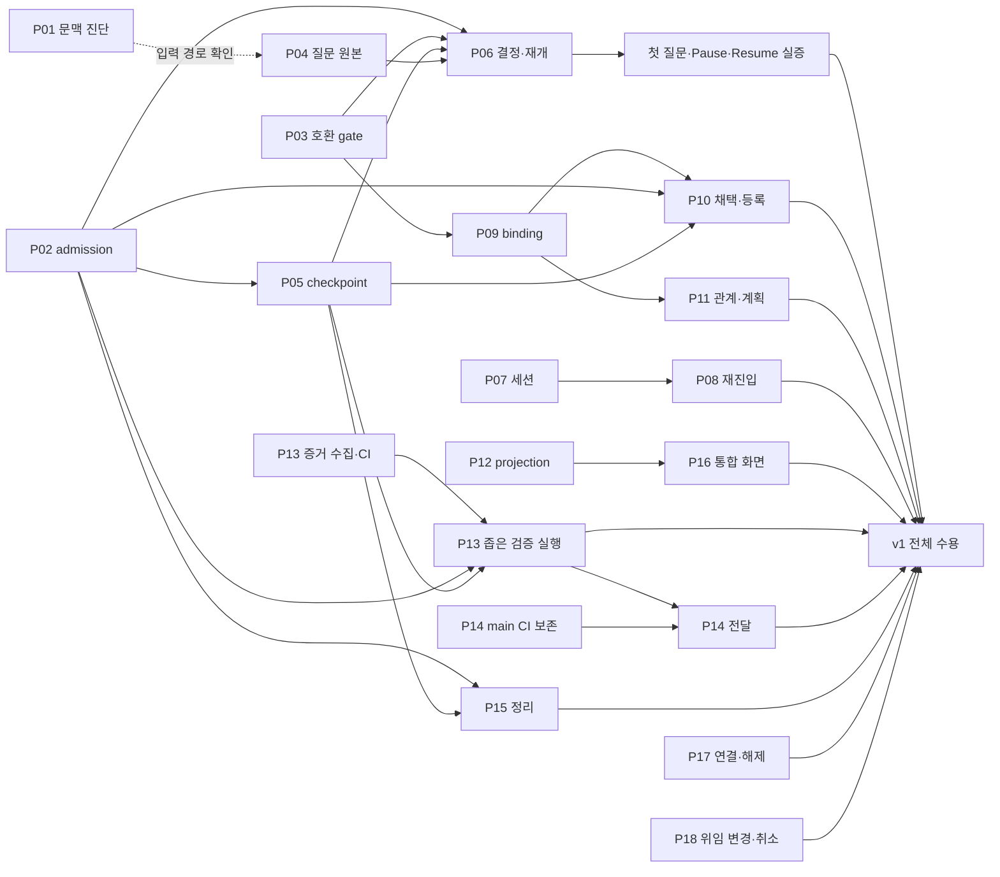
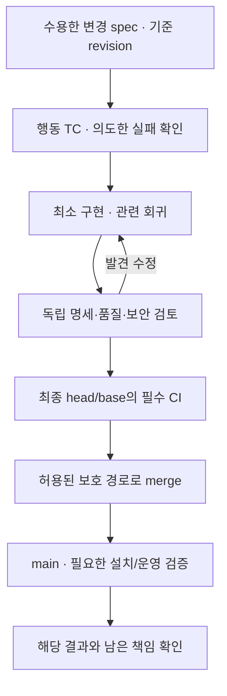

# Hydra v1.0.0 변경 명세와 PR 실행 인계

Revision: 4 · 상태: 설계 후보 · 2026-10-19 · 기존 작업: Issue #3

이 문서는 [전체 요구](../spec.md)의 작은 구현 결과를 실제 PR 경계로 연결한다.
P01–P18은 설계 식별자이며 GitHub PR 번호·이미 할당된 작업·완료 상태가 아니다.
각 디렉터리의 `spec.md`는 해당 기능·변경의 목적·계약·구현 기준·TC·완료 기준을 유지하는 정본이다.
한 명세를 여러 PR로 구현할 수 있으며 각 PR은 그 명세의 정확한 판본과 구현 단계를 참조한다.
실제 Issue/PR·실행 결과는 GitHub에 남기며 이 목록을 별도 진행 대장으로 갱신하지 않는다.

## 1. 한 PR이 책임지는 것

한 PR은 사용자가 관측하거나 다음 구현이 소비할 수 있는 결과 하나를 제공한다.
그 결과에 필요한 코드·TC·문서·CI 배선을 함께 포함한다. parser, adapter, UI를 기계적으로
각 PR로 나누지 않으며 producer/consumer 계약 변경은 함께 검증한다. 반대로 독립적으로
기각·전달·회복할 수 있는 결과를 단지 같은 파일을 수정한다는 이유로 묶지 않는다.

기존 구현·PR이 이미 해당 결과를 제공하면 재사용한다. 이 목록을 맞추기 위해 18개 새 PR을
반드시 만들지 않는다. 실제 범위가 커지면 원래 목적·수용 기준을 보존해 분할하고, 얇은 인접
변경은 합칠 수 있다. 바뀐 연결과 이유를 기존 Issue/PR에서 남기며 완료 기준을 없애지 않는다.

공통 입력은 제품 목적, 해당 change spec의 정확한 revision, 참조 계약, 실제 base/head,
이미 충족한 선행 능력과 실행 권한이다. 출발 전 현재 dirty 후보와 원격의 실제 전달 상태를
대사한다. 이전 agent의 완료 보고나 이 문서의 작성 날짜로 구현·merge를 추정하지 않는다.

### 1.1. 명세 재사용·개정과 새 명세의 경계

| 변경 | 명세 처리 | PR에 연결할 근거 |
| --- | --- | --- |
| 수용된 동작을 어기는 구현 버그 | 기존 명세 재사용; 계약이 충분하면 본문 변경 불필요 | 해당 요구와 재현·회귀 TC |
| 같은 책임의 설명·예외·인터페이스 보완 | 기존 명세 개정; 의미 변경은 영향 요구·소비자·TC와 함께 검토 | 변경 이유와 새 수용 판본 |
| 같은 기능의 단계별 구현·후속 수정 | 같은 명세 안의 구현 단계와 완료 조건 재사용 | 이번 단계의 결과·범위·검증·남은 책임 |
| 독립적인 목적·책임·완료 기준이 필요한 기능 | 새 명세; 기존 계약은 참조하고 복제하지 않음 | 새 결과와 기존 명세의 의존 관계 |
| 기존 구조를 대체하는 변경 | 독립 검토가 필요하면 별도 변경 명세, 아니면 기존 명세 개정 | 대체 대상·호환·전환·복구와 적용 시점 |

새 PR 번호, 파일 수, agent 교체는 새 명세를 만드는 이유가 아니다. 현재 명세는 현재 계약을
설명하고 과거 수용·실행 근거는 Git revision과 기존 검증 기록으로 보존한다. 같은 path가
수정돼도 진행 중인 PR의 기준을 몰래 최신 본문으로 바꾸지 않는다. 의미 변경이면 영향받는
구현·TC·소비자·리뷰를 다시 대조한다. 단순 정정은 제품 기준의 재승인 절차를 만들지 않는다.

## 2. PR 설계 지도

자료조사 후 개정의 근거·통합 순서는 [계획 §0](../plan.md#0-자료조사에서-설계-개정과-실행-인계까지)를
따른다. G1 실행 연결, G2 한 작업 전달, G3 자율 복구, G4 선제적 다중 프로젝트는 아래 PR의
능력을 조합한 수용 단계이며 새 작업 상태/추가 PR이 아니다. P07은 provider별 inventory·Goal
의미, P08은 제안 억제와 surface별 wake, P10은 native 관계 준비 조정, P14는 main CI 실행
보존을 포함한다. 각 기능의 live 자격과 D/L/O가 없으면 설계 후보를 운영 지원으로 표시하지 않는다.

Codex 중심 개정의 순서는 [계획 §0.3](../plan.md#03-codex-중심-운영-개정의-구현-순서)를 따른다.
P04/P10은 요구사항 질문의 의미 보존, P07은 native Plan/Goal 선택, P08은 Goal continuation과
예약의 분리, P16은 보조 앱과 필수 원격 경로의 분리를 소비한다. 실제 원격 증거는 검증 O01–06이
소유하고 어느 PR의 로컬 UI 성공으로도 이를 대체하지 않는다.

아래 선행은 **필요한 능력**이다. 해당 PR 번호가 merge됐다는 사실만으로 충족하지 않는다.
독립 fixture·순수 guard·read-only 구현은 live provider 자격 확인과 병렬로 준비할 수 있다.

| 설계 | PR이 만드는 결과 | 주요 선행 능력 | 기존 책임 |
| --- | --- | --- | --- |
| [P01 호출 문맥](01-native-context/spec.md) | MCP가 실제 알려주는 문맥·미확인을 정확히 반환 | 기존 status/runtime/SDK 경계 | W1a·W3a, A |
| [P02 프로젝트 제어](02-project-admission/spec.md) | stale·동시 요청을 구분하는 Pause/Resume | 기존 admission store/lock | W3b, B |
| [P03 호환 gate](03-work-source-compatibility/spec.md) | project v2에서 기존 intake를 유지하고 구버전 쓰기를 차단 | 기존 v1 계약·전환 대사 | W2a 최소 부분 |
| [P04 질문 원본 연결](04-native-answer-source/spec.md) | 같은 질문·답변·채택 근거를 원본에서 재발견 | 실제 지원 source와 호출 주체; P01은 진단 입력 | W1b·W4b, C |
| [P05 좁은 checkpoint](05-checkpoint-only/spec.md) | 원 단계의 완료·보존까지만 수행하고 반환 | 기존 exact assignment와 P02 typed admission/expected guard | W3b·W4a, D 일부 |
| [P06 결정과 재개](06-decision-resume/spec.md) | 같은 결정을 적용하고 같은 책임의 후속 배정으로 연결 | P02·P03·P04·P05 | W4a·W4b, D |
| [P07 세션 수명주기](07-native-session-lifecycle/spec.md) | 정확한 task의 재사용·생성·관측·중단·복원 | NC source/actor qualification와 기존 ownership | W1b·W4a |
| [P08 재진입](08-native-wake/spec.md) | 위임된 대기 조건에서 같은 책임을 다시 판단 | P07의 exact task/ownership·실제 schedule source | W1b·W4b |
| [P09 작업 binding](09-work-binding/spec.md) | 자유로운 원문과 고정 실행 의미를 분리 | P03의 명시적 source 선택 | W2a |
| [P10 채택과 등록](10-work-adoption/spec.md) | 유효 요구를 실제 Issue 하나로 연결하고 필요한 native 관계 준비 조정 | P02 명령/admission·P05 공통 MCP 배선·P03/P09·qualified draft source; 앱 소비는 P12 기반, 관계 쓰기는 별도 qualification | W2b |
| [P11 관계와 계획](11-dependencies-planning/spec.md) | 현재 관계와 수용 입력조건에 따라 다음 작업 판단 | P09·GitHub 관계/선택한 planning source | W2c |
| [P12 projection](12-projection-contract/spec.md) | 같은 source 의미를 Python→Rust→TS까지 보존 | 기존 읽기 경계; native source만 개별 qualification | W3a |
| [P13 검증 근거](13-verification-evidence/spec.md) | 증거 수집·CI와 좁은 검증 실행을 두 단계로 전달 | 수집은 기존 TC/CI; 실행은 해당 명령·native review 능력; 각 PR의 TC는 처음부터 포함 | W5 |
| [P14 보호 전달](14-protected-delivery/spec.md) | main CI 보존을 먼저 전달하고 후보 전달·후속 책임 연결 | CI 보존은 기존 workflow; 실제 전달은 후보 검증·review·대상 보호 규칙 | W6a |
| [P15 자원 정리](15-resource-retirement/spec.md) | 끝난 책임의 소유 자원만 보존 확인 후 정리 | 해당 provider의 종료/소유/보존 증거; 원격 명령은 P02 공통 guard·P05 MCP 배선 | W6b·W1b |
| [P16 통합 화면](16-control-tower/spec.md) | 현재 사실·대기·결정·제어 결과를 한 화면에서 조작 | P12와 실제 구현·qualified된 명령/원본 | W7 화면 |
| [P17 프로젝트 연결](17-project-connection/spec.md) | 연결·설정·해제와 남은 책임을 정확히 관리 | 기존 등록 설정·source 조회·소유 자원 관측 | F01·W1/W3 |
| [P18 위임 변경](18-delegation-change/spec.md) | 범위 변경·철회·취소를 원래 책임에 적용 | qualified 위임 원본·기존 work/attempt·소유 실행 | F02/F07·W2/W4/W6 |

그림의 실선은 구현에 필요한 능력이고 점선은 조사 입력이다. 각 native 명령의 활성화에는
해당 source의 실제 qualification이 별도로 필요하다. Z로 향하는 선은 구현 선행이 아닌 최종
수용 증거다. P10/P13이 P05에서 소비하는 것은 공통 MCP 배선이며 checkpoint 전체 완료가 아니다.
P15의 실제 정리는 P07/P08 또는 기존 provider가
제공하는 종료·소유 증거를 사용한다. 취소된 작업의 정리에 성공한 merge를 요구하지 않는다.
P16은 구현된 read/command부터 통합할 수 있지만 미지원 기능을 정상 버튼으로 광고하지 않는다.
P13이 끝나야 다른 PR에 테스트를 붙이는 순서는 없다. 모든 PR은 처음부터 자체 TC/CI를 가진다.
P17/P18은 제품 기능표의 연결 수명주기와 위임 변경을 닫는다. 이미 등록된 fixture·현재 유효한
위임을 쓰는 앞선 단위의 전역 선행은 아니다. cancel 뒤 실제 interrupt와 정리는 P07/P15의
해당 능력을 사용하며, 취소 원본 적용과 전체 정리 완료를 같은 PR 완료 조건으로 묶지 않는다.

제품의 [전체 기능 조작표](../../../product/mvp-design.md#42-전체-기능-조작표)와 구현 소유는 다음과 같다.
이는 기능 완료 현황이 아니라 누락된 producer/consumer를 방지하는 설계 연결이다.

| 제품 기능 | 구현 소유 |
| --- | --- |
| F01 연결·설정·해제 | P17, 화면 연결 P16 |
| F02 위임·범위 변경·철회 | 최초 채택 P10, 변경/철회 P18 |
| F03 접수·채택·보류·제외 | P09/P10 |
| F04 설계·계획·우선순위·의존 | P09/P11, 검증 P13 |
| F05 세션·작업 공간·실행 연결 | P01/P07 |
| F06 질문·답변·결정 적용 | P04/P05/P06, 호환 gate P03 |
| F07 pause·stop·resume·cancel | P02/P06/P07/P18, 명시적 정리 P15 |
| F08 검증·리뷰·수정·완료 이의 | P13, 기존 수정 실행 P05/P06 |
| F09 후보 공개·전달·후속 관측 | P14, 실제 배포는 해당 목표의 기존 provider/위임 |
| F10 지속 관측·예약·다음 행동 | P08, 관측 P12 |
| F11 실패·유실·재시작·인계 | 각 효과 소유 PR, native 인계 P07, 전체 대조 P12 |
| F12 결과 판정·종료·보관·정리 | P14/P15, 확인 화면 P16 |

## 3. 각 spec에서 구현 전에 확인할 계약

각 `spec.md`는 아래 내용을 구체적으로 갖춘다. 이미 소유 계약에 있는 schema와 oracle은
참조하며 새로운 사본을 만들지 않는다. 내부 함수 분해·적합한 자료구조는 구현자 재량이다.

| 항목 | 구현자가 받아야 하는 내용 |
| --- | --- |
| 목적 | 현재 문제, 변경 뒤 관측 가능한 결과, R 요구·상위 책임 |
| 범위 | 명세 전체의 결과와 이번 PR이 맡는 구현 단계, 후속 결과, 변경하면 안 되는 권한·기준 |
| 입력·출력 | 소유 계약의 타입/절·정확한 판본, 정상 및 오류 의미, 실제 consumer |
| 시작 조건 | 현재 base/head·선행 증거·source qualification·기존 구현/실패 |
| 구현 순서 | 실제 변경/시험 경로, 기대 행동부터 외부 adapter·consumer까지 작은 단계 |
| TC | 기존 case ID, 초기 상태·사건 순서·정상 결과·금지 효과·독립 oracle |
| 검증 | 기존 명령과 예정 selector 구분, 필수 D/L/O와 해당하지 않는 이유 |
| 완료·회복 | 독립 검토·final revision·필수 CI·전달/후속 관측, 중간 실패 시 보존·다음 행동 |

실제 command/schema/원본 필드가 아직 특정되지 않은 provider 경로는 qualification 결과가
필요한 공백이다. 구현자가 가상의 API나 인간 승인 근거를 만들어 채우지 않는다. 해당 경로의
실제 actor·version·source·read-back을 먼저 확정하고 change spec에 연결한다. 부족한 경우
영향받는 live 기능만 미지원으로 남기며 독립 계약·TC·원본 읽기는 진행한다.

## 4. 구현자와 검토자의 인계

주관 Codex task는 목표·선행·남은 책임을 유지하고 한 PR의 구현 owner를 명확히 한다.
작은 코드 작업마다 별도 사용자 task를 만들지 않는다. 사용할 기능의 실행 주체와 조건은
[세션 계약](../contracts/codex-sessions.md), 플랫폼 기록은
[GitHub 활용 계약](../contracts/github-integration.md)을 따른다.

구현자에게 전달할 최소 묶음은 다음과 같다. 기존 Issue·spec·지원 native 메시지에서 참조하며
새 ledger/진행 DB나 transcript mirror로 만들지 않는다.

1. 결과 한 문장, 명세의 구현 단계·요구 선택자와 change spec·참조 계약의 고정 revision.
2. 실제 작업 경로·base/head·변경 소유 범위, 필요한 producer/consumer·선행 능력과 그 증거.
3. 요구별 TC/oracle·검증 명령·필수 D/L/O, 허용 효과·제외 범위·미확정 외부 요청.
4. PR 병합 조건, 기능 활성화 조건, 명세 전체 완료 조건과 이번 PR에 남지 않을 후속 책임.
5. 반환할 증거: 변경 revision, 실제 명령과 결과, 요구 충족 여부, 실패 뒤 확인할 원본·다음 행동.

구현·검증의 상세 기준은 해당 명세와 참조 계약에 둔다. PR 본문은 위 범위와 원본 링크를
요약하며 PR에만 새 동작 계약을 숨기지 않는다. 문서의 Revision 숫자만으로 내용이 고정되지는
않는다. 실행 기준은 Git commit의 명세·참조 계약이고, 미커밋 설계 검토는 내용 hash로 구분한다.
이는 provider WorkBinding의 revision 형식을 바꾸지 않는다. 실제 실행은 해당 계약의 고정
revision 제약을 만족해야 하며, hash가 같다는 사실도 실행 환경·원격 CI의 재검증을 대신하지 않는다.

검토자는 요구·base/head·전체 diff·실제 TC/결과를 직접 읽는다. 구현자의 설명만 전달하지 않는다.
명세 충실성과 코드/TC 품질을 구분해 판정하고 현재 정책의 보안 검토를 연결한다. 독립 검토는
새로운 사람 승인이나 다른 GitHub 계정 생성을 뜻하지 않는다. 구현자와 분리된 판단을 사용하며
스스로 쓴 성공 요약으로 자기 후보를 통과시키지 않는다.

같은 코드를 여러 writer가 동시에 수정하지 않는다. 독립 조사·read-only review는 병렬화하고
공유 코드의 통합은 한 owner가 수행한다. 순차 PR의 base가 바뀌면 새 실제 diff와 의존 근거를
재대조한다. 같은 대화의 compaction이나 작업 재개도 완료한 결과의 재구현 사유가 아니다.

## 5. PR 구현·검증·전달의 종점

순서는 [구현 규율](../implementation-method.md)을 따른다.

파일 없음/의존 누락의 예외는 행동 RED가 아니다. 기존 구현이 이미 통과하면 사실을 보존하고,
회귀력을 확인할 필요가 있는 경우 격리된 이전 판본이나 제한된 결함 주입을 쓴다. 현재 dirty
작업을 삭제해서 TDD 이력을 만들지 않는다. 실제 testcase 수·skip·실패를 확인하며 0 tests나
고정 모델 답변 재생을 실제 기능 성공으로 세지 않는다.

PR의 merge 조건과 기능의 실제 수용은 구별한다. 각 spec의 필수 사전 gate를 통과한 코드가
미지원 기능을 계속 비활성으로 두는 경우 source 변경만 전달할 수 있다. 그러나 spec에서
필수로 정한 live 증거가 남으면 그 기능 단위와 v1 전체는 완료가 아니다. 합성 fixture PASS로
O 요구를 없애거나 `unsupported` 반환만으로 긍정 경로를 통과시키지 않는다.

PR 본문에는 문제와 바뀐 동작, spec/Issue/요구 연결, 실제 검증과 제한을 쓴다. 원문 전체나
private task ID·대화·자격을 복사하지 않는다. 자동 조기 close를 만들지 않도록 기본 연결은
`Related issue`를 사용하고 생성 본문·commit/squash message의 closing keyword를 검사한다.
사람이 Issue를 먼저 닫아도 남은 main·운영·정리 책임은 소멸하지 않는다.
공개해도 되는 원본 링크로 결과를 연결한다.

### 5.1. Hydra 자체 개발의 진행과 복구

Hydra 구현은 현재 허용된 Codex 작업·GitHub 개발 절차로 시작한다. 미완성 P13/P14/P15의
제품 도구를 앞선 PR의 검증·병합·정리 도구로 요구하지 않는다. 첫 대사에서 기존 위임,
필수 검사·reviewer·보호 병합 경로·작업 소유를 확인하며, 자동 병합 허용이 없으면 해당
원본 승인만 기다린다. 제품 adapter의 미지원 기능과 개발자가 사용할 수 있는 기존 도구를 구분한다.

| 관측한 상황 | 현재 PR 또는 같은 책임의 다음 행동 | 진행 가능한 범위 |
| --- | --- | --- |
| 필수 CI/code·security review 충족 | 최종 head/base와 현재 보호 조건 재확인→허용된 merge→실제 merge SHA의 main 확인 | 필요한 사람 승인만 정확한 링크·대상 revision과 함께 대기 |
| 제품 결함으로 CI/review 실패 | 같은 PR 수정, 영향 TC·review·CI 재확인 | 결함과 무관한 독립 작업은 계속 |
| 인프라 실행 실패 | 기존 정책의 지원·위임·한도 안에서만 재실행; 같은 원인 반복이면 진단과 변경된 접근 | 한도가 없으면 반복 실행하지 않고 정확한 미결정 조건 표시 |
| head/base/spec 변경 | 현재 후보와 영향받는 증거 대조, 필수 재검사 | 과거 green을 현재 후보로 승계하지 않음 |
| push/PR/merge 응답 유실 | 기존 ref·PR·merge SHA에서 원래 효과 확인 | unknown을 새 PR/새 요청으로 우회하지 않음 |
| main pending / failed / unknown / success | 각각 같은 SHA 관측 / 원래 책임의 복구 PR / 원본 재조회 / 필수 운영 검증과 다음 결과 | failed를 무기한 pending으로 대기시키지 않으며 영향을 받는 후속만 보류 |
| 운영 검증·정리만 남음 | 코드 전달과 잔여 책임을 구별해 원래 작업에서 재발견 | source merge로 기능 완료·Issue 자동 close를 만들지 않음 |
| Goal 재진입·사용자 변경 | 현재 위임·원본 작업·세션·미확정 효과부터 대사 | 유효한 다음 단계 재사용, 새 Goal/task/예약 권한 합성 금지 |

복구 PR은 실패한 결과와 필요한 요구를 참조하며 자신의 입력에 원래 실패 작업의 완료를
요구하지 않는다. 검증된 Hydra 기능을 자체 개발에 적용할 때에는 해당 효과의 owner와 진행 중
요청을 먼저 대사하고 한 경로만 사용한다. 미확인 요청이 남은 채 다른 실행기로 같은 효과를
재전송하지 않는다. self-use는 제품의 실제 연결 증거가 있을 때만 기록한다.

다음 작업 선택은 [계획의 구현 단계](../plan.md#16-구현-단계와-선택-순서)를 사용한다.
이 표는 개발 중의 도구 선택이며 제품 명령의 effect ceiling이나 보호 정책을 변경하지 않는다.

## 6. 전체 v1 Goal의 종료 조건

18개 제목이 green인지는 제품 완료 기준이 아니다. [verification](../verification.md)의 R01–R16,
D/L/O, O01–O06과 서로 다른 두 프로젝트의 실제 흐름을 확인한다. 첫 왕복 실증과 전체 수용은
통합 milestone이며 새 제품 변경이 없다면 기록만을 위한 PR을 만들지 않는다. 실제 통합 결함이
발견되면 해당 소유 PR의 후속 수정으로 연결한다.

주관 task는 매 재진입 때 현재 원본·기존 결과·미확정 효과를 읽고 실행 가능한 다음 PR을
선택한다. 같은 목표·범위의 통상 구현·TC·리뷰 수정은 계속한다. 실제 새로운 제품 선택·권한·
비용·보호 승인이 필요하면 구체적 대상과 링크를 남기며, 관계없는 결과는 계속 진행한다.
사용자가 실제 Goal을 시작하기 전에는 이 설계 목록으로 작업·예약·운영을 자동 생성하지 않는다.

최종 전달 기록에는 마지막 확인 revision, 필수 검사/리뷰/merge/main, 설치와 운영 근거,
미완료 책임·소유 자원과 정리 결과를 연결한다. 문서 작성·PR merge·native Goal의 표시 상태만으로
Hydra v1.0.0을 달성했다고 선언하지 않는다.
