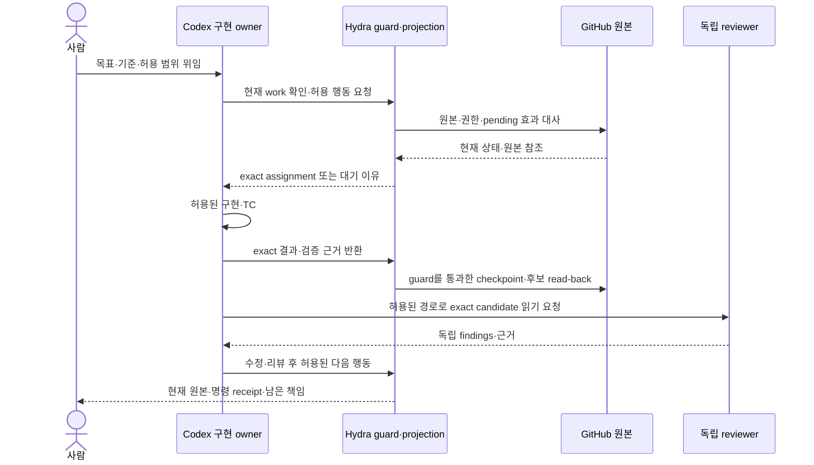

# Codex 세션·작업 공간·재진입 계약

Revision: 3 · 상태: 설계 후보 · 2026-10-19 · 실제 native lifecycle 시험: NOT RUN

상위 요구는 [v1.0.0 spec](../spec.md)의 R01/R06–08/R12–16이다. 실행 identity·효과 순서는
[EX](execution.md), source/qualification은 [NC](native-capability.md), 표시·명령은
[CP](control-plane.md)가 소유한다. 이 문서는 Codex 자원의 선택·사용·인계 기준만 추가한다.
schema나 workflow 상태를 다시 정의하지 않으며 현재 앱 도구를 외부 Hydra API로 간주하지 않는다.

## 1. 목적·책임·범위

| 항목 | 계약 |
| --- | --- |
| 목적 | 사람이 같은 맥락을 반복 전달하지 않아도 위임된 결과를 이어가고, 세션 증가·중복 writer·유실된 책임을 막음 |
| 책임 | Codex는 대화/turn/질문/Goal/예약, GitHub는 요구·설계·전달, 기존 자원 provider는 workspace, Hydra는 admission·연결 검증·projection |
| 동작 | 원본에서 책임과 실행을 읽음 → 기존 owner 재사용 판단 → 허용된 한 조작 → 접수/실제 효과/복원 가능성을 분리 관측 |
| 실패·복구 | 같은 원본·요청을 재조회. unknown을 새 task·새 attempt로 덮지 않고 owned edits와 pending 효과 보존 |
| 완료 | 정상 reuse와 새 생성, 실행 중 interrupt, turn 뒤 재진입, restart 복원, owned 정리를 각각 D/O로 입증 |
| 범위 | 한 trusted host의 기존 writer 1개. 고정 coordinator chat, 새 daemon/SDK worker/세션 DB/스케줄러는 요구하지 않음 |

CS-R1. 자연어 대화와 정형 명령은 같은 위임을 사용하지만 같은 효과가 아니다. 사용자가 답한
대화·명령을 전달한 주체·실제 실행 owner를 구분한다. task를 열거나 대화한 사실은 Hydra 작업의
위임·scope·step을 새로 만들지 않는다. 기존 유효한 위임은 재사용하고 새 권한만 구체적으로 판단한다.

그림의 native 호출은 해당 주체에게 허용되고 qualification된 경로만 뜻한다. 새 reviewer task
생성·메시지 권한을 자동 부여하지 않는다. GitHub/native source identity는 각 원본에 남고 Hydra는 참조한다.

## 2. 이름이 비슷한 자원의 구별

| 개념 | 원본과 수명 | Hydra에서 의미하지 않는 것 |
| --- | --- | --- |
| Codex Project | host에 저장된 프로젝트와 실행 환경 선택 | GitHub repository numeric ID와 자동 동일한 인증 identity |
| 위임 책임/제품 goal | GitHub 작업·설계와 수용된 위임; 여러 결과를 포함 가능 | native chat 한 개 또는 무기한 유지보수 허가 |
| native task/thread/chat | Codex 대화 identity; 여러 turn·attempt를 담을 수 있음 | Issue와 1:1 대응, 제목만으로 현재 work 소유 증명 |
| turn | native 한 번의 진행과 입력/도구/결과 수명 | Hydra phase 완료·모든 자식 실행 종료 |
| subagent | native가 위임한 하위 분석/실행; 부모와 별도 수명/조회 범위 가능 | 독립 자격·사람 승인, 자동 새 Issue/PR 또는 별도 writer 허가 |
| worktree | Git checkout과 로컬 파일의 자원 수명 | native task 종료·PR merge·ignored 파일의 자동 보존 |
| attempt / step | EX의 work 시도 / exact native 배정 identity | task ID 또는 turn ID; 둘 사이 연결은 원본으로 따로 확인 |
| native Goal | 해당 thread의 명시적 목표 진행 기능 | 제품 전체 목표의 정본, 예약, 예산의 무제한 확대 |
| native schedule | provider가 소유하는 예약과 실행 이력 | 실행 중 interrupt, 정확히 한 번 실행 또는 모든 host의 coverage |

CS-R2. 위 구분의 연결은 NC/EX의 기존 private source 참조와 GitHub 공개 work 참조를 조인한다.
private task/turn/schedule ID를 public progress에 넣지 않는다. `project_threads`는 configured
후보 locator일 뿐 현재 owner 증명이 아니다. 별도 mapping 파일·transcript mirror를 만들지 않는다.

## 3. 플랫폼 활용과 qualification 위치

공식 App Server는 read/resume, fork, compact, turn start/steer/interrupt, goal과 review를
별도 조작으로 설명한다. 이를 지원 API 후보로 읽되 설치 version·실제 owner 접근·권한·생성 유실
복원을 NC에서 입증하기 전에는 Hydra lifecycle 지원으로 켜지 않는다. 새 서버의 새 thread 성공은
기존 desktop owner에 대한 제어 증거가 아니다. [공식 App Server](https://learn.chatgpt.com/docs/app-server#api-overview)

| 활용 기능 | 호출 주체 후보와 source | 현재 채택 경계·미검증 |
| --- | --- | --- |
| Project/task 목록·제한 history | 허용된 native caller의 앱 read 도구 또는 owner에 연결된 qualified adapter | NC §2.2의 partial metadata/history까지만. 전체 inventory·owner·Q/A 귀속은 별도 |
| 신규 task·fork·후속 메시지 | 해당 기능과 실제 사용자 권한이 있는 native caller; 또는 같은 조건을 증명한 provider | 앱 도구 노출을 외부 Hydra에서 사용 가능하다고 추론하지 않음 |
| active turn steer/interrupt | exact owner/turn에 연결된 supported native 경로 | interrupt 요청과 ended 관측 별도. handoff의 interrupt 부작용을 Stop 대용으로 쓰지 않음 |
| Goal·compact | 해당 thread에서 지원하는 native 기능 | compaction은 완료·승인·새 위임이 아님. Goal도 NC의 별도 실행 capability |
| 원격 답변·검토 | 연결 host의 같은 native task를 여는 지원 원격 창구 | 개별 질문 UI·answer source·응답 권한·restart 복원은 P04에서 시험 |
| thread 내 예약·독립 scheduled run | 허용된 native scheduler와 원본 schedule 조회 | P08의 대상/권한/재발견/턴 뒤 wake/종료 검증 전 NOT RUN |
| worktree·handoff·archive | 기존 resource provider와 해당 native 도구 | P07의 소유·보존·actual stopped와 P08 예약 소유를 먼저 대사 |

공식 원격 기능은 연결 host의 환경에서 기존 대화·질문·검토를 이어가는 경로다. 일반 외부
서비스용 Hydra 제어 API나 모든 질문 형태의 원격 보장을 뜻하지 않는다.
[공식 Remote connections](https://learn.chatgpt.com/docs/remote-connections#what-you-can-do-remotely)

CS-R3. adapter는 **그 호출 주체의 실제 도구 조건**을 그대로 유지한다. 신규 task가 명시적
사용자 요청을 요구하는 표면에서는 일반 goal만으로 `create_thread` 권한을 합성하지 않는다.
다른 task 메시지에 직접 인간의 명시적 권한이 필요한 표면에서는 agent의 “보고하라” 지시로
`send_message_to_thread`를 허용하지 않는다. 이미 존재하는 정확한 사용자 권한은 재사용한다.
worktree 방식·다른 host·예약 대상의 추가 조건도 조회·검증한다. 조건을 충족하지 못하는 자동
조작만 보류하고 읽기와 현재 task의 허용된 작업은 계속한다. 제품의 위임문구를 넓혀 tool 제한을 우회하지 않는다.

### 3.1. Native 기능 선택과 대화 계약

| 기능 | 사용할 때 | 경계와 필요한 증거 |
| --- | --- | --- |
| 일반 대화·진행 중 steering | 상태 확인·간단한 변경·기존 작업 수정 | 범위 변경이면 EX/WR의 재대사. 새 메시지 자체는 authority 아님 |
| native Plan | 여러 제품 선택·설계 의존을 정리할 때 | 모드별 도구·읽기/쓰기 조건 유지. 저장소 accepted spec이나 Goal 상태와 별개. 자동 mode 전환 API를 가정하지 않음 |
| native 질문 | 요구·사실·선호·판단·충돌 해소 | 주관식 또는 추천/대안+자유 입력. 현재 mode·원격 client의 실제 지원을 각각 확인 |
| native Goal | 명시적 사용자 요청으로 지속 목표를 맡겼을 때 | 결과·검증·제약·위임·중단 조건. 예산은 명시한 경우만 설정; 일반 구현 요청으로 생성하지 않음 |
| MCP 조회/명령 | 외부 상태·admission·검증된 workflow 효과 | CP 공통 core, 대상/권한/현재 원본/중복 효과 확인. 모델 인자는 명령 후보 |
| MCP elicitation | 특정 도구 호출의 추가 입력이 필요할 때 | 요구사항 대화의 대체물이 아님. input-required와 back-channel 개별 qualification |
| native 예약 | 미래 시점·외부 사건에 재관측이 필요할 때 | Goal continuation과 중복 wake 금지. 실제 owner·지원 surface·끝조건 확인 |

native Plan 모드, 저장소의 설계 정본, 현재 작업 단계 계획을 구분한다. Plan-only 상태에서
자동 구현·Goal continuation을 약속하지 않는다. 지원 native 질문이 현재 mode에 없으면 일반
대화의 자유 입력을 사용하고, 구조화 폼을 시험한 것으로 표시하지 않는다. 질문 전달·실제 응답·
설계 반영·실행 허용·재개는 EX의 별도 단계다. 원문은 Codex, 공개 가능한 수용 의미는 기존
설계/작업 기록에 두며 Hydra가 대화나 Plan·Goal의 두 번째 정본을 저장하지 않는다.

[공식 Goals](https://developers.openai.com/cookbook/examples/codex/using_goals_in_codex)와
[App Server](https://learn.chatgpt.com/docs/app-server#api-overview)는 후보 기능의 근거다.
문서·현재 native 도구 노출·설치 버전·원격 실제 동작을 서로 대체하지 않는다.

## 4. 세션 선택과 조작 결정표

provider별 inventory의 기본 filter를 고정된 전체 목록으로 해석하지 않는다. 현재 App Server
문서의 thread/list에서 sourceKinds 생략/빈 배열은 cli/vscode이고 loaded/list는 memory 내
목록이다. archived·ephemeral·subagent/appServer/exec의 포함 범위가 다를 수 있다. 반환된
thread.sessionId와 thread ID도 별개이며 fork의 session root를 ID에서 유도하지 않는다.
P07은 누락 filter·부분 descendant·공유 session root와 정상 기존 작업 재사용을 함께 시험한다.

원격 입력 창구와 실행 위치는 별도다. Work Cloud local access 활성화는 기존 task를 이전하지
않으며 cloud 실행을 같은 local checkout/권한/owner로 인정하지 않는다. 실행 환경 변화는
재qualification 대상이고 옛 writer를 해제할 증거가 아니다. v1에 자동 cloud failover를 추가하지 않는다.

CS-R4. 선택 전에 work·위임·현재 admission·GitHub pending 효과·native 실행·owned workspace를
읽는다. 이미 발행된 EX step은 task 선택 실패 때문에 재발행하지 않는다. 아래 receipt는
EX §6의 기존 provider record를 사용하며 새로운 wire/저장 schema가 아니다.

| 조작 | 선택 조건 | 효과와 완료 근거 | 금지/실패 후 행동 |
| --- | --- | --- | --- |
| reuse | 같은 책임의 exact task 연결이 원본에서 확인되고 환경/권한이 유효 | 기존 task에서 현재 step/다음 허용 행동. 실제 turn/step 연결을 관측 | active turn에 같은 실행을 중복 전송하지 않음; 제목 유사 task 채택 금지 |
| create | 적합한 기존 task가 없다는 충분한 조회, 명시적 생성 권한, 지원되는 요청 재발견 경로 | native 새 identity와 원래 책임 연결의 read-back. 생성 접수만이면 pending | 부분 목록에서 없다고 생성하지 않음. create ACK 유실이면 같은 원본 lookup, 불명확하면 추가 생성 0 |
| fork | 별도 탐색/리뷰 목적·새 task 권한·fork 원본 범위가 명확 | 새 identity와 원본 관계를 관측. fork의 시작/후속 turn은 별도 | 원 task의 step·writer 권한을 복사하지 않음. fork를 자동 독립 리뷰로 인정하지 않음 |
| compact | 지원되는 같은 task의 문맥 정리. authoritative refs를 다시 읽을 수 있음 | provider 요청/완료 및 후속 원본 재조회 | 요약으로 exact 질문/답변·현재 정책을 대체하지 않음. 접근 불가 refs는 unknown |
| resume/continue | 같은 task·현 위임·current state 확인; 후속 입력 권한 있음 | 저장 대화를 load하는 것과 turn 시작을 분리 관측 | read 대신 resume 호출 금지. CLI most-recent 선택으로 owner를 추정하지 않음 |
| steer | 실행 중 exact turn에 정정할 필요와 권한 | 해당 turn의 수신과 이후 결과 각각 확인 | 질문 답변·project Resume·scope 확대를 같은 의미로 취급하지 않음 |
| interrupt | owned exact task/turn, Stop 권한, 지원 연결 | 접수 후 원본의 ended 및 필요한 child/process coverage 확인 | timeout·accepted로 stopped 제출/ticket 해제 금지; 반복 interrupt 대신 원본 대사 |
| archive | 결과/취소 책임 확인, 실행·필수 질문·pending 효과 없음, 보존·정리 권한 | task/하위 자원별 원본 read-back | archive를 stop으로 사용하지 않음. unknown/foreign/dirty 자원은 보존 |

새 task 선택은 새 worktree 생성과 별개다. 기존 적합한 owned worktree를 먼저 확인한다. 동시에
동일 branch를 두 checkout에서 쓰지 않는다. native managed worktree의 archive가 자원 정리를
수반할 수 있으므로 unpushed·untracked·필요 ignored 파일의 보존을 원본 provider에서 확인한다.
snapshot이 존재한다는 설명만으로 모든 파일이 보존됐다고 추정하지 않는다.
[공식 Worktrees](https://learn.chatgpt.com/docs/environments/git-worktrees#worktree-cleanup)

## 5. 구현 owner와 독립 리뷰

CS-R5. 한 reviewable PR 결과에 하나의 구현 책임과 exact candidate revision을 둔다. 동일
책임의 설계·수정·검증은 가능한 한 그 task를 재사용한다. 함수/TC/commit마다 task를 만들지 않는다.
여러 PR이 같은 task를 이어 쓰는 경우에도 각 PR의 scope·head·증거를 다시 고정한다.

- 구현 owner는 현재 spec/TC를 읽고 허용된 source를 수정한다. Hydra 소유 변경의 commit/전달은 EX의 guard 경로를 따른다.
- 독립 reviewer는 요구·accepted spec·candidate diff/head·실제 검사 결과를 읽는다. 구현자의 완료 서술이 oracle이 아니다.
- reviewer task는 read-only이며 candidate를 수정하지 않는다. findings는 정확한 요구와 위치·재현·영향으로 돌려주고 owner가 수정한다.
- 수정 뒤 head/spec가 바뀌면 해당 판단을 재검토한다. 이전 review 완료나 native review mode 진입을 새 head의 승인으로 옮기지 않는다.
- fresh review 문맥에는 구현자의 정답·최종 결론을 그대로 주입하지 않는다. 같은 provider/계정의 별도 task는 사람 승인이나 보안 principal 분리가 아니다.

subagent는 독립 읽기·설계 대조·검증 해석에 사용할 수 있다. source 수정은 host writer 1개를
유지하도록 현재 쓰기 책임에 직렬화한다. 서로 다른 task/worktree라는 이유로 두 Hydra write
assignment를 동시에 실행하지 않는다. 다른 비관리 native 작업의 부재까지 보장한다고 표시하지 않는다.
native `review/start`를 쓸 때에도 EX의 exact-head/원본/수정 없음 계약을 동일하게 검증한다.

## 6. 인계와 문맥 복원

CS-R6. 인계 내용은 지원 native 원본 또는 기존 work/spec의 참조로 전달한다. 별도 로그를
만들지 않는다. 구현자가 다시 제품 책임을 추정하지 않도록 다음을 포함한다.

| 인계 내용 | 참조·확인 위치 |
| --- | --- |
| 목적·허용 결과·현재 남은 요구 | 수용한 goal/work/spec revision. 새 목적을 summary에 끼워 넣지 않음 |
| 맡은 역할·scope·금지 효과 | 현재 위임과 PR packet. 읽기/review/write 구분 |
| 현재 exact execution | EX의 work/attempt/step/head/policy/spec 참조; private task/turn/workspace 연결은 native/provider에만 |
| 마지막 실제 결과·미확인 효과 | GitHub checkpoint/PR/check 및 provider receipt. 모델 추정과 관측 구분 |
| 질문·선택·재개 조건 | EX §7/NC §2.1 원본. 사람이 답했다는 요약만 전달하지 않음 |
| 다음 행동·끝조건·반환 위치 | packet의 검증·허용 효과 상한과 기존 책임. 메시지 반환도 원래 도구 권한을 따름 |

handoff 전에 실제 writer 중단과 checkpoint 보존을 확인한다. target host/cwd가 바뀌면 source,
권한, runtime, 원본 접근을 재검증한다. GitHub에 없는 unpushed head가 대상에 없으면 이어 쓰지
않는다. native의 실제 handoff가 실행 중 turn을 중단할 수 있어도 그것만으로 Hydra ticket을
넘기지 않는다. 원 host가 unknown이면 자동 failover하지 않는다.
[공식 Handoff](https://learn.chatgpt.com/docs/remote-connections#hand-off-a-chat-between-hosts)

## 7. Goal·예약과 bounded 재진입

CS-R7. native Goal은 사람이 명시한 목표/예산 범위에서만 사용한다. thread의 native Goal 완료와
GitHub 제품 결과 완료를 각각 확인하며 한쪽 상태로 다른 쪽을 덮지 않는다. 토큰 예산·host·모델
설정을 임의로 확대하지 않는다. turn이 끝나도 남은 책임은 원본에서 재발견되어야 한다.

즉시 가능한 일은 같은 turn에서 계속한다. 명시적으로 활성화된 native Goal은 해당 지원 표면의
idle·대기 입력·작업 조건과 예산 안에서 자체 continuation을 사용한다. Hydra가 매 단계 타이머를
만들지 않는다. Plan-only, pause, interruption, budget 종료 및 사용자 입력 대기는 각 native
조건을 따르며 언제나 자동 재시작되는 서비스로 광고하지 않는다. Goal 완료는 GitHub 전달 증거와
별도다. 외부 사건이 필요하면 EX §7.4와 P08의 선택으로
지원 native 예약/재진입을 사용한다. 같은 대화 예약과 매번 새 대화를 만드는 독립 예약은 목적이
다르다. 기존 책임을 잇는 경우 thread 내 예약을 우선 검토하되 도구·위임이 허용해야 한다.
각 tick의 instruction은 원본/권한/admission 대사, 유효 변화의 다음 행동, 멈출 조건을 담는다.
[공식 Scheduled tasks](https://learn.chatgpt.com/docs/automations#schedule-a-task-inside-a-chat)

예약 자체가 모델 turn을 발생시킬 수 있다. 원본 변화도 실행 가능한 미완료 책임도 없는 상태의
Hydra 추가 작업 0회와 전체 비용 0을 혼동하지 않는다. 변화가 없어도 이전에 미전송이 확인된
유효한 다음 행동은 재시작 뒤 이어간다. 질문만 남거나 결과가 끝나면 전용 예약은 허용된 경로로 중지/retire하고
공유 예약에서는 끝난 책임만 제외한다. schedule 변경도 현재 제어·권한 경계를 따르며 실패하면
cleanup pending을 유지한다. schedule disable·삭제·archive·현재 turn interrupt는 각각 별도다.
local 예약은 host/app/project 가용성을 요구한다. 놓친 tick을 개수만큼 replay하지 않고 최신
책임을 한 번 대사한다. 지원되지 않는 event subscription이나 숨은 cron을 만들지 않는다.

## 8. 장애·재발견·정리

Goal의 재관측·재개는 원래 objective와 누적 사용량을 보존한다. 상태 확인은 read를 사용한다.
현재 App Server에서 새 objective 설정은 사용량 초기화를 수반할 수 있으며, 현재 nonterminal
objective 유지/생략과 새 목표 교체를 구분한다. reconnect를 이유로 새 목표를 설정하지 않는다. 실제 목표 교체는 범위 변경 계약을 따르고 예산 증가를 자동 수행하지 않는다.
P07은 동일 목표 복원과 실제 교체를 별도 사례로 검증한다. Hydra 예산 엔진을 새로 만들지 않는다.

CS-R8. 재시작은 기존 GitHub progress/ticket, resource provider, native 원본을 읽어 연결을
복원한다. 복원 실패를 새 작업으로 해결하지 않는다. 조회의 빈 결과와 complete coverage를 구별한다.

| 사건 | 복구와 정상 진행 조건 |
| --- | --- |
| create 응답 유실 | 원래 요청 identity와 scope로 원본 조회. 같은 task 발견 시 재사용하고 다음 허용 행동까지 진행; 조회 불가면 pending, 새 create 없음 |
| 같은 참조의 복수 task | 실제 authority/owner를 대사. 최신 제목·시간으로 선택하지 않음; 나머지 task를 자동 archive하지 않음 |
| foreign/host mismatch | 읽기 범위 내 표시, 효과 차단. 명시적 인계와 원본 확인 뒤에만 채택 |
| controller/app/host restart | 각각 구별. 기존 task와 assignment의 정상 재연결을 시험; stale turn/step은 현재 작업을 바꾸지 못함 |
| context 압축·잘림·원본 삭제 | summary를 authority로 복원하지 않음. 독립 원본을 읽거나 해당 연결 unknown. 새 질문으로 조용히 대체하지 않음 |
| owner 종료·subagent 잔존 | child/resource coverage를 확인할 때까지 전체 ended/cleanup 완료 불가. task archive ACK만으로 child 완료 추정 금지 |
| cancel 뒤 전달 일부 완료 | 전달 사실 보존, 추가 개발은 중단, 미확인 효과·필요 보존·정리를 같은 책임에서 처리 |

관측·안전한 거절만 구현한 것은 lifecycle 완료가 아니다. [P07](../changes/07-native-session-lifecycle/spec.md)은
reuse/create/실행 중 interrupt/정상 restart의 실제 양성 흐름을 요구한다.
[P08](../changes/08-native-wake/spec.md)은 turn 종료 뒤 유효 wake와 종료 후 예약 정리를 요구한다.
지원 경로가 없으면 해당 capability/packet을 BLOCKED 또는 NOT RUN으로 남기며 v1 전체 완료로 세지 않는다.

검증은 NC-D02/05–10, EX-D01–04/09/13/14 및 EX의 wake/cleanup 사례와 해당 packet의 oracle을
연결한다. 새 session journal이나 전체 task API wrapper framework가 이 계약의 완료 산출물이 아니다.
