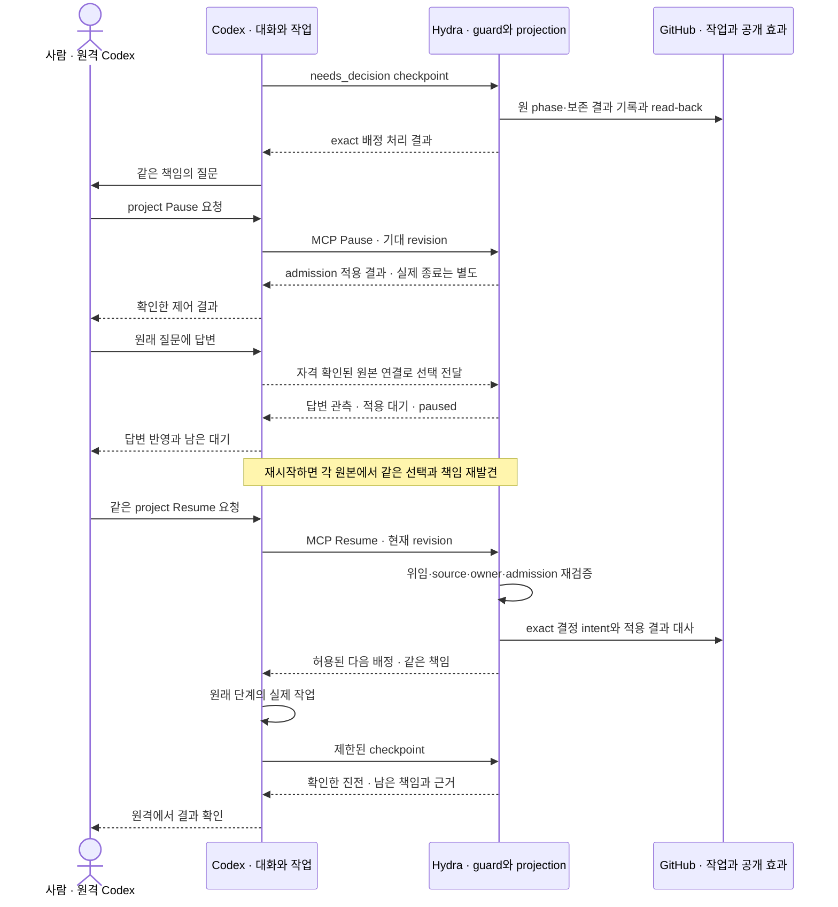

# Hydra v1.0.0 상세 설계 진입점

Revision: 8 · 상태: 설계 후보 · 2026-10-19 · 기존 작업 기록: Issue #3

이 묶음은 [SDLC 통합 설계](../../architecture/sdlc.md)를 구현 단위까지 내린다.
여기서의 MUST는 수용 후 목표 동작이며 현재 구현 지원을 선언하지 않는다. 구현을 시작할 때
문서 묶음의 정확한 revision과 독립 검토 결과를 기록한다. 이 문서를 작성한 것만으로 실행을 재개하지 않는다.

플랫폼 활용의 선택과 대안은 [책임 경계안](../../architecture/platform-boundaries.md)에 있다.
자료조사에 근거한 전체 개정과 통합 인계는 [계획 §0](plan.md#0-자료조사에서-설계-개정과-실행-인계까지)가
연결한다. 18개 명세의 존재가 모든 native 연결의 구현 가능성을 뜻하지 않는다. 기능별 필요한
caller·source transport·권한·복원 증거는 NC에서 확인하고, 미확인 효과만 비활성으로 인계한다.
작업 기록·호환은 WR, 호출 문맥·실제 source 자격은 NC, 제어·효과 상한은 CP,
결정 적용·재진입·전달·정리는 EX가 소유한다. 아래는 상세화한 설계 후보이며 현행 구현 계약을
자동으로 대체하지 않는다. 구현할 결과 단위의 정확한 판본과 검토 범위를 고정해 사용한다.

첫 통합 단위인 **질문 대기 → project Pause → 원격 답변 → 명시 Resume → 같은 작업의 진전**은
[계획 §1.2](plan.md#12-첫-통합-증명의-범위)에 범위를 고정했다. EX §7은 질문/결정/재개,
CP §8은 project CAS·효과 경계, NC §2.1은 필요한 원본 연결, verification의 첫 통합 흐름은
정확한 D/L/O oracle을 소유한다. 기존 유효 legacy 작업을 재사용하되 구형 runner가 새 결정
경로를 소비하지 않도록 WR의 project-v2 최소 gate와 명시적 legacy source를 사용한다.
전체 native 관계/WorkBinding 전환은 선행시키지 않는다. 호출 문맥 reader, project CAS,
질문 원본 연결, 결정 적용, 실제 왕복의 구체적인 선행 관계는 [계획 §1.4](plan.md#14-첫-흐름까지의-구체적인-구현-인계)가
소유한다. 상세 설계와 실제 native 지원·구현 수용은 별도이며 실제 통합 시험은 NOT RUN이다.

## 1. 목적·책임·범위

목적은 사람이 정한 결과와 기준을 프로젝트 설계에 연결하고, Codex가 구현·검증·전달을
이어가며 Hydra에서 전체 상황과 제어 결과를 확인하는 것이다. 기존 설계가 잘 되어 있으면
그 설계와 기존 구현을 재사용한다. 부실한 입력도 해석·보완하여 유효한 일로 만들 수 있어야 한다.

GitHub가 작업/설계/전달 정본, Codex가 판단/세션/질문/예약 정본, Hydra가 최소 소유권과
admission 및 외부 projection/명령 경계를 소유한다. 별도 tracker, 작업 DB, 대화 mirror,
모델 실행기, scheduler를 추가하지 않는다. 기존 단일 host 실행 계약과 보호된 전달을 유지한다.

사람은 목적·taste·중요한 제품 선택·위임·외부 효과 경계를 정한다. 에이전트는 상세 설계,
TC·작업 분해·구현·검토 수정·복구를 맡는다. 모든 TC나 내부 구현 선택을 재승인받지 않는다.
기존 결정을 재사용하고 실제 새 판단이 필요한 부분만 영향과 대안을 제시한다.

v1.0.0 필수는 아래 R01–R16과 전체 운영 시나리오다. 여러 host의 자동 takeover, 새로운 요금/자격,
제품별 business rule 내장, 무단 배포, 범용 외부 시스템 플러그인 프레임워크는 범위 밖이다.

## 2. 상세 계약의 정본

| 문서 | 소유하는 결정 |
| --- | --- |
| [작업 기록·유연한 접수](contracts/work-records.md) | 원본 Issue, 기본 컨벤션, 해석/채택, 목표 관계, 실행 binding, 위임, 생성·변경·의존성 |
| [Projection·명령·화면](contracts/control-plane.md) | source identity/freshness/coverage, 읽기 모델, UI, 명령 envelope, 데이터 최소화와 호환성 |
| [실행·복구·전달](contracts/execution.md) | assignment/시도, 단계 전이, 질문·대기, 효과·재시도, 전달·정리 |
| [Codex 세션 수명주기](contracts/codex-sessions.md) | task·turn·subagent·Goal·worktree의 관계, 역할·생성/재사용/교체·문맥 인계·중단·보관 |
| [GitHub 기능 활용](contracts/github-integration.md) | GitHub 기능별 용도·읽기/쓰기 경계·컨벤션·API 관측 한계; 작업/전달 schema는 WR/EX 참조 |
| [프로젝트 연결](contracts/project-connection.md) | 기존 설정을 이용한 연결·변경·해제, admission과의 순서, 잔여 책임·자격 철회 |
| [변경 명세와 PR 인계](changes/README.md) | P01–P18의 유지·개정 원칙과 PR별 최소 인계; 각 명세는 기능·구현 단계·TC·완료·회복을 소유 |
| [Native capability 검증](contracts/native-capability.md) | 실제 native 표면, 기능별 조건, private 연결/재시작, qualification 절차와 불가 시 처리 |
| [검증 설계](verification.md) | D/L/O, 요구·TC 추적, fixture/eval/실제 운영 runbook, CI와 완료 증거 |
| [구현 계획](plan.md) | 명세의 구현 단계 간 순서·선행 능력과 소비 관계; 상세 동작·TC는 소유 명세 참조 |
| [Goal 실행문](goal.md) | 위 계약을 이용해 다음 세션이 전체 v1.0.0을 진행하는 지시 |
| [구현 규율](implementation-method.md) | RED/GREEN·원인 분석·독립 검토·최종 revision 검증 |

같은 schema를 두 문서에 유지하지 않는다. 교차 문서는 소유 계약을 참조한다.
명세는 같은 책임 안에서 유지·개정하며 한 명세를 여러 PR로 구현할 수 있다. 매 PR에 새 명세를
만들지 않는다. 제품·구조는 목적/책임, 공통 계약은 공유 규칙, 개별 명세는 구체 동작·구현·검증을
소유한다. 실행 상태와 실제 증거는 기존 Issue/PR·검증 기록에 남기며 계획에 별도 대장을 만들지 않는다.
상위 원칙과 상세 계약이 충돌하면 구현자가 편한 쪽을 고르지 않고 원인과 영향 범위를 수정·검토한다.
새 작업 의미의 보호된 project v2 전환은 작업 기록 계약, 화면 protocol v3 전환은 control-plane
계약이 소유한다. 기존 progress v1은 유지한다. 이 설계 작성은 프로젝트 정책의 실제 전환이 아니다.

### 구현자에게 남기는 재량과 사실 확인

| 구분 | 지금 정한 것 / 남긴 것 | 의존 범위 |
| --- | --- | --- |
| 계약 | 원본 소유, 정규화 입력/출력, 버전·거절 의미, 권한·admission, 효과의 intent/read-back, 실패 후 책임, D/L/O oracle | 구현자가 임의로 바꾸지 않는다. 모순은 소유 계약에서 수정하고 영향 범위를 재검토 |
| 가역적인 내부 구현 | 함수·class 분해, 허용 schema를 표현하는 자료구조, 같은 의미의 시험 배치 | 요구를 유지하는 선택은 구현자가 처리. 사용자에게 다시 결정 요청하지 않음 |
| 실제 provider 사실 | native 입력 경로·질문/선택의 재발견·권한 출처, 실제 interrupt/wake, 관계/queue/정리 adapter의 지원 범위 | NC 및 각 O에서 확인. 해당 live 효과만 보류하고 독립 parser·guard·fixture 작업은 계속 |
| 새로운 권한·효과 | 정책 전환, 새 실행 소유권/자격/지출, 위임 밖 전달·삭제 | 기존 결정 재사용 또는 정확한 새 결정. 도구 존재·모델 판단으로 권한 생성 금지 |

이 구분은 미확인을 없애 보이기 위한 예외가 아니다. 예를 들어 MCP Context reader의 완성은
질문 답변의 원본 연결을 증명하지 않는다. 반대로 그 연결이 미확인이라는 이유로 정상 Issue
읽기·project CAS·독립 검증의 구현까지 막지 않는다.

### 첫 흐름에서 각 시스템이 확인하는 것

아래는 실제 연결을 확인한 뒤 구현할 정상 흐름이다. 화살표는 필요한 책임 간 전달이며
특정 미검증 API가 이미 지원된다는 뜻이 아니다. 입력 경로와 각 효과의 정확한 계약은 NC/CP/EX가 소유한다.

답변은 Pause를 해제하지 않는다. Resume ACK는 실제 작업 완료가 아니며, 결정 적용도 다음
배정과 별도 효과다. Pause 전에 전송한 원격 요청의 늦은 결과는 원래 intent에 연결해 대사한다.

### 원격 사용자 경로와 native 기능의 수용

R06/R08/R10/R14의 필수 사용자 행동은 원격 Codex에서 완료해야 한다. MCP를 통한 조회·제어와
native Plan/Goal/질문은 [CS §3.1](contracts/codex-sessions.md#31-native-기능-선택과-대화-계약)의
선택 기준을 따르며 현재 환경의 개별 지원을 검증한다. 사람 답변·설계 변경·권한·재개를 합치지
않는다. 준비 질문에는 attempt를 만들지 않고, native Goal 생성은 명시적 요청이 있을 때만 한다.
앱은 보조 화면이며 로컬 성공으로 원격 qualification을 대신하지 않는다.

## 3. 요구사항과 판정

| ID | 제품 요구와 금지되는 오판 | 계약·완료 판정 |
| --- | --- | --- |
| R01 | 사실마다 정본 하나. Hydra 영속 데이터는 연결/admission/bounded ownership만 | control-plane, 캐시 제거·재시작 후 외부에서 재구성; 이중 workflow 기록 없음 |
| R02 | 자유 형식·외부 작성 Issue도 검토 가능. 컨벤션 미준수는 유효한 요구의 거절 이유가 아님 | work-records, 형식 차이/다국어/외부 작성/누락/유용한 injection 혼합 사례 |
| R03 | 원본·해석·채택·실행 권한을 구분. 텍스트가 command/policy/credential/평가 기준을 주입할 수 없음 | work-records/execution, 격리된 해석과 deterministic effect 거절 |
| R04 | 기존 설계·TC·완료 증거를 재사용, 요구→작업→검증·전달을 연결 | work-records/verification, 충분한 설계 재작성·중복 구현 없음 |
| R05 | 의미 있는 결과 단위의 Issue와 의존 관계, 멱등 등록·재개 | work-records, 중복/충돌/유실/순환/닫혔지만 결과 없는 의존성 |
| R06 | 실제 native task와 정확한 assignment/workspace 연결 | native-capability/execution, 실제 시작/재개/종료 및 unknown 보존 |
| R07 | 다음 행동을 같은 목표에서 선택하고 필요한 조건으로 재진입 | execution, 무변화 wake/중복 생성 없음; 실제 턴 종료 후 유효한 진전 |
| R08 | 기술 선택은 자율 처리, 중요한 질문은 기존 책임에 연결 | execution, 실제 질문·답변·원래 단계 재개; 오래된 답/침묵은 승인 아님 |
| R09 | 목적에서 독립적으로 도출한 TC·평가로 구현 검증 | verification, 의미 있는 RED/GREEN·독립 요구 충족 검토 |
| R10 | head/spec/policy/source 변경의 영향을 확인하고 증거 유효성 보존 | 모든 계약, stale 결과나 source drift가 새 scope를 승인하지 않음 |
| R11 | current-head CI/리뷰·보호 전달·main·필요한 배포 관측을 구분 | execution/verification, 요청·성공 문자열·merge만으로 전체 완료 불가 |
| R12 | 제어·취소·중단·재시작·부분 실패에서 소유 작업과 불확실성 보존 | execution/control-plane, 새 효과 거절과 실제 종료 별도 확인 |
| R13 | 결과 완료와 정리를 분리, 원래 책임에서 정리를 재발견 | execution, dirty/foreign/unknown 보존·중복 정리 없음·끝난 책임은 종료 |
| R14 | 전체 흐름을 Hydra에서 근거와 함께 이해·조종 | control-plane, source별 partial/stale 표시, 실제 화면과 명령 read-back |
| R15 | 다른 설계·컨벤션·검증을 가진 프로젝트가 같은 코드로 연결 | work-records/verification, 일반 프로젝트 두 개, 제품별 if 분기 없음 |
| R16 | 모델 오판·환경 장애·미지원·한도 초과를 구분해 복구하거나 정확히 질문 | 모든 계약, 관측 불가=0/성공 및 endless retry 없음 |

## 4. 시나리오를 선제적으로 도출하는 규칙

Issue뿐 아니라 spec, PR/review, CI 로그, native 질문·답변, 설정, 외부 링크, 완료 보고 모두
같은 질문으로 점검한다. 아래 행마다 해당 요소의 구체적 입력과 기대 결과를 TC/평가에 연결한다.

| 변화 축 | 반드시 검토할 사례 | 기본 처리 원칙 |
| --- | --- | --- |
| 표현 | 다른 언어/제목/양식·짧은 설명·여러 요구 혼합·잘못된 링크 | 읽고 해석, 후보로 구체화; 의미를 잃지 않는 기본값, 모호함만 질문 |
| 출처·권한 | 외부 기여자·fork·인용·위조 marker·권한 철회 | 유용성과 권한을 별도 판정; 실제 actor/policy·위임으로 효과 확인 |
| 내용 | 유용한 사실+악성 지시, 요구·설계 충돌, 재현 불가, 존재하지 않는 증거 | 원문은 데이터, 필요한 안전한 사실만 추출; 독립 검증과 범위 제한 |
| 시간 | 진행 중 수정·삭제·rename·이관·늦은 응답·같은 사건 반복 | 안정된 identity와 source version 대조; 묵시적 인계/새 기준 채택 금지 |
| 의존·동시성 | cycle·fan-in·일부 완료·동시 제어·외부 사람 수정 | 실제 선행 결과·writer·scope 확인; 영향 범위만 보류 |
| 외부 시스템 | 401/403/404/429/5xx·timeout·잘림·API/enum 변경 | 권한 부족/부재/미확인/미지원 구분, bounded retry·coverage 보존 |
| 모델 | 잘못된 해석·빈 출력·schema 오류·성공 과장·반복 수정·과잉 작업 | 원본 근거 대조·한정된 수정/진단·실행 guard; 판단이 증거를 대체하지 않음 |
| 자원·운영 | disk full·host sleep/reboot·프로세스 잔존·읽기 실패·부분 설치 | 소유 변경 보존, 현재 runtime 확인, qualification과 정리 재대조 |
| 완료 | 테스트 누락·skip·stale PASS·진짜 결과 없이 Issue close·정리 실패 | 증거 종류별 판정, 목표/전달/자원 종료 분리 |

지원하지 않는 모든 조합에 별도 상태를 만들지 않는다. 허용된 공통 상태와 이유/다음 관측으로
표현한다. 입력을 유연하게 해석하는 판단층과 실제 효과를 허용하는 결정적 경계를 분리한다.
정확한 수치 상한은 자원 보호값이며 제품 의미의 합격 기준이 아니다. 초과를 잘라서 성공으로 처리하지 않는다.

## 5. 구현과 완료의 경계

각 packet은 목적·책임·입출력·실패/복구·완료·범위를 가진다. source 변경과 소비 계층을 함께
검증한다. 새 schema가 필요하면 버전과 이전 reader의 거절/보존 동작까지 구현한다.
단위 tests, 실제 CI, 독립 리뷰, merge, 설치, 실제 운영은 별도 증거다.

현재 후보에서 전체 v1.0.0 수용을 막는 알려진 실증 공백은 native 연동이다. 이는 제품 요구를
낮추는 예외가 아니라 W1의 가장 먼저 실행할 qualification이다. 문서화된 API나 이 대화의
tool 존재만으로 standalone Hydra 앱의 접근을 입증할 수 없다.

상세 계약 검토 후 내부 구현의 가역적 선택은 에이전트가 진행한다. 제품 목적·실행 권한·
보호된 외부 효과 변경만 구체적 판단 대상으로 올린다. qualification이 실패하면 원인·
가능한 지원 경로·정확한 미충족 요구를 기록하고 독립 작업은 계속하되 전체 완료를 선언하지 않는다.

## 6. 이 후보의 설계 검토 범위

2026-10-19: WR Rev3, NC Rev6, CP Rev4, EX Rev5와 plan Rev9·verification Rev7의 연결을
독립적으로 대조했다. SDK 주입 필드와 기존 runner의 단계 의미를 source와 비교하고, 정상 진전,
구버전 거절, Pause 경합, 응답 유실·재시작, 외부 marker 위조를 검토했다. Issue 본문과 Projects의
priority 변경 차이, 완료 기록 전 소유권 해제, append-only 기록과 실제 적용의 중복 구분,
호출 여부를 구별할 수 없는 crash, 외부 위조 댓글에 의한 정상 진행 차단을 계약과 TC에 반영했다.
최종 좁은 재검토에서 추가 P1/P2는 보고되지 않았다. 이는 전체 구현·보안 검토의 완료 판정이 아니다.

이번 검증은 문서·source 대조와 계약 검토다. 코드·설치·설정·외부 상태를 변경하지 않았고
제품 TC/CI·실제 L 평가·native 왕복 O는 실행하지 않았다. A/B/D의 구현 계약과 검증 경계는
구체화됐으며, C의 실제 원본 연결·호출 이력 coverage는 qualification으로 확인해야 한다.
실제 구현 인계에는 해당 변경의 immutable revision과 검토·검증 결과를 별도로 연결한다.

후속 상세화는 세션 수명주기·GitHub 기능 활용과 [P01–P18 PR 설계](changes/README.md)를
추가했다. 상위 W 책임과 첫 A–E 흐름을 유지하면서 각 PR이 소비할 계약·정상/실패 oracle·
완료 증거를 분리한다. 신규 문서 역시 설계 후보이며 실제 source·설치·운영 수용을 뜻하지 않는다.

같은 날짜의 후속 검토 대상은 WR Rev4, NC Rev6, CP Rev5, EX Rev6, 세션·GitHub·프로젝트
연결 계약 Rev1, plan Rev10, verification Rev8, 구현 규율 Rev2와 P01–P18이다. 제품 F01–F12의
구현 소유와 선행 관계를 대조하고, 작성자와 분리된 검토에서 발견한 누락을 수정했다. 특히
검증 전용 실행의 독립 리뷰 완료 경로, 정상 checkpoint와 실제 실행 종료의 차이, 재시작 후
미전송 작업의 진전, 명시적 정리의 효과 상한, 위임 변경의 실제 원본, 프로젝트 해제 중 crash에서
CLI/MCP가 같은 trusted 설정을 읽는 경계를 재검토했다. 해당 수정의 최종 좁은 재검토에서
추가 P1/P2는 보고되지 않았다. 이는 모든 구현 경로에 대한 무결점 판정이 아니다.

변경한 Hydra 문서 30개와 내부 링크 231개의 링크·anchor·fence·공백·공개 경계 검사는 통과했다.
실제 제품 테스트, CI, L 평가와 O 실증은 이번 문서 작업에서도 NOT RUN이다. 후속 구현은 해당
PR의 명세 판본과 실제 source를 다시 고정하고, 각 PR의 양성·장애 TC 및 필요한 live 증거를 수행한다.
