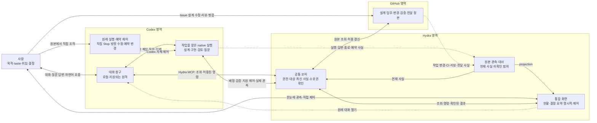

# Hydra v1.0.0: 사람의 대화·관측·조종 시나리오

Revision: 3 · 상태: 제품 설계 후보 · 2026-10-18 · 관련 작업: Issue #3
상위: [제품 기준 S1–S6](mvp-design.md), [플랫폼 책임 경계](../architecture/platform-boundaries.md)

기능별 목적·조작·효과 한도·끝조건은 [전체 기능 조작표 F01–F12](mvp-design.md#42-전체-기능-조작표)가
소유한다. 이 문서는 같은 기능을 서로 다른 창구에서 사용하고 다시 돌아오는 사례를 정의한다.

## 1. 목적과 기본 선택

**Codex는 원격에서도 필요한 사용자 조작을 완료하는 필수 창구다. Hydra MCP는 그 대화에서
외부 상태를 조회하고 허용된 효과를 수행하는 경계이며, Hydra 앱은 보조 관측·제어 화면이다.**
Hydra 화면을 열어야만 일을 맡길 수 있게 하거나, 질문에 답하려고 매번 별도 작업을 시작하게
하지 않는다. 두 입구에서 Hydra에 보내는 요청은 같은 권한·소유권·최신 상태 검사를 거친다.
Codex/GitHub 원래 기능의 직접 조작은 그 시스템에 적용되며 Hydra는 결과를 관측·대사한다.

| 사람이 하려는 일 | 기본 창구 | 시스템이 이어줄 것 |
| --- | --- | --- |
| 목표를 설명하고 설계·taste·대안을 논의 | 해당 프로젝트의 Codex 대화 | 기존 설계·위임·작업을 찾아 같은 책임으로 연결 |
| 여러 프로젝트의 현재 상황과 필요한 개입 확인 | Codex 조회; Hydra 화면은 보조 | 같은 원본에서 얻은 상황·관측 시점·불확실성 |
| 질문에 답하거나 원격에서 방향 수정 | 연결된 원래 Codex 대화 | 정확한 질문·결정과 영향받는 작업, 실제 반영 결과 |
| 일시정지·재개·중단 등 명확한 제어 | Codex의 명시적 사용자 지시 → Hydra MCP; 지원되는 Hydra 버튼도 같은 core | 동일한 명령 검증과 실제 효과 확인 |
| 보호된 검토·배포 등 별도 승인이 필요한 행동 | 그 승인을 소유한 GitHub/Codex 등의 원래 화면 | 정확한 승인 대상과 결과의 projection |

Hydra에 두 번째 채팅·답변함을 만들지 않는다. 질문 요약·이유·대안·영향·원래 대화로 가는
경로를 표시하고, Codex의 답변이 반영됐는지 확인한다. Hydra에서 답을 입력하는 기능은
같은 원래 질문으로 전달되고 결과를 읽을 수 있는 경우에만 후속 편의 기능으로 검토한다.
반면 상태 조회와 명시적 제어는 Hydra 안에서 실제 결과까지 확인해야 한다.

원격 Codex만으로 필수 흐름을 수행하는 것은 v1 수용 조건이다. 현재 설치 환경에서 모든 경로가
작동한다는 주장은 아니다. 로컬 Hydra 버튼으로 우회한 성공은 원격 수용을 대신하지 않는다.
보호 승인은 그 원본 시스템이 지원하는 정확한 승인 경로를 사용한다. 원격 Codex에서 접근할
수 없는 필수 보호 승인이 있으면 그 시나리오는 미충족으로 남기며 일반 채팅 승인으로 대체하지 않는다.

## 2. 두 입구와 하나의 실행 책임

원본에서 직접 바뀐 사실은 Hydra guard를 거쳤다고 가정하지 않는다. 사건은 재관측의 계기이며
관측 함수는 읽기만 한다. 이후의 새 효과는 현재 위임과 제품 조작 계약에 따라 별도로 판정한다.
Hydra가 모든 외부 조작을 가로채거나 원본 간 동시 변경을 하나의 transaction으로 묶는 그림이 아니다.

대화 창구와 실행은 역할 구분이다. 같은 task가 둘 다 맡을 수 있고 필요한 실행·검토만
분리할 수 있다. 프로젝트마다 영구 coordinator 세션을 만들라는 뜻이 아니다. 기존 적절한
대화를 재사용하며 질문이 생길 때마다 새 세션을 만들지 않는다.

각 사람 판단에는 **어느 책임의 어떤 질문에 어디서 답할지**가 분명해야 한다. 다른 실행자가
발견한 질문은 지원되는 위임 경로로 담당 대화에 연결한다. 이미 유효한 질문이 다른 task에
있다면 이를 원본으로 가리키며 새 답변 대상을 복제하지 않는다. 일반 자연어 대화와 native
질문 폼 모두 사용할 수 있지만, 폼 제출과 일반 메시지 수신을 같은 사건이라고 가정하지 않는다.

### 원격 운영의 가용성 경계

기본 배치는 Codex + Hydra MCP다. 앱에는 projection과 최소 제어를 두고 별도 채팅·질문함·계획
편집기를 만들지 않는다. 작업 owner가 바쁜 경우에도 제어가 그 worker의 다음 모델 응답에 종속되지
않는 지원 경로를 확인한다. MCP 연결 장애, Codex 원격 접근 장애, 실행 host 단절을 구분한다.
로컬 버튼이나 같은 실패 transport의 보조 화면은 독립 원격 제어 경로가 아니다.

호스트에 도달하지 못하면 실제 적용을 unknown으로 표시한다. 연결 복구 후 원본을 먼저 읽고
미확정 명령을 맹목적으로 재전송하지 않는다. Codex 자체 장애에서도 조작할 독립 원격 앱은 기본
범위가 아니다. 이를 요구하게 되면 별도 transport·인증·운영 책임을 명시한 제품 결정을 거친다.

## 3. 대표 왕복 흐름

### A. Codex에서 시작하고 Hydra에서 확인

1. 사람이 프로젝트 대화에서 원하는 결과와 허용 범위를 맡긴다.
2. Codex는 기존 설계·작업·위임을 확인해 재사용하고, 필요한 작업만 기존 기록에 연결한다.
   자연어를 이해했다는 사실만으로 외부 효과를 허용하지 않는다.
3. Hydra의 공통 검증을 거쳐 유효한 행동을 진행한다. Codex는 무엇을 맡았고 다음에 무엇을
   하는지 말하며, Hydra는 같은 책임·실행·증거를 표시한다.
4. 사용자가 Hydra 화면을 열지 않아도 Codex에서 현재 상황을 묻고 명령할 수 있다.

### B. Hydra에서 시작하고 Codex에서 대화

1. 사람은 Hydra에서 프로젝트와 기존 목표/설계를 선택해 작업을 맡긴다.
2. 충분한 위임이면 기존 적절한 native task에 전달한다. 논의가 필요하면 같은 책임에 연결된
   Codex 대화로 이어진다. 폼에 입력한 목적·선택을 사용자가 다시 설명하게 하지 않는다.
3. 새 task가 필요한 경우에만 해당 native 생성 조건과 사용자 지시를 충족해 만든다.
   화면에 등록된 요청과 실제 실행 시작을 별도로 보여준다.
4. 지원되는 전달 경로가 없으면 미전달로 표시한다. 링크를 열었다는 것만으로 작업을
   시작했다고 표시하지 않는다. 시작 경로 자체는 실제 qualification 대상이다.

### C. 실행 중 질문이 생기고 원격에서 답변

1. 에이전트가 기존 기준으로 결정할 수 없는 문제를 발견하면 원래 작업의 영향을 받는 부분을
   보존하고 질문한다. 이유·권고안·대안의 영향·답변으로 이어질 행동을 함께 보여준다.
2. 질문과 답변의 원본은 Codex에 둔다. Hydra는 필요한 판단을 projection하고 같은 질문으로
   연결한다. 알림도 동일 질문의 진입점이며 별도 요청이나 승인 원본이 아니다.
3. 사람은 지원되는 원격 단말에서 같은 대화를 열어 폼 또는 자연어로 답한다. 일반 메시지는
   정확한 미해결 질문과 연결할 수 있을 때 답변 후보로 해석한다. 모호하면 그 연결만 확인한다.
4. 질문이 여전히 유효한지, 답변자·위임·현재 설계/실행 범위가 맞는지 확인한다. 답변이
   결정한 공개 가능한 의미는 프로젝트의 기존 결정/설계 기록에 반영하고 private 대화는 복사하지 않는다.
5. 유효한 다음 행동을 같은 책임에서 진행한다. Codex와 Hydra에서 **답변 수신, 결정 반영,
   실행 재개 또는 남은 대기 이유**를 구분해 확인한다. 답변 수신만으로 재개 완료가 되지 않는다.

질문 하나가 영향을 주지 않는 작업은 위임·의존성·host 소유권 범위에서 계속한다. 답변만
기다릴 때는 반복 질문·변화 없는 알림을 만들지 않는다. 알림을 보내는 채널과 설정은 기존
native 기능·사용자 설정을 따르며 별도 메시징 서비스를 추가하지 않는다.

### C-1. 요구사항을 구체화하고 수정하는 대화

요구사항 발견, 사용자만 아는 사실, 선호, 선택지 비교와 기존 답변 수정도 질문의 목적이다.
저장소·기존 결정으로 알 수 있는 것은 먼저 확인한다. 일반 질문은 지원되는 native 질문 기능을
사용하며 선택지가 도움이 되면 추천·대안·영향과 자유 입력을 함께 제공한다. 설명 자체가 필요한
경우 주관식으로 묻는다. 지원 모드에서 쓸 수 없는 폼을 있다고 가장하거나 모드를 임의 전환하지 않는다.

선택한 항목과 추가 설명을 함께 해석한다. 부분 답변은 독립적으로 확정할 수 있는 결정에만 적용하고,
상호 의존하는 선택 묶음은 빠진 부분을 확인한다. 답변 뒤 무엇을 설계·TC에 반영했는지 짧게 알린다.
명확한 기존 위임을 매번 재승인받지 않는다. 실행 범위를 바꾸는 수정은 기존 변경 계약을 거친다.

준비 질문에 가짜 attempt/checkpoint를 만들지 않는다. 실행 중 결정을 기다려야 하는 경우만
EX의 보존·질문·재개 절차를 사용한다. MCP elicitation은 특정 도구 호출의 누락 입력용이며 같은
제품 결정을 native 질문과 MCP 양쪽에서 중복 요청하지 않는다.

### D. Codex에서 Hydra 조종

“현재 A 프로젝트에서 막힌 게 뭐야?”는 조회다. “A의 새 작업을 일시정지해”는 제어다.
“A를 멈추는 게 좋을까?”는 논의다. 인용된 Issue 지시나 에이전트 제안은 사람의 명령이 아니다.

Codex는 사람의 문장을 읽어 대상·의도·범위가 명확한 명령 후보로 만든다. Hydra는 버튼과
동일한 guard로 실제 위임·대상·현재 상태를 검사한다. 명확하고 허용된 지시는 바로 처리하며
재확인을 의식적으로 추가하지 않는다. “그거”, “다 멈춰”처럼 적용 범위가 모호할 때만 확인한다.
현재 대화의 프로젝트는 기본 문맥이며 모든 프로젝트를 조종할 권한이 아니다.
“검증만” 같은 효과 상한도 두 입구에서 같다. 좁은 요청을 전달까지 수행하는 넓은 legacy
도구로 바꾸지 않는다. 요청 ID는 응답을 찾는 근거이고, 그 자체가 영속적인 중복 방지는 아니다.
이미 일어났을 수 있는 효과는 원본에서 확인한 뒤 재시도를 결정한다.

대상과 효과가 분명한 제어 결과를 양쪽에서 확인한다. 예를 들어 새 배정만 차단한 상태와
실행 중인 task까지 종료된 상태는 다르다. 자연어 stop이 일반 메시지 대기열에 들어간 경우에는
아직 제어가 적용되지 않은 것이다. 실행 중단은 바쁜 worker의 다음 답변에 의존하지 않는
지원 제어 경로가 필요하며, 이 경로가 없으면 지연/미지원을 그대로 표시한다.

Codex의 native Stop은 해당 실행 제어이고 Hydra의 책임 일시정지와 범위가 같다고 가정하지
않는다. 사람의 중단이 원본에서 확인되면 해당 실행의 남은 책임과 후속 지시를 대조하고,
중단 원인·재개 의도를 확인하지 않은 채 같은 시도를 즉시 자동 재시작하지 않는다. 반대로
이를 모든 프로젝트의 위임 철회로 확대하지 않는다. 창을 닫는 동작과도 구별한다.

## 4. 정상·경계 시나리오와 기대 경험

I01–I13은 기존 S1–S6를 대화 창구 전환에 적용한 사례다. 신규 업무 상태나 강제 Issue 문법이 아니다.
위임/접수는 F01–04, 질문과 실행은 F05–06, 제어는 F07, 결과·전달은 F08–09,
재관측/복구/종료는 F10–12와 연결한다. 이 13개 사례만으로 전체 기능의 수용을 대신하지 않는다.

| ID | 상황 | 기대 결과·경계 | 기존 검증 연결 |
| --- | --- | --- | --- |
| I01 | Codex에서 목표 위임, Hydra로 이동 | 같은 프로젝트·책임·실행이 보이고 중복 작업 없음 | S1/2 · O02/03/06 |
| I02 | Hydra에서 기존 목표 시작, Codex로 이동 | 입력 문맥과 현재 위임 연결; 미전달/실제 시작 구분 | S1 · O01/03/06 |
| I03 | 로컬 실행의 질문에 원격 Codex에서 답 | 같은 질문에 답이 도착하고 유효한 결정 반영 후 실제 재개 | S3 · O01/03 |
| I04 | 원래 폼 대신 같은 대화의 자연어 답 | 의미 해석 뒤 질문·현재 범위 확인; 폼 완료나 새 권한을 추정하지 않음 | S3 · L/O03 |
| I05 | 다른 대화에서 “A 작업의 질문에는 B안으로” | 원래 질문과 사용자 전달 지시가 명확하고 지원 경로가 있을 때만 연결. 모호하면 정확한 원래 대화 안내/확인 | S3/6 · D/L/O03/06 |
| I06 | Hydra와 Codex에서 같은 요청 반복/서로 다른 답 | 같은 효과를 중복 실행하지 않고 이미 적용한 결과 표시. 충돌은 원래 결정에 연결해 해소 | S3/4 · D/O04 |
| I07 | 답하기 전에 설계·질문·실행 담당이 바뀜 | 현재 질문과 영향 비교; 무효 답변은 실행에 소비하지 않고 이유 설명. 담당 변경 자체를 새 질문으로 복제하지 않음 | S3/4 · D/L/O04 |
| I08 | Codex에서 상태 조회·pause·resume·stop | Hydra 버튼과 같은 범위·권한·판정. 접수/적용/실제 종료 구분; 중단은 작업 답변 대기와 분리 | S4 · D/L/O01/04 |
| I09 | A를 보던 중 B 변경 또는 전체 중단 지시 | 명시된 대상·위임만 적용; 프로젝트별 성공·대기·미확인 표시, 부분 실패를 전체 성공으로 표시하지 않음 | S4/6 · D/L/O06 |
| I10 | 원격 연결/host/Hydra 연결 상실 | 수신되지 않은 요청과 적용 여부 미확인을 구분. 복구 시 원본을 먼저 읽고 재전송 판단; 다른 host로 조용히 실행 이전 금지 | S4 · D/O04 |
| I11 | Codex에서 제품 결정에 동의했으나 GitHub 승인이 필요 | 제품 판단은 반영하고 보호 승인은 정확한 원본으로 안내. 채팅의 “승인”으로 보호 gate 통과 금지 | S3/5 · D/L/O05 |
| I12 | 결과 완료 뒤 답변·알림 도착, 이후 새 요청 | 이전 결과와 정리 상태 표시; 늦은 이벤트로 종료 작업을 재실행하지 않음. 새 범위는 현재 위임과 다시 연결 | S2/5 · D/L/O06 |
| I13 | Codex native Stop 또는 현재 turn에 방향 수정 | 중단/수정의 원본과 영향 범위를 대조. worker 종료와 책임 취소를 구분하고 사람의 중단을 자동 재시작으로 무효화하지 않음 | S3/4 · D/L/O01/04 |

Hydra 화면만 닫혀 있고 코어가 정상인 경우에는 허용된 작업을 계속할 수 있다. 코어에
연결할 수 없어도 Codex에서 논의나 허용된 읽기를 할 수 있다. 다만 Hydra가 담당하는
명령의 검증·결과 확인이 불가능한 상태를 완료로 보고하거나 별도 실행으로 우회하지 않는다.
화면을 닫는 것은 책임 취소가 아니며, host/app 가용성 상실은 실제 실행 종료의 증거가 아니다.

## 5. 정본과 최소 연결

| 정보 | 소유 위치 | Hydra가 필요한 것 |
| --- | --- | --- |
| 대화·질문·사람의 실제 답변 | Codex의 원래 대화/질문 | 허용된 요약·참조·현재 해결 여부. transcript 사본 없음 |
| 수용한 제품 결정·설계·작업·검증 | 해당 프로젝트의 기존 GitHub 기록과 versioned spec | 현재 실행 기준과 원본 증거 참조. 모든 채팅을 공개 기록으로 만들지 않음 |
| admission과 host 실행 소유권 | 기존 Hydra 설정과 bounded ticket | 어떤 신규 효과를 허용하고 누가 현재 책임지는지 |
| 명령의 의도·결과 | 효과별 기존 원본 intent와 provider 결과 | 요청·대상·위임·현재 revision·실제 결과의 연결과 복구 조회 |

새 세션 레지스트리·질문 DB·답변 동기화 계층을 두지 않는다. 질문/답변과 작업을 연결할 때
필요한 의미는 프로젝트·책임/작업·질문/답변 원본·적용 대상 revision·요청 출처·결과다.
이것은 새 schema 제안이 아니며 기존 CP/EX/NC가 해당 의미의 표현과 복구를 소유한다.
지원되는 원본으로 연결을 복원하지 못하면 미확인이다. 제목·마지막 메시지·시간만으로
다른 작업에 답을 적용하거나 새로 만든 질문을 기존 질문처럼 취급하지 않는다.

## 6. 구현으로 내리기 전 검증

- **결정적 TC:** 대상·질문·revision 불일치, 같은 효과 반복, 답변 뒤 변경, scope 밖 명령,
  부분 실패, 응답 유실을 CP/EX/NC guard와 source fixture로 검증한다.
- **LLM 평가:** 문의/제안/지시 구분, 자유로운 답변의 의미, 모호함이 실제로 확인을 요구하는지,
  질문의 필요성, private 답변의 공개 가능한 결정 요약을 평가한다. LLM이 권한·종료를 인증하지 않는다.
- **실제 연결:** I01/I02의 양방향 시작, I03의 원격 답변→실제 재개, I08의 실행 중 제어,
  I10의 응답 유실/복구를 같은 위임된 대상에서 관측한다. O01/03/04/06에 이 전환을 포함하며
  원래 runbook과 중복 실행하지 않는다. 해당 원격 단말의 질문 폼·일반 답변·알림은 각각 확인한다.

다음 설계는 API 하나를 먼저 고르는 대신 이 왕복 경험에 필요한 **질문/답변 연결,
자연어/버튼 공통 명령, 실제 결과의 양쪽 표시**를 CP/EX/NC에 대조한다. 이후 가장 작은
한 책임으로 왕복을 실증한다. 단순 조회 성공만으로 원격 답변·조종 경험 전체를 통과시키지 않는다.

현재 상태는 시나리오 설계 후보이며 실제 단말·질문·명령·재진입 시험은 NOT RUN이다.

## 7. 상세 계약에 반영할 차이

| 기존 소유 계약 | 필요한 구체화 |
| --- | --- |
| EX 질문·결정 | 원래 질문의 소유자와 답을 입력한 창구를 구분. 실제 답변 출처·유효성·공개 가능한 결정 반영·재개 조건을 연결. GitHub resolved만으로 native 답변 전달을 인증하지 않음 |
| CP 명령·projection | 버튼/자연어의 동일한 대상·효과 상한과 결과 표시. native Stop·책임 pause·global admission 구분, UI 종료와 코어 장애 분리 |
| NC capability | 원격 대화 접근, 질문 폼/일반 메시지, 다른 task 전달, 실행 중 제어, 답변 뒤 wake 각각의 실제 호출 주체·권한·원본 증거 확인 |
| W1/W3/W4와 O 검증 | API 한 개의 접근 성공 이후 위 왕복 경험을 qualification. 기존 guard·TC를 재사용하고 현재 tool 노출만으로 기능을 켜지 않음 |

이 차이가 정합하게 반영되기 전에는 기존 상세 후보를 그대로 구현해 이 사용자 경험을
충족했다고 보지 않는다. 새 영속 저장소·상주 coordinator·remote 서버 도입은 이 시나리오의 전제가 아니다.
