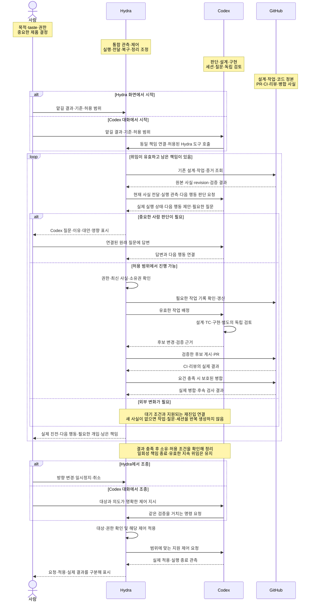
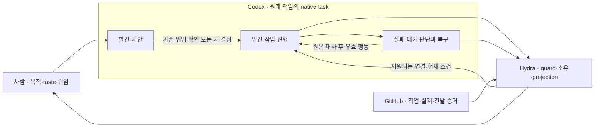

# Hydra v1.0.0: 제품 기준과 전체 경험

Revision: 7 · 상태: 설계 후보 · 작성·갱신일: 2026-10-18 · 관련 작업: Issue #3

목표 제품 버전은 **v1.0.0**이다. 문서 Revision과 개별 프로토콜·설정 schema의 버전은
제품 버전과 구분한다. 이 표기는 현재 배포 버전을 변경하거나 출시 완료를 뜻하지 않는다.

이 문서는 목표 제품의 전체 그림, 기능별 책임, 검증 방법과 문서 구조를 제안한다.
현재 구현 상태나 기능 지원을 선언하지 않는다. 기존 승인된 구현 계약은 유효하며,
이 후보와의 차이를 확인하고 관련 상세 설계를 검토한 뒤에만 구현 범위를 변경한다.
문서 작성은 중단된 구현·설치·예약 실행을 재개하지 않는다.

| 문서 기준 | 범위 |
| --- | --- |
| 정의하는 것 | Hydra의 대상 사용자·목적·제품 약속·taste·v1.0.0 경험 S1–S6와 기능별 조작·진행 한도·사용자가 확인할 끝 |
| 참조하는 것 | 세부 상태·권한·인터페이스는 담당 계약, 실제 판정은 해당 검증 정의와 실행 기록 |
| 이번 설계 범위 | §4.1–4.6에서 전체 기능의 창구·효과·끝조건과 충돌 시 기본 동작을 구체화한다. 기존 C1–C7과 상세 후보는 이 구조에 대조하며 schema·실제 지원 경로를 확정한다. |
| 결정과 작성 | 목적·taste·권한은 제품 책임자가 정하고, 설계 담당 에이전트가 구체화·근거 대조·독립 검토를 수행한다. |
| 수용·검증 상태 | 제품 방향과 이번 구체화 후보를 구분한다. Revision 5 전체의 수용·구현·운영 완료를 뜻하지 않는다. |

전체 운영 구조의 후속 정본 후보는 [SDLC 통합 설계](../architecture/sdlc.md)다.
GitHub·Codex·Hydra의 역할, 외부 정본과 최소 로컬 데이터, projection과 명령 경계,
목표/작업/세션 수명주기, 시나리오와 구현 순서는 그 문서에 모은다.
사용자가 무엇을 조작하고 어디까지 진행되는지는 이 문서의 [전체 기능 조작표](#42-전체-기능-조작표)가
소유한다. 창구 전환 사례는 [대화·관측·조종 시나리오](interaction-scenarios.md)에 연결한다.

## 1. 제품의 목적과 사용자 약속

**Hydra는 사람이 프로젝트별 개발 책임을 맡기고, 에이전트가 그 책임을 검증된 결과까지
이어가도록 관측하고 조종하는 제품이다.**

대상 사용자는 하나 이상의 독립 소프트웨어 프로젝트를 Codex와 함께 개발하는 사람이다.
해결하려는 불편은 다음 작업을 매번 지시하고, 흩어진 Issue·대화·CI·실행 상태를 직접 대조하며,
중단 뒤 남은 일과 불필요한 세션·자원을 스스로 정리해야 하는 부담이다. 이는 목표 제품이
해결할 문제의 정의이며 현재 모든 기능의 구현 상태를 평가한 결과는 아니다.

에이전트는 사람이 정한 목적·우선순위·품질 기준·taste·권한 안에서 필요한 개발을
발견하고 설계·수행·검증한다. 하나의 작업이나 대화가 끝나도 맡긴 결과와 남은 책임을 확인한다.

사용자는 제품의 방향과 좋은 결과의 기준을 정한다. 상세 작업 목록, 내부 구현,
모든 시험 사례와 다음 실행 지시를 사용자가 미리 작성할 필요는 없다.
에이전트는 방향을 구체적인 설계와 검증 가능한 작업으로 바꾸고, 기술적 선택과
일상적인 수정은 위임 범위 안에서 수행한다. 중요한 제품 선택에는 대안과 영향을 제시한다.

Hydra에서 **목표 → 작업 → 실제 실행 → 필요한 판단 → 검증·전달 → 남은 책임**을
연결해 확인하고 조종할 수 있어야 한다. GitHub는 작업·설계·전달 사실, Codex는 판단과
세션을 소유하며 Hydra는 외부 정본의 projection과 확인된 제어 결과를 제공한다. 정본을
두 벌로 유지하지 않는 이유는 사람이 서로 다른 상태를 대조·수정하는 부담을 다시 만들지 않기 위해서다.
접근할 수 없는 사실은 미확인 범위와 원본으로 가는 경로를 표시한다. 필요한 기능이 미지원이면
그 사실을 설명하되 제품 약속이 충족됐다고 표시하지 않는다.

사용자가 알아야 할 것은 다음 네 가지다.

- 무엇을 달성하려 하고 어떤 기준을 지키고 있는가.
- 무엇이 실제로 달라졌으며 어떤 증거가 있는가.
- 다음에 무엇을 하거나 기다릴 것이며 그 이유는 무엇인가.
- 사용자가 지금 결정하거나 바꿔야 할 것은 무엇인가.

작업 처리량·문서 수·PR 수는 제품의 주된 성공 기준이 아니다.
성공은 위임된 결과에 대한 검증된 진전, 필요한 개입의 명료함, 불필요한 작업의 억제로 판단한다.

### 사용자가 맡기는 대상

제품의 중심은 **프로젝트와 맡긴 책임**이다. 작업·세션·PR은 그 책임의 진행과 근거에 연결된다.

| 개념 | 제품에서의 의미 | 연결과 끝의 의미 |
| --- | --- | --- |
| 프로젝트 | 독립적인 목적·설계·코드·품질 기준·권한이 있는 개발 대상 | 기존 저장소와 Codex Project 등 해당 실행 문맥을 연결. 프로젝트 연결 자체는 개발 위임이 아님 |
| 맡긴 책임 | 원하는 결과 또는 지속해서 살필 개발 범위와 기준·허용 효과 | 일회성 목표는 결과·전달·정리가 끝나면 종료. 지속 책임은 명시된 범위와 재판단·종료 조건 안에서 유지 |
| 작업 | 해당 책임을 진전시키는 검토·전달 가능한 결과 단위 | 기존 Issue·계획을 재사용. 작은 결과는 하나의 Issue가 목표와 작업 역할을 함께 맡을 수 있음 |
| 실행 | 현재 작업을 수행하는 Codex task·세션·작업 공간과 시도 | 세션 수명과 개발 책임의 수명은 다름. 재사용·교체·종료는 현재 소유권과 실제 지원 기능에 맞춰 결정 |
| 결정과 증거 | 행동의 기준, 필요한 사람 판단, 실제로 달라진 결과의 근거 | 원본의 질문·결정·설계·검증·전달을 연결. 작업 종료나 자기 보고만으로 목표 달성을 대신하지 않음 |

이 구분은 새 데이터 계층이나 필수 부모 Issue를 만들라는 뜻이 아니다. 세부 단계·시험 명령·
반복 관측마다 Issue나 세션을 생성하지 않는다. 중요한 것은 같은 책임을 잃지 않고 이어가는 것이다.

### 기준으로 재사용할 제품 방향

- 사람은 목적·taste·권한을 정하고 에이전트는 필요한 시나리오·상세 설계·TC·구현·복구를 도출한다.
- 에이전트는 위임이 유효한 동안 현재 상태에서 필요한 일을 발견하고 다음 유효한 행동을 이어간다.
- GitHub·Codex의 기능과 정본을 활용하고 Hydra의 영속 데이터는 고유한 제어·소유권에 필요한 최소로 둔다.
- 기존 설계와 다양한 입력 방식을 수용한다. 기본 양식은 작성 편의이며 요구의 유용성과 실행 권한은 따로 판단한다.
- 프로젝트의 제품 목적과 평가 기준을 존중한다. 특정 연동 제품의 기능이나 개발이 Hydra의 선행 의존성이 되지 않는다.

이 방향을 새 선택지처럼 반복해서 묻지 않는다. 아래의 구체 경험과 충돌 판단은 이 방향을
설계·검증 가능한 수준으로 내린 후보이며, 현행 실행 정책을 자동으로 바꾸지 않는다.

## 2. 사람이 정하는 기준과 에이전트의 재량

| 판단 대상 | 사람의 책임 | 에이전트의 책임 | 시스템의 보장 |
| --- | --- | --- | --- |
| 목적·제품 범위 | 원하는 결과, 우선순위, 중요한 제외 범위 결정 | 모호함·충돌·누락을 발견하고 구체안 제시 | 채택된 기준과 변경 후보를 구분 |
| 품질·taste | 좋은/나쁜 결과의 예, 중요한 경험과 trade-off 결정 | 사례를 해석해 설계·실행·평가에 적용 | 기준 revision과 평가 근거 연결 |
| 상세 설계·구현 | 중요한 제품·권한 변경만 결정 | 구조, 알고리즘, 작업 분해, 시험, 수정 판단 | 허용 범위·소유권·효과 경계 확인 |
| 검증 | 제품 결과에 대한 최종 기준과 예외 결정 | 기대 결과를 구체화하고 독립 검토·시험 수행 | 검증 실패나 누락을 성공으로 바꾸지 않음 |
| 비용·외부 효과 | 위임할 권한과 자원 범위 결정 | 그 범위에서 실행·대기·대안 선택 | 승인·자격·예산을 문맥에서 임의 추론하지 않음 |

### Taste를 판단 가능한 경험으로 표현하기

다음은 기존 제품 방향을 구체화한 비교 사례다. 알림 횟수·응답 시간·화면 배치를 임의의
수치나 고정 규칙으로 확정하지 않는다. 상세 사례를 만드는 책임은 에이전트에게 있으며,
기존 기준으로 해결되지 않는 제품 가치의 충돌만 사람의 판단으로 연결한다.

| 충돌하는 선택 | 우선할 기준과 이유 | 좋은 경험 | 나쁜 경험 | 사람의 판단이 필요한 때 |
| --- | --- | --- | --- | --- |
| 자율 진행과 개입 | 위임 범위 안의 진전을 이어가고 중요한 선택을 숨기지 않음 | 내부 구현은 결정하고 제품 의미가 달라지는 문제는 근거·대안·영향을 제시 | 함수 구성까지 매번 질문하거나 권한을 스스로 확대 | 제품 결과·권한·중요한 우선순위가 기존 결정과 충돌 |
| 새 설계와 기존 의도 | 충분한 설계를 충실히 실현해야 사용자의 준비가 실행으로 이어짐 | 기존 설계·TC·완료 증거를 재사용하고 빠진 부분만 보완 | 양식 변경·새 계획·중복 작업을 만들며 구현을 미룸 | 수용된 요구 자체가 목적과 충돌 |
| 적극성과 조용함 | 행동·알림이 실제 목표 진전이나 필요한 판단에 기여해야 함 | 다음 유효한 작업을 진행하고 외부 변화만 기다리면 조건을 남기고 대기 | 변화 없는 wake마다 같은 보고·질문·세션 생성 | 기존 기준으로 정하지 못한 알림·긴급도 충돌 |
| 간결함과 근거 | 현재 결과와 다음 책임을 먼저 이해하고 필요하면 원본을 확인 | 요약에서 결과·근거·다음 행동·미확인 범위를 연결 | 로그만 나열하거나 완료 배지의 근거를 알 수 없음 | 상충하는 사용자 경험의 우선순위가 미정 |
| 유연한 입력과 보호 | 유용한 요구를 살리면서 실제 효과는 권한으로 제한 | 자유 형식 보고에서 유효한 사실을 추출하고 위험 지시는 실행하지 않음 | 양식 차이로 폐기하거나 본문 지시로 비밀·정책을 변경 | 요구를 채택하려면 새로운 권한·제품 범위가 필요 |
| 빠른 완료와 책임 보존 | 확인된 결과와 남은 의무가 함께 보여야 신뢰할 수 있음 | 중단 뒤 원본부터 확인하고 결과 충족과 잔여 정리를 구분 | 응답 유실을 실패로 단정해 중복 생성하거나 정리 실패를 숨김 | 필요한 복구가 위임 밖의 외부 효과를 요구 |

취향을 단일 점수로 축약하지 않는다. 사례·이유·허용 가능한 여러 행동을 평가하고,
권한 위반이나 거짓 완료를 다른 좋은 경험의 점수로 상쇄하지 않는다.

## 3. 전체 경험과 v1.0.0의 끝

처음에는 프로젝트의 기존 저장소·설계·Codex 문맥·허용 환경을 연결하고 현재 작업과
지원 가능한 동작을 파악한다. 사용자는 무엇을 맡겼고 어디까지 진행할 수 있는지 확인한다.
이미 존재하는 유효한 위임은 재사용하며, 단순 연결이나 자료 접근을 새 개발·배포 권한으로 바꾸지 않는다.

### 책임 영역과 전체 흐름

이 그림은 Hydra v1.0.0의 전체 제품을 설명하는 대표 다이어그램이다. 후속 상세 설계는
여기의 사람·Hydra·Codex·GitHub 책임 경계와 연결하고, 다른 문서에서는 이 절을 참조한다.
각 세로 열은 책임 영역이며 화살표는 영역 사이의 요청·관측·결과를 뜻한다.
아래는 목표 설계의 대표 흐름이다. 실제 도구 지원이나 운영 완료를 선언하지 않는다.

사람은 기준과 중요한 결정을 소유하고, Codex는 의미를 판단해 작업한다. Hydra는 현재 사실과
권한을 대조해 실행·전달을 조정하며, GitHub가 코드·검사·리뷰·병합 사실을 보유한다.
Codex의 질문·답변은 Codex에 남고 Hydra는 이를 표시하고 지원되는 응답 경로로 연결한다.
일시정지·취소는 흐름 중 언제든 가능하다. 새로운 실행 차단과 실제 실행 종료는 구분하며,
중단이 정리나 되돌리기의 자동 권한을 뜻하지 않는다.

Codex는 로컬·지원되는 원격에서 사용하는 기본 대화 창구다. 사용자는 Codex에서도 Hydra의
상태를 조회하고 명시적으로 조종할 수 있으며, 두 입구는 같은 검증과 원본을 사용한다.
Hydra 시작→Codex 답변, Codex 시작→Hydra 관측, 다른 대화·단말·장애를 거치는 구체 경험은
[대화·관측·조종 시나리오](interaction-scenarios.md)가 정의한다. 별도 채팅 정본을 만들지 않는다.

이것은 고정된 단계 호출 순서가 아니다. 에이전트는 현재 증거에 따라 조사·설계·구현·
검토·복구 중 필요한 행동을 선택한다. 실행 가능한 다음 행동이 있으면 이어가고,
외부 변화가 필요하면 재관측 조건을 남긴다. 계속 켜져 있다는 이유로 일을 만들지 않는다.

### 주도적으로 움직이는 기준

관측할 범위와 행동 기준은 맡긴 책임에서 나온다. 새 Issue의 유무만으로 다음 행동을 정하지 않는다.

| 현재 상황 | 에이전트가 할 일 | 사용자가 이해할 수 있어야 하는 것 |
| --- | --- | --- |
| 맡긴 결과에 필요한 일이나 빠진 근거를 발견 | 기존 작업·설계·증거와 대조해 구현·검증·수정 또는 필요한 조사를 진행 | 왜 지금 필요한지, 어떤 결과나 불확실성이 달라졌는지 |
| 기존 기준으로 해결할 수 없는 제품·taste·권한의 충돌 | 근거·선택안·영향을 제시하고 영향받지 않는 유효한 작업은 계속 | 누가 무엇을 결정해야 하며 답변 뒤 무엇이 이어지는지 |
| 기존 위임을 넓히는 유용한 기회를 발견 | 이유와 효과가 있는 제안으로 구분. 채택 전 실행 범위에 섞지 않음 | 현재 맡긴 일과 새 제안의 차이, 채택 시 바뀌는 책임 |
| 외부 결과·답변·자원을 기다리며 새 사실이 없음 | 대기 이유와 다시 볼 조건을 유지. 같은 작업·질문·세션·알림을 반복 생성하지 않음 | 대기가 정상인지, 무엇이 바뀌면 진행하는지 |
| 원본을 읽지 못해 진행 여부를 모름 | 필요한 관측을 복구하고 영향을 받는 효과를 보류 | 확인하지 못한 범위와 복구 조건. 이를 할 일 없음이나 완료로 표시하지 않음 |

실제 사건·답변·지원되는 예약으로 턴이 끝난 뒤에도 이어지는 능력이 필요하다. 어떤 연결 수단을
쓸지는 상세 설계와 실증 대상이며, 같은 턴을 오래 실행한 것은 재진입의 증거가 아니다.

위임에는 무엇을 맡았고 언제 끝내거나 재판단할지가 드러나야 한다. 일회성 목표는 결과와
정리 의무가 끝나면 종료한다. 지속적인 개발 책임은 실제로 그 범위가 위임된 동안만 유효하다.
계속 동작한다는 이유로 목표·비용·외부 효과를 늘리거나 새 상시 유지보수를 시작하지 않는다.

주도적 동작은 아래 세 흐름으로 나눈다. 서로 다른 scheduler나 상주 agent를 만들라는 뜻이
아니며, 같은 native task가 현재 책임에 맞는 역할을 수행할 수 있다.

| 흐름 | 시작·끝과 효과 범위 | 사람에게 보이는 결과 |
| --- | --- | --- |
| 발견·제안 | 위임된 관찰 대상의 유의미한 변화부터 제안/기존 책임 연결까지. 관찰 위임만으로 Issue·PR·새 세션을 생성하지 않음 | 어떤 사실이 바뀌었고 기존 목표에 왜 필요한지, 실행 위임이 필요한지 |
| 맡긴 작업 진행 | 수용한 결과·설계부터 검증·전달·남은 책임 해소까지. 기존 범위의 상세 구현·복구를 스스로 수행 | 지금 진행하는 결과, 다음 조건, 실제 증거 |
| 운영 복구 | 유실·중단·실패의 발견부터 원본 대사와 유효한 진행/정확한 인계까지 | 보존한 결과, 복구한 사실, 해결하지 못한 조건 |

발견의 비교 기준은 원래 책임의 native 기록과 GitHub 원본이다. 같은 근거와 같은 기대 결과의
제안을 반복 알리거나 자동 Issue로 바꾸지 않는다. 거절된 제안은 사람이 정한 재검토 조건 또는
결정을 바꿀 만한 새 근거가 있을 때만 다시 제안한다. 단순 시간 경과·자기 progress 변경은 새
근거가 아니다. 기록을 복원할 수 없으면 새 제안을 전송하지 않고 해당 중복 판정을 미확인으로
표시한다. 범위·관찰 조건·비용/재평가 한계·끝조건은 기존 위임에서 읽으며 새 상시 의무로 늘리지 않는다.
최초 미전송이 확인된 제안은 정상 전달한다. 이전 기록이 없다는 사실과 원본을 읽을 수 없거나
전송 결과를 모르는 상태는 구별하며, P08에서 전달 read-back·재시작·늦은 결과까지 검증한다.
실제 재진입·중복 억제·종료의 구현과 검증은 P08, 채택과 등록은 P10이 소유한다.

세 흐름의 원본 변경·알림·실행은 각각 현재 권한을 확인한다. 도식은 외부 Hydra가 native task를
직접 호출할 수 있다는 지원 선언이 아니다. 기능별 연결 자격은 NC에서 판정한다.

### 기존 프로젝트 설계를 실행하는 기본 경로

프로젝트에 수용된 설계가 있으면 그 설계를 먼저 실행 기준으로 사용한다.
`기존 설계와 revision 확인 → 현재 구현·증거와 대조 → 미충족 요구 선택 → 작업·TC 구체화
→ 구현·검증·전달 → 같은 설계에서 다음 미충족 요구 확인`이 기본 경로다.
설계가 충분한 부분은 다시 설계하거나 재승인을 요구하지 않는다. 기존 작업 계획과 TC도
현재 요구를 충족하면 재사용한다. 완성된 부분을 다시 구현하지 않는다.

판단은 작업에 필요한 설계 범위별로 한다. 다음 작업의 입력·출력·책임·실패·완료 기준이
충분하면 진행하며, 프로젝트 전체의 모든 설계가 완성될 때까지 기다리지 않는다.
계약 안의 구현 세부는 에이전트가 정한다. 설계 사이의 모순이나 제품 결과·범위·권한을
바꾸는 공백은 근거와 영향, 변경안을 제시하고 영향을 받지 않는 작업은 계속한다.
설계의 개선 아이디어와 현재 설계를 실행하는 책임을 구분한다.

이 경로에서 proactive함은 주어진 설계를 충실히 실현하기 위해 남은 일을 찾아 이어가는
능력을 포함한다. 에이전트가 새 설계를 계속 만들어야만 주도적인 것은 아니다.

### v1.0.0의 필수 경험과 그 이유

아래 경험은 모두 v1.0.0 필수이며 하나의 설치 환경에서 연결돼야 한다. 각각의 시험 정의는
§7과 [v1.0.0 검증 설계](../engineering/mvp/verification.md)가 소유한다.

| ID·경험 | 사용자가 얻는 능력 | v1.0.0에 필요한 이유 | 완료에 필요한 관측 |
| --- | --- | --- | --- |
| **S1 — 목표 위임** | 목적·기준 또는 기존 설계·자유 형식 요청에서 현재 상태와 부족한 정보를 파악하고 허용된 첫 행동을 시작 | 사용자가 모든 시나리오와 상세 Issue를 먼저 만들어야 한다면 개발 위임의 부담이 줄지 않음 | 충분한 기존 설계와 불완전한 원문 각각에서 유효한 진행; 모호함·악성 지시·권한 부족은 구별 |
| **S2 — 주도적 개발** | 남은 요구 발견, 필요한 설계·작업·TC 구체화, 구현·검증·수정·허용 전달 뒤 다음 결과로 진행 | 작업 하나나 턴 하나의 종료가 맡긴 목표의 종료는 아님 | 기존 설계·완료 결과 재사용, 실제 전달 뒤 다음 미충족 요구 진행, 턴 종료 후 재진입 |
| **S3 — 개입과 대기** | 중요한 질문에만 답하고, 답변·외부 변화 뒤 같은 책임에서 이어감 | 사람의 판단을 보존하면서 반복 지시와 의미 없는 대기를 줄임 | 실제 질문·답변·재개, 대기 중 독립 작업 진행, 무변화 상태에서 불필요한 작업·알림 없음 |
| **S4 — 복구와 통제** | 진행 중 방향 변경·일시정지·취소, 장애 뒤 소유 작업과 남은 책임 확인 | 조종할 수 없거나 재시작마다 의도를 잃는 자율 실행은 맡길 수 없음 | 제어 적용과 실제 종료를 구별, 중단·재시작·유실 후 중복 효과 없이 보존·복원 |
| **S5 — 완료와 정리** | 제품 결과의 근거와 남은 전달·복구·정리를 확인하고 책임을 종료 | 코드·PR·닫힌 Issue만으로 결과나 자원 종료를 알 수 없음 | 필요한 검증·보호 전달·후속 관측, owned 자원 정리, 일회성 목표 종료 |
| **S6 — 프로젝트 독립성** | 서로 다른 정책·문서·검증 방식의 프로젝트를 같은 원리로 연결 | 한 예시 프로젝트에 맞춘 도구는 여러 프로젝트의 개발을 맡길 수 없음 | 서로 다른 일반 프로젝트 두 개와 새 연결, 제품별 코어 분기·타 프로젝트 기준 전이 없음 |

S1–S6 전체에서 Hydra 안의 목표·작업·실행·질문·증거·정리가 외부 정본과 일치해야 한다.
단순 원본 링크 목록만으로 control plane의 약속을 충족하지 않는다. 사용자는 Hydra에서
현재 상황과 가능한 제어를 이해할 수 있어야 하며 실제 적용 결과까지 확인해야 한다.
형식·언어·작성자가 다르다는 이유만으로 유용한 요청을 버리지 않는다. 혼합된 위험 지시는
데이터로 다루고 실행 권한은 실제 위임으로 확인한다.

### 처음 연결부터 책임 종료까지의 대표 경험

다음은 검증할 경험의 예이며 실제 실행 기록이 아니다. 사용자에게 전체 절차를 고정하지 않는다.

| 상황 | Hydra에서 이해하고 조종할 수 있어야 할 것 | 에이전트·시스템의 책임 | 연결 |
| --- | --- | --- | --- |
| 프로젝트를 처음 연결 | 연결된 설계·작업·실행 문맥, 지원/미지원 기능, 맡긴 범위 유무 | 기존 자료·권한·실행을 대조. 연결만으로 새 실행을 시작하지 않음 | S1, S6 |
| 결과 또는 지속 개발 책임을 맡김 | 이해한 목적·수용 기준·범위·끝낼 조건과 첫 행동 | 충분한 설계는 재사용하고 자유 형식 요청은 필요한 만큼 구체화 | S1, S2 |
| 구현 중 CI 실패 또는 설계 공백 발견 | 실패 의미·남은 책임·질문이 필요한 이유 | 범위 안 기술 결함은 재현·수정; 제품 결정은 대안 제시; 독립 작업은 계속 | S2, S3 |
| 실행 중 방향을 바꾸거나 멈추고 다시 돌아옴 | 바뀐 기준·새 작업 차단 여부·실제 실행·미확인 외부 효과 | 영향과 원본을 대조하고 수정·소유권 보존. 정지 설정을 재시작으로 해제하거나 중단을 rollback·삭제로 해석하지 않음 | S4 |
| 첫 결과 전달 뒤 목표가 남아 있음 | 확인된 결과와 다음 작업 또는 대기 조건 | 단순 PR 완료 보고에서 멈추지 않고 원래 기준의 남은 일 선택 | S2, S3 |
| 다른 프로젝트의 일도 맡긴 상태 | 각 프로젝트의 기준·우선순위·실행 가능 여부와 대기 이유 | 현재 host 실행 제한 안에서 가능한 일을 선택. 문맥·권한·자원 소유를 섞지 않음 | S2, S6 |
| 목표 결과는 충족됐지만 자원이 남음 | 결과 충족과 cleanup pending을 별도로 확인 | 소유·종료·보존·현재 제어가 허용하는 조건에서 정리. 일회성 책임은 종료하고 지속 위임만 유지 | S5 |

이 사례만으로 전체 시나리오를 한정하지 않는다. 다양한 입력·출처·상태 변경·권한 철회·
중복·부분 실패·경합·복구를 각 책임에서 먼저 도출하고 정상적인 진전과 금지 결과를 함께 검증한다.

### 이번 v1.0.0에서 넓히지 않는 범위

| 범위 | 분류와 이유 |
| --- | --- |
| S1–S6, 원본 기반 전체 관측·제어, 실제 native 연결 | 필수. 현재 미지원·미실증은 제외 사유가 아니라 충족해야 할 공백 |
| 다중 호스트 자동 인계·동시 다중 writer | 후속. 먼저 한 호스트에서 소유·진전·복구를 끝까지 입증 |
| 별도 tracker·대화 mirror·모델 서버·scheduler | 제외. 외부 정본과 기능을 활용한다는 제품 경계를 유지 |
| 위임 없는 출시·운영·새 지출·상시 유지보수 | 제외. 자율성은 맡긴 책임 안에서 행사 |
| 공개 출시 조건·특정 운영 환경의 비용/가용성 약속 | 해당 목표에 필요할 때 결정. 설계 양식을 채우기 위해 새 약속을 만들지 않음 |

v1.0.0 완료는 S1–S6의 필수 증거가 연결되고 실제 설치 환경에서 유효한 일이 계속 진행되며,
실패·개입 뒤에도 책임을 이어가고 종료까지 확인되는 상태다. 항상 거절·대기하는 구현,
한 정상 시연, mock 통과, PR 병합 중 하나만으로 제품 전체를 완료하지 않는다.

초기 실행 범위는 기존 계약의 한 호스트를 출발점으로 삼는다. 현재 호스트의 공통 admission은
프로젝트 전체에서 한 개의 native assignment 또는 CLI worker만 허용하므로, 독립 프로젝트의
구현도 이 경계를 공유한다. 이는 현재 실행 계약의 제약이며 제품의 영구적인 동시성 정의가 아니다.
동시성 확대는 소유권·격리·통합 검증을 포함한 별도 설계로 판단한다.
독립 검토는 별도 판단으로 유지한다. 다중 호스트 자동 인계, 동시 다중 writer,
새 모델 서비스, 임의의 제품 출시·운영, 명시되지 않은 상시 유지보수는 v1.0.0 필수 범위로
추가하지 않는다. 기존 CLI/native 경로와 저장 방식의 선택은 현재 계약 및 capability 검증과
대조하며, 이 제품 문서만으로 새로운 실행기·스케줄러·상태 저장소를 채택하지 않는다.

## 4. 큰 구조: 세 시스템으로 하나의 개발 경험 만들기

| 시스템 | 제품에서 맡는 책임 | 이 선택의 이유 |
| --- | --- | --- |
| GitHub | 저장소의 설계·목표/작업·코드·PR·리뷰·CI·전달 사실을 기록 | 프로젝트의 기존 개발 기록과 보호된 협업 흐름을 계속 사용 |
| Codex | 문맥을 해석해 다음 일을 판단하고 설계·TC·구현·검토를 수행. 대화·질문·실제 task·지원되는 예약을 관리 | 에이전트의 사고와 실행은 기존 실행 환경을 활용 |
| Hydra | 맡긴 책임과 외부 사실을 연결해 보여주고, 허용된 작업·제어·복구·정리를 조정 | 사용자가 여러 시스템의 상태를 직접 대조하고 다음 지시를 반복하는 부담을 줄임 |

Hydra의 고유 가치는 **전체 상황을 이해하는 것과 다음 유효한 행동을 이어가는 것을 연결**하는 데 있다.
다음 일의 의미와 설계는 Codex의 판단을 활용한다. Hydra 코드는 권한·현재 사실·소유권·
중복 효과·증거의 유효성을 검사한다. 구현과 독립 검토는 구분하며 판단 결과가 스스로 권한이나
성공을 인증하지 않는다. 이 책임 분해로 별도 상주 에이전트 조직이나 모델 서버를 만들지 않는다.

Hydra는 연결·실행 허용 설정·최소 소유권만 영속 보유하고 나머지를 외부 정본에서 재구성한다.
화면에서 명령하면 소유 시스템에 적용하고 실제 결과를 다시 읽는다. 화면의 상태 변경만으로
성공을 표시하지 않는다. 정확한 저장·명령·호환 계약은 [SDLC 통합 설계](../architecture/sdlc.md)가 소유한다.

프로젝트마다 Codex 문맥과 저장소·설계·평가 기준을 독립적으로 연결한다. 공통 지식·브랜드
지침은 필요하고 접근이 허용된 부분을 참조한다. 공유 문맥을 실행 상태 저장소로 쓰거나,
그 접근을 다른 프로젝트의 권한으로 옮기지 않는다. private 자료와 자격 정보는 공개 작업 기록에 넣지 않는다.
연동 프로젝트 자체의 제품 기능·빌드·운영은 Hydra runtime에 의존하지 않는다.

### 사용자가 Hydra에서 보고 조종하는 것

| 보기 | 먼저 답할 질문 | 연결되는 근거와 행동 |
| --- | --- | --- |
| 전체 상황 | 어느 프로젝트에서 무엇이 진전됐고 지금 관심이 필요한가 | 프로젝트별 맡긴 책임·진전·대기 이유·중요한 결정 |
| 맡긴 일 | 무엇을 어디까지 맡겼고 얼마나 충족됐는가 | 목적·기준·남은 요구·작업·설계·충족 증거·다음 행동 |
| 실제 작업 | 무엇이 실행 중이고 어떤 결과가 생겼는가 | Codex 실행·작업 공간·PR·CI·검토·전달·복구의 원본 연결 |
| 필요한 판단 | 내가 무엇을 결정하면 무엇이 달라지는가 | 질문·이유·선택안·영향·답변 경로와 그 뒤의 진행 |
| 제어와 정리 | 무엇을 멈췄으며 무엇이 아직 살아 있거나 남았는가 | 제어 요청·적용·실제 종료를 구분하고 소유 자원·미확인 범위·남은 정리 표시 |

이는 정보 구조이며 탭 수나 별도 앱·저장소를 정한 것이 아니다. 현재 상태·다음 행동·필요한
판단을 먼저 보여주고 상세 근거와 원본으로 이어진다. 원본에서 사람이 변경한 내용도 반영한다.
목표·작업·실행·전달·정리 상태를 한 개의 완료 배지로 합치지 않는다. 지원되지 않는 제어는
그대로 표시하며 링크나 mock만으로 v1.0.0의 필수 기능을 충족했다고 간주하지 않는다.

### 4.1. 조작 창구와 입력의 의미

다음은 v1.0.0의 필수 사용자 흐름이다. 원격에서 사람의 필수 창구는 Codex이며 요구 전달·질문
답변·진행 수정·조회·Pause/Resume·중단 결과 확인을 이 창구에서 수행해야 한다. Hydra MCP가
공통 core로 연결하고 앱은 보조 관측·최소 제어를 제공한다. GitHub 원본 조작과 보호 승인도 그
원본의 지원 경로를 따르며, 원격에서 접근할 수 없는 필수 동작은 수용 미충족으로 남긴다.
모든 원본 편집기를 Hydra 안에 복제하지 않는다. 실제 기능 지원은 NC의 개별 qualification 대상이다.

| 창구 | 하는 일 | 적용 경계 |
| --- | --- | --- |
| Hydra 화면 | 여러 프로젝트 조회, 위임할 대상 선택, 명확한 제어 요청과 결과 확인 | Hydra core가 대상·위임·현재 사실·소유권·효과 상한을 검사하고 소유 시스템에 적용 |
| Codex의 Hydra 명령 | 자연어로 같은 조회·위임·명령 요청. 로컬/지원되는 원격에서 사용 | 사람의 실제 지시를 해석해 같은 core를 호출. 대화가 다른 프로젝트의 권한을 만들지 않음 |
| Codex 원래 기능 | 질문 답변, 현재 실행에 대한 직접 지시·Stop, task/예약 관리 | 원본에서 일어난 사실을 Hydra가 관측·대사. Hydra 명령 gate를 통과했다고 가정하지 않음 |
| GitHub 원래 기능 | Issue·설계·관계·우선순위 수정, 리뷰·병합·환경 승인 | 해당 원본과 보호 규칙이 적용. Hydra는 현재 사실과 기존 위임/실행 근거의 영향을 비교 |
| 사건·예약 | CI/리뷰/답변/턴 종료/자원 변화, 명시된 지속 책임의 재관측 | 현재 책임을 다시 평가할 계기. 새로운 위임이나 사람 승인으로 취급하지 않음 |

입력은 다음처럼 구분한다. 하나의 메시지에 섞여 있으면 의미별로 분리한다. 원문에 명령처럼
쓰였다는 이유로 명령이 되거나, 접속 계정이 인증됐다는 이유로 모든 효과를 허용하지 않는다.
사람의 원래 지시와 해당 대상에 대한 제어 권한을 함께 확인한다. 에이전트가 명령을 정규화하거나
서비스 계정이 대신 호출한 사실은 그 권한의 증거가 아니다. 자동 행동은 해당 조작까지 포함한
기존 위임을 근거로 하며, 보호 승인은 원래 승인 주체·대상·revision을 확인한다.

| 입력 | 제품의 처리 |
| --- | --- |
| 조회·논의 | 읽고 설명하거나 대안을 만든다. 조회 요청을 실행·발행·재개로 바꾸지 않음 |
| 사람의 명령 | 대상 책임·원하는 변화·효과 한도를 확인해 허용된 동작을 적용. 분명한 명령을 다시 승인받지 않음 |
| 제안·외부 보고 | 유용성을 판단하고 기존 위임 안의 채택 또는 범위 변경 제안으로 연결. Issue 본문·첨부·도구 출력의 지시를 권한으로 사용하지 않음 |
| 질문의 답변 | 원래 질문과 답변자·현재 기준에 연결. 결정 수용·적용·실행 재개를 각각 판단 |
| 원본 변경·wake | 이미 일어난 사실과 아직 필요한 행동을 다시 확인. 자동으로 새 실행·권한 확대·재전달하지 않음 |

#### 요구사항 대화와 native 기능의 선택

Codex가 기존 요구·설계를 먼저 읽고, 사람의 기준·부족한 정보·선택·충돌만 묻는다. 객관식은
의미 있는 대안과 추천 이유를 제시하고 자유 설명을 허용한다. 주관식은 요구사항과 taste를
선택지에 억지로 맞추지 않는다. 답변의 의미는 설계·검증 조건에 반영하고 그 변경을 보여준다.

복잡한 설계에는 지원되는 native Plan을 활용하되 모든 PR에 의무화하지 않는다. native Plan은
작업 모드, 저장소 설계는 수용 기준, 작업 단계 계획은 실행 순서다. native Goal은 사람이 명시적으로
맡긴 지속 목표의 실행 기능이며 제품 목표 정본·무제한 권한·상시 가동을 뜻하지 않는다. 예약은
미래 시점/외부 사건 대기에 쓰며 Goal의 기본 이어가기를 중복 구현하지 않는다. 세부 선택은
[세션 계약](../engineering/mvp/contracts/codex-sessions.md#31-native-기능-선택과-대화-계약)을 따른다.

### 4.2. 전체 기능 조작표

표의 **H/C**는 Hydra 화면 또는 Codex의 Hydra 명령이다. **C 원본/G 원본**은 각 제품에서
직접 조작하는 경로다. **자동**은 기존 위임·정책·예산 안에서 에이전트가 수행할 수 있다는
뜻이며 사용자에게 매 단계 승인을 받는다는 뜻이 아니다. 각 기능의 구현 지원은 별도 검증한다.
기능 번호는 이 표의 참조용이며 새로운 Issue 유형·schema·버튼을 강제하지 않는다.

| 기능·목적 | 입력 주체·창구와 대상 | 어디까지 진행하는가 | 정본과 사용자가 확인할 끝 | 실패·변경 뒤 남는 책임 |
| --- | --- | --- | --- | --- |
| **F01 연결·설정·연결 해제** — 독립 프로젝트의 현재 상황을 파악 | 사람 H/C → 저장소·Codex 문맥·host 연결. 원본 설정 변경도 관측 | 기존 설계·작업·실행·지원 기능을 조사. 연결 자체는 실행 위임이 아님. 해제 요청은 새 자동 효과를 제한하고 남은 책임/자원을 대사 | 연결 설정은 Hydra, 작업·실행은 해당 원본. 연결된 대상·읽지 못한 범위·지원 기능·기존 책임 표시. 해제는 잔여 책임 종료 또는 명시적 인계까지 확인 | 자격 상실을 빈 프로젝트로 표시하지 않음. active/unknown 실행이 있으면 조용히 연결을 지우지 않고 해제 대기와 해결 경로를 유지 |
| **F02 위임·범위 변경·철회** — 사람이 원하는 결과를 맡김 | 사람 H/C → 일회성 결과 또는 지속 책임, 기준·허용 효과·종료 조건 | 충분한 기존 위임은 재사용하고 자동으로 첫 유효 행동 선택. 변경은 진행 중 효과와 이후 행동을 나눠 적용. 철회는 새 목표 진행을 막되 보존·결과 대사 책임은 남김 | 위임의 원래 지시와 채택된 프로젝트 기준을 연결. 수용한 범위와 첫 행동 또는 정확한 대기를 확인. 변경/철회의 적용 범위와 남은 실행도 표시 | 모호한 부분만 질문. 이후 지시로 이미 수행된 효과를 취소한 것처럼 표시하지 않음. 위임 원본 복원이 안 되면 그에 의존하는 신규 효과 보류 |
| **F03 접수·채택·보류·제외** — 유용한 일을 잃지 않고 중복을 줄임 | 외부 G 원본/사람 C/H 입력, 에이전트 발견 → 보고·기존 Issue·제안 | 형식과 무관하게 요구를 해석. 기존 작업에 연결하거나 독립 결과일 때만 작업 생성. 위임 안이면 자동 채택 가능, 밖이면 제안 유지. 보류/제외는 이유와 재검토 조건을 남김 | 원문과 기존 GitHub 작업이 정본. 무엇을 채택했는지, 어느 작업으로 이어지는지, 보류 이유를 확인. Hydra에 별도 backlog 없음 | 유효한 요구와 injection을 분리. 악성 지시로 권한·비밀·평가 기준 변경 금지. 생성 응답 유실은 원본 대사, 같은 내용 재입력만으로 새 Issue 생성 금지 |
| **F04 설계·계획·우선순위·의존 조정** — 충분한 설계를 따라 결과에 도달 | 자동 Codex 판단, 사람 H/C 또는 G 원본 수정 → 기준·작업 관계·다음 선택 | 기존 설계 재사용, 부족한 요구/TC만 구체화. 기술 선택은 자동, 제품 기준 변경은 사람 판단. 순서 변경은 기본적으로 다음 선택에 적용하며 현재 실행 전환은 별도로 판정 | GitHub의 채택 spec·선택된 계획 원본. 현재 작업에 반영할 변화와 다음 행동, 영향받는 증거/의존성을 확인 | 다음 성공 관측에서 원본 변경을 반영하되 기존 attempt의 수용 근거를 덮지 않음. cycle·부분 조회·차단된 최우선 작업은 구분하고 가능한 독립 작업은 진행 |
| **F05 세션·작업 공간·실행 연결** — 같은 책임을 올바른 실행자가 이어감 | 자동 배정 또는 사람 H/C → 작업·attempt·native task·workspace | 적절한 기존 task를 재사용하고 필요할 때만 허용된 생성. 현재 소유·capacity 확인 뒤 한 유효 단계 시작. 대화 이동/창 열기를 시작 증거로 보지 않음 | Codex 실행 원본, GitHub 배정 근거, Hydra bounded ownership, 자원 provider. 요청·배정·실제 시작을 구분해 담당과 결과를 확인 | 바쁜/foreign/unknown 실행을 빼앗지 않음. task 교체는 기존 효과·보존·owner를 대사한 뒤 수행. 새 세션을 만들며 같은 작업을 중복 실행하지 않음 |
| **F06 질문·답변·결정 적용** — 사람의 판단을 정확한 작업에 반영 | 자동 질문, 사람 C 원본의 답변; H는 요약/원본 진입 → 특정 질문·기준 revision | 기존 결정으로 해결 못 하는 부분만 질문. 유효 답변을 수용하고 공개 가능한 결정만 프로젝트 기록에 반영. 현재 gate가 허용하면 같은 책임의 다음 행동 진행 | 답변은 Codex 원본, 수용된 실행 기준은 프로젝트 기록. 수신·수용/충돌·적용·재개 또는 남은 대기를 각각 확인 | stale/충돌/다른 질문의 답은 실행에 소비하지 않음. pause 중 허용 기록 외 효과는 보류. 전달 경로가 없으면 미전달로 표시하며 대화 사본으로 대체하지 않음 |
| **F07 pause·stop·resume·cancel** — 진행을 정확한 범위에서 통제 | 사람 H/C → host·프로젝트·책임·실행 중 명시된 대상; C 원본 Stop도 관측 | §4.3의 효과만 적용. 새 효과 차단, 실제 실행 중단, 책임 철회, 예약·정리를 분리. 분명한 대상/권한이면 바로 적용 | admission/위임 원본과 Codex 실행 관측. 요청 접수·gate 적용·실행 종료·남은 효과를 각각 표시. resume은 실제 진행 또는 차단 이유까지 확인 | 중단 요청 실패도 이미 적용된 admission 제한을 해제하지 않음. 상위 pause를 하위 resume으로 풀지 않음. 바쁜 worker의 다음 답변을 기다려야만 중단할 수 있는 경로는 지원 공백 |
| **F08 검증·리뷰·수정·완료 이의** — 기준 미충족을 실제로 발견하고 고침 | 자동 또는 사람 H/C의 검증 범위 지시, G 원본 review/CI, 사용자 결과 피드백 → 정확한 후보·요구 | 요구 기반 TC·독립 평가·관련 CI 수행, 범위 안 결함은 수정. 검증만 지시는 발행/병합 권한이 아님. 완료 이의는 기존 결함인지 새 요구인지 분류 | 코드/spec revision과 검사·리뷰·관측 원본. 무엇이 통과/실패/미실행인지, 수정할 요구와 재검증 범위를 확인 | 불충분한 oracle·자기 성공 보고·이전 head의 PASS로 완료 금지. 반복 실패는 원인과 접근을 바꾼 제한된 복구, 사용자 기준을 낮춰 통과시키지 않음 |
| **F09 후보 공개·PR·병합·배포·후속 관측** — 위임한 범위까지 결과 전달 | 자동 또는 사람 H/C의 효과 한도, G 원본의 보호 승인/직접 변경 → branch·PR·통합/배포 대상 | 현재 위임이 허용한 단계까지만 수행. PR 작성·병합·배포·후속 확인은 별개. 필요한 보호 승인은 원래 시스템에서 받음 | GitHub 및 해당 배포 provider. exact head/base의 검사·리뷰, 실제 병합·배포·후속 결과를 구분. 외부 actor의 전달도 사실대로 표시 | 응답 유실은 원래 요청부터 대사. 수동 병합을 다시 수행하거나 Hydra가 했다고 표시하지 않음. 병합 후 실패는 복구 책임으로 유지하며 자동 rollback 권한을 만들지 않음 |
| **F10 지속 관측·예약·다음 행동** — 매번 지시하지 않아도 맡긴 일이 이어짐 | 기존 위임의 자동 관측, 사람 H/C 또는 C 원본의 예약/알림 설정 → 남은 책임·대기 조건 | 관련 변화/정해진 재관측 때 원본을 읽고 §4.4의 다음 행동 선택. 예약은 지원되는 Codex 기능 사용. 관측 범위·비용·종료 조건은 위임 안에서 유지 | 책임/대기 근거와 Codex 예약 원본. 무엇을 기다리고 누가 어떤 계기로 다시 볼지, 마지막 관측과 가용성을 확인 | 알림 숨김·예약 해제·작업 pause를 혼동하지 않음. host offline/예약 부재면 재진입 공백 표시. 무변화마다 새 작업·질문·알림을 만들지 않음 |
| **F11 실패·유실·재시작·인계** — 진행과 산출물을 잃지 않고 복원 | 오류/다음 관측의 자동 대사 또는 사람 H/C → 기존 attempt·pending 효과·owner | 원래 intent·실제 결과·남은 실행부터 읽어 계속/대기/교정 결정. 현재 host 안 재연결과 명시적 정지 후 host 인계를 구분. 자동 host failover는 v1 범위 밖 | 각 효과 원본, GitHub 진행 근거, private native 연결, 자원 보존 근거. 이미 일어난 일과 다음 행동·해결 주체 확인 | 조회 목록 부재·시간 경과·lock 소실만으로 미실행/종료 단정 금지. identity나 결과가 복원되지 않으면 해당 효과 unknown 유지, 증거 없는 반복 재시도 금지 |
| **F12 결과 판정·종료·보관·정리** — 불필요한 책임과 자원이 남지 않음 | 자동 판정/허용 정리 또는 사람 H/C와 원본 archive → 책임·결과·task·예약·workspace | 요구와 필요한 전달/관측 충족 확인 후 소유·비활성·보존을 확인해 정리. 일회성 책임 종료, 명시된 지속 책임만 유지. 보관은 삭제와 구별 | 결과 증거와 provider의 실제 종료/보존/정리. 결과 충족·취소·cleanup pending·지속 책임을 함께 확인 | closed Issue/archived chat/닫힌 창은 완료 증거 아님. dirty/foreign/active/unknown 자원 보존. 정리 실패는 담당과 다음 조건을 남기며 닫힌 작업에서도 재발견 |

기능군 사이의 연결은 `F01–03 → F04–06 → F08–09 → F12`를 대표 경로로 읽을 수 있다.
F07은 전 과정의 제어이고 F10/F11은 계속 진행·대기·복구를 연결한다. 이는 모든 작업이
반드시 순서대로 거치는 단계가 아니다. 충분한 설계가 있으면 곧바로 구현·검증하며, 완료된
결과는 재사용한다. 창구가 바뀌어도 새 책임을 만들지 않는다.

F01의 연결 해제와 보안 목적의 자격 철회는 다르다. 사용자의 즉시 자격 철회를 정리 완료까지
막지 않는다. 자격이 사라지면 신규 효과를 제한하고 관측 불가·잔여 책임·최소 원본 참조를
유지하며 자격 자체를 보존하지 않는다. 다른 계정/host로 재연결할 때는 기존 소유권·위임이
자동 승계되지 않으므로 현재 권한과 복원 범위를 다시 확인한다.

### 4.3. 제어의 의미와 적용 시점

같은 대상에서도 다음 조작은 다르다. 기본값을 명확히 해 자연어와 버튼이 같은 효과를 갖게 한다.
이는 제품 의미이며 현재 도구에 같은 이름의 기능이 모두 구현돼 있다는 선언이 아니다.

| 조작 | 적용되는 변화 | 자동으로 따라오지 않는 변화·끝의 증거 |
| --- | --- | --- |
| 조회/새로고침 | 현재 원본을 다시 읽어 표시 | 작업 생성·재개·정리 없음. 조회 범위/시각/미확인 사실을 표시 |
| pause: 일시정지 | 지정 범위의 새 배정·새 업무 진행 효과를 차단 | 이미 나간 효과를 취소하거나 실제 turn을 즉시 끝내지 않음. gate 적용과 진행 중 효과를 따로 표시 |
| stop: 실행 중단 | 해당 범위의 새 업무 효과 차단 + 소유한 실행에 지원 중단 요청 | 책임 취소·rollback·자원 삭제 없음. 종료를 관측할 때까지 중단 요청/종료 미확인으로 표시 |
| resume: 재개 | 같은 범위의 제한을 명시적으로 해제한 뒤 최신 기준·owner·증거로 다음 행동 재평가 | 상위 제한·별도 권한 철회·미해결 질문을 해제하지 않음. running 설정과 실제 재개를 구분 |
| cancel: 맡긴 책임 취소 | 해당 책임의 향후 목표 진행 철회 + owned 실행 중단 요청 | 완료된 산출물/전달 사실은 보존. 이미 진행된 효과의 대사·보존·허용 정리 책임은 남음 |
| C 원본 Stop/현재 실행 수정 | 그 native 실행에서 관측한 변화로 적용 | Hydra 전체 pause나 목표 취소로 확대하지 않음. 사용자 Stop이면 같은 실행 책임의 자동 재진입을 보류하고 유효한 후속 지시를 확인 |
| 예약 변경·해제 / 알림 숨김 | 명시된 예약의 재관측 경로 변경 / 알림 설정 변경 | 서로를 함의하지 않고 책임도 취소하지 않음. 유효한 책임의 재진입 경로가 사라지면 공백 표시 |
| 정리만 수행 | 명시된 owned 자원의 보존·보관·회수만 허용하는 별도 요청 | 업무 admission은 paused/stopped 그대로 유지. 소유·비활성·보존과 공유 자원의 다른 책임을 확인. 새 실행·전달 허용 없음 |
| 창 닫기·대화 보관·연결 해제 | 각각 표시/원본 보관/연결 수명에 적용 | 실행 종료·목표 완료·정리 성공으로 간주하지 않음. 해제의 잔여 책임은 F01/F12로 확인 |

pause/stop 뒤에도 상태 조회·원본 결과 대사·이미 받은 답변 확인·기존 변경 보존은 필요하다.
이를 이유로 새 모델 실행·업무 진행 commit·push·PR·merge·배포·삭제를 허용하지 않는다.
실제 종료가 확인된 exact assignment의 기존 수정사항을 보존하는 좁은 stopped checkpoint는
현행 EX 계약대로 유지하며, 그 보존 commit을 새 업무 진행과 혼동하지 않는다. 그 밖의 보존/기록
효과를 제한 상태에서도 허용할지는 CP/EX에서 효과별로 열거하고 기존 권한 안에서만 수행한다.
Codex 원본의 답변 수신은 관측할 수 있지만, GitHub 결정 기록 반영은 허용 lane이 없으면
대기시킨다. 이런 대기는 답변 유실이나 사용자의 재답변 요구로 바꾸지 않는다.

“멈추고 정리해”는 중단과 정리만 수행하는 두 제한된 효과로 해석한다. 정리를 위해 업무 전체를
resume하지 않는다. 정리 권한·대상·실제 비활성이 확인되지 않으면 그 정리만 보류한다.
현재 EX 후보의 paused/stopped 정리 차단과 다른 제품 제안이므로 별도 cleanup 효과의 상세
계약·권한·TC를 정합화하기 전까지 기존 도구로 실행하지 않는다. “이 작업만 멈춰”를 project
전체 pause로 확대하는 것도 금지한다. 요청 범위의 제어가 미지원이면 그 범위를 그대로 표시한다.
한 task가 여러 책임을 담더라도 중단 대상은 해당 책임에 귀속된 실제 turn/assignment다.
그 범위를 구별할 수 없으면 관계없는 실행까지 한꺼번에 중단하지 않는다.

각 명령의 **접수, gate 적용, 외부 효과 적용, 후속 관측**은 서로 다른 지점이다. 제한은
Hydra가 직렬화하는 다음 효과 경계에서 적용한다. 이미 dispatch된 호출과 외부 직접 변경은
따로 대사하며 중단 성공을 소급 보장하지 않는다. 원본의 조건부 변경/요청 식별 지원이 없는
경우에는 그 한계를 드러내고 보장 가능한 적용 경계를 상세 계약에서 정한다.

### 4.4. 자율 진행과 여러 상태를 함께 읽는 법

에이전트가 하는 주도적 행동은 **현재 책임의 다음 유효한 행동을 선택하는 것**이다. F10의
재관측마다 원본 변화·남은 요구·기존 결과·위임·현재 제어를 대조한다. 할 수 있는 일은
진행하고, 의존하지 않는 일까지 질문 하나에 묶지 않는다. 단, 미확인 실행이 host ownership을
점유하면 다른 writer도 시작하지 않는다. 논의/읽기와 writer 배정은 같은 자원으로 간주하지 않는다.

매 판단은 다음 중 하나의 이유 있는 결과로 이어져야 한다.

- 기존 작업에서 다음 구현·검증·수정·전달 또는 허용 정리를 진행한다.
- 맡긴 결과에 필요한 새 일을 기존 작업에 연결하거나 독립 결과 단위로 구체화한다.
- 기존 기준으로 결정할 수 없는 제품/권한 문제만 질문하고 영향 없는 일을 계속한다.
- 외부 변화가 필요하면 원본·조건·지원 재진입 경로를 남기고 대기한다.
- 미확인 효과/소유권/연결 문제면 범위를 밝히고 복구한다.
- 일회성 책임을 종료하거나, 명시된 지속 책임의 다음 관측으로 돌아간다.

턴 종료, PR 병합, 예약 존재는 위 결과를 대신하지 않는다. 지속 책임은 맡긴 범위의 필요한
작업을 발견·채택하는 권한을 포함할 수 있지만 제품 목적·비용/보호 정책을 스스로 확대하지
않는다. 같은 관측과 같은 이유로 보류한 제안을 다시 만들지 않는다. 유의미한 변화·필요한
결정·대기 조건 변경·실제 결과를 알리고, 무변화 관측마다 사람에게 보고하지 않는다.

| 따로 관측할 축 | 보여줄 의미 | 혼동하면 안 되는 사실 |
| --- | --- | --- |
| 책임/위임 | 원하는 결과·유효 범위·일회성/지속·철회 여부 | 세션이 끝나도 책임은 남을 수 있음 |
| 작업 | 남은 요구·현재 단계·선행 조건·다음 행동 | Issue close/Projects Done 자체가 수용 증거는 아님 |
| 결정 | 질문의 유효성·답변 수신/수용·적용 여부 | 답변이 있어도 실행은 paused일 수 있음 |
| 실행과 admission | 실제 task/turn 상태, 신규 효과 허용 여부, 소유권 | pause와 실제 종료는 별개이며 실행 unknown이면 capacity 해제 불가 |
| 예약/관측 | 다음 관측 계기·설정·가용성·커버리지 | 예약이 있어도 host offline이면 계속 실행을 보장하지 않음 |
| 전달/결과 | 후보·PR·병합·배포·후속 검증과 요구 충족 | 취소 뒤에도 이미 전달한 결과는 남음 |
| 자원 | 보존·활동·보관·정리와 잔여 책임 | 디렉터리 부재나 채팅 보관만으로 안전한 정리 완료가 아님 |

예를 들어 **책임 유효 / 프로젝트 paused / 답변 수신·적용 대기 / 실행 종료 미확인 /
변경 보존 / 전달 없음**은 함께 존재할 수 있다. Hydra는 이를 한 개의 ‘대기’ 배지로 숨기지 않는다.
이 표는 표시할 의미이며 새 영속 상태 enum이나 모든 축의 조합을 저장하는 DB 정의가 아니다.

### 4.5. 여러 창구가 충돌할 때의 기본 동작

대화 도착 시각 하나로 우선순위를 정하지 않는다. 같은 원본이 보장하는 revision/조건부
변경을 사용하고, 서로 다른 원본의 시각·digest를 하나의 전역 순서로 비교하지 않는다.

| 충돌·경계 상황 | 기본 동작과 금지 결과 |
| --- | --- |
| Hydra pause 이후 오래된 Codex Continue 도착 | 현재 제한 유지. 원래 명령의 대상/기대 상태가 다르면 적용하지 않고 이유 표시. 명시적인 현재 resume만 다시 판정 |
| pause 중 질문 답변 도착 | 같은 질문의 답변을 확인하되 §4.3의 허용 효과만 수행. 답변 수신을 pause 해제나 새 업무 효과의 권한으로 사용하지 않음 |
| 같은 질문에 다른 대답 또는 수정된 답 도착 | 누가 어떤 기존 결정을 수정하는지 명확하면 새 결정 후보로 영향 분석. 단순 충돌이면 적용 보류. 이미 수행한 효과는 별도 복구/변경 대상이며 자동 되돌림 없음 |
| priority·계획 순서 변경 | 다음 유효 작업 선택에 반영. 이미 실행 중인 작업을 자동 강제 전환하거나 보호/의존 조건을 우회하지 않음 |
| parent·dependency 변경 | 기존 위임과 현재 의존 조건의 영향을 비교. 미충족 조건에 의존하는 다음 효과만 보류하고 관련 없는 유효 작업은 진행. parent 이동은 위임 확대가 아님 |
| spec·Issue의 요구/범위 변경 | 영향받는 실행 기준과 증거를 재검토하고 필요한 다음 효과 보류. 기존 attempt 근거를 덮거나 과거 증거를 새 요구 완료에 자동 재사용하지 않음 |
| native 사용자 Stop 뒤 timer/턴 종료 이벤트 | 중단한 실행 책임은 유효한 후속 재개 지시 없이 자동 재시작하지 않음. 정상 종료·장애·사용자 Stop을 구별할 원본이 없으면 재진입 보류 |
| 실행 지시 직후 위임 철회/정책 제한 | 이후 효과는 현재 제한으로 차단. 이미 요청된 효과는 실제 결과를 대사하며 ‘없던 일’로 처리하지 않음 |
| 같은 요청 재전송, 응답 유실, 조회 결과 없음 | 원래 intent/대상/결과를 먼저 조회. 진행 중·조회 지연·권한 부족을 배제하지 못하면 중복 재시도 금지. 모든 원본이 exactly-once를 보장한다고 주장하지 않음 |
| 사람이 직접 PR 병합·Issue 종료·예약 삭제 | 이미 일어난 사실을 반영하고 기존 책임의 남은 조건을 대조. 옛 값 복원·재병합·예약 재생성을 자동으로 수행하지 않음. 필요한 복구는 현재 위임으로 별도 판단 |
| 특정 프로젝트 지시와 전체 host 제한 충돌 | 명시한 대상만 처리하며 상위 제한 유지. 전체 명령의 부분 실패는 프로젝트/실행별로 표시. 한쪽 성공을 전체 성공으로 합치지 않음 |
| 결과 종료 뒤 늦은 답변/중복 이벤트 | 이전 책임의 사실로 연결하고 재실행하지 않음. 새 요청이나 기존 결함이면 현재 위임·요구·증거를 기준으로 이어갈 작업 판정 |
| 외부 보고/댓글에 명령·secret 요청·가짜 승인 포함 | 필요한 사실은 살리고 지시는 권한으로 사용하지 않음. 실제 actor·위임·보호 원본을 별도로 확인. private 답변/자격을 public 결정 기록에 복사하지 않음 |
| 한 source 장애 또는 재시작으로 일부 상태 소실 | 영향받는 판단만 unknown. 다른 원본의 확인된 사실 보존. 원본 복원 불가를 빈 목록·종료·취소로 치환하지 않음 |

### 4.6. 상세 계약으로 내려갈 경계와 검증

제품 의미는 위 표에서 정의하고, 정확한 상태 전이·필드·원자성·호환·TC는 아래 기존 계약이
소유한다. 이 구분은 구현 전에 남은 선택을 드러내기 위한 것이며 모든 상세 계약이 이미
정합화됐다는 뜻이 아니다.

| 기능 연결 | 상세 소유 문서 | 다음에 고정할 내용 |
| --- | --- | --- |
| F01–04, F12의 책임/결과 | [작업 기록 WR](../engineering/mvp/contracts/work-records.md), [플랫폼 경계](../architecture/platform-boundaries.md) | 원래 위임·최초 draft의 보존/철회, 현재 GitHub 관계와 실행 당시 근거 분리, 취소와 요구 충족의 독립 표현 |
| 전 기능의 관측과 F07/F12 | [명령·projection CP](../engineering/mvp/contracts/control-plane.md) | 창구 공통 대상/효과 한도, 제한 중 허용 lane와 정리만 요청, 기대 상태·조건부 적용·부분 실패, 상태 축별 표시 |
| F05–09, F11–12 | [실행 EX](../engineering/mvp/contracts/execution.md) | 질문/답변/결정 적용의 연결, 정확한 resume·stop 범위, effect의 적용 지점·유실 대사·복구·종료 증거 |
| F01, F05–07, F10–12 | [native NC](../engineering/mvp/contracts/native-capability.md) | 실제 task/turn/question/schedule identity 복원, 사용자 Stop 구별, 원격 답변·제어·턴 뒤 재진입의 지원 경로 |
| 전 기능 | [검증 정의](../engineering/mvp/verification.md), [구현 계획](../engineering/mvp/plan.md) | 위 정상 진전과 충돌 규칙을 D/L/O에 연결. 한 작업 흐름부터 실제 증명하고 두 프로젝트 전체 수용까지 확대 |

특히 **최초 위임과 변경/철회, private 작업↔task 연결, 질문↔답변↔결정 적용, native
명령의 유실 복구, 사용자 Stop과 후속 재개**는 복원 가능한 저장 주체와 지원 조회가 필요하다.
책임 단위 pause/resume 의도의 정본도 확인해야 한다. 현재 CP의 host/project admission만으로는
이 의미를 보존할 수 없으며, native Goal이나 Issue close를 같은 제어로 가정하지 않는다.
현재 후보의 타입 이름이나 ‘원본에서 복원한다’는 문장만으로 그 능력이 생기지 않는다.
해당 사실이 실제로 존재하고 읽히는지는 NC/WR/EX에서 확인할 사실이다. 없으면 영향받는
자동 동작의 지원 공백과 대안을 기록한다. 별도 업무 DB·대화 사본으로 조용히 메우지 않는다.

결정적 TC는 같은 입력/상태에서 허용·금지 효과, revision/identity, 중복·유실·순서 변화를
검증한다. LLM 평가는 입력 의미, 다음 행동의 타당성, 필요한 질문, 충분한 설계 재사용과
완료 이의의 해석을 검증한다. 실제 native/원격/전달/재시작은 O로 증명한다. 항상 보류하는
구현도 실패이며, 정상 위임·유효 사실에서는 실제 다음 행동이 진행돼야 한다.

이번 개정은 전체 기능의 제품 기본값을 구체화했다. 데이터 저장 방식·provider capability·
현재 코드 호환을 모두 확정한 것은 아니다. 다음은 CP/EX의 질문·일시정지·재개 계약과 필요한
WR/NC 원본 연결을 맞춰 [첫 통합 흐름](../engineering/mvp/plan.md#12-첫-통합-증명의-범위)을
구현 가능한 단위로 고정하는 것이다. 런타임 검증 상태는 계속 NOT RUN이다.

## 5. 각 기능에 적용할 여섯 항목

아래는 전체 제품에서 상세 설계로 내려갈 때의 연결 지도다. 이번 개정은 개별 schema나
작업 단위를 확정하지 않는다. C1–C7의 기존 후보는 앞의 제품 경험·책임 경계와 대조하며 구체화한다.

모든 기능 설계는 다음 질문에 답한다. 입력·상태·출력·불변조건·외부 효과는 **동작**에,
재시도·응답 유실·재시작·복구 주체는 **실패·복구**에 구체화한다.

| 항목 | 반드시 답할 질문 |
| --- | --- |
| 목적 | 전체 제품 결과에 왜 필요한가. 이 기능이 없으면 어떤 사용자 경험이 성립하지 않는가. |
| 책임 | 사람이 결정할 것, 에이전트가 판단할 것, 코드가 보장할 것은 각각 무엇인가. |
| 동작 | 어떤 입력과 현재 사실에서 무엇을 읽고 변경하며, 어떤 결과를 후속 책임에 전달하는가. |
| 실패·복구 | 무엇을 보존하고, 누가 어떤 관측과 조건으로 이어가거나 중단하는가. |
| 완료 | 결정적 검사·LLM 평가·실제 실행 중 무엇으로 어떤 증거를 확인하는가. |
| 범위 | v1.0.0 필수, 명시적 제외, 구현자가 선택 가능한 세부사항은 무엇인가. |

이를 적용할 기능 묶음은 아래와 같다. 파일이나 조직 구성의 분해가 아니라 제품 책임의 분해다.

| ID | 기능 설계 | 핵심 질문 | 연결 경험 |
| --- | --- | --- | --- |
| C1 | 목표·기준·문맥과 위임 | 어떤 결과와 기준을 이해했으며 무엇을 할 권한이 있는가. | S1, S3 |
| C2 | 관측·기회 발견·다음 행동 판단 | 지금 왜 이 일을 해야 하며, 기존 일이나 대기로 충분하지 않은가. | S1, S2, S3 |
| C3 | 상세 설계·작업 분해·의존 관계 | 기존 설계·계획에서 남은 요구를 찾아, 원래 계약과 기준을 지키며 구현할 수 있는가. | S2 |
| C4 | 세션·작업 공간·실행 연결 | 누가 어떤 작업을 수행 중이며 중복 없이 이어갈 수 있는가. | S2, S4 |
| C5 | 검증·수정·전달 | 결과가 기준을 만족하며 실제 전달됐는가. | S2, S5 |
| C6 | 대기·재개·복구·자원 정리 | 세션이 끝나거나 응답을 잃어도 어떤 책임이 남는가. | S3, S4, S5 |
| C7 | 사용자 조종·질문·진행 이해 | 사용자가 전체 방향과 실제 결과를 알고 필요한 결정을 할 수 있는가. | S1–S6 |

### C2 상세 설계의 작성 예

**목적:** 사용자가 다음 작업을 계속 작성하지 않아도 위임된 결과에 가까워지게 한다.

**책임:** 사람은 목표·우선순위·taste·범위를 정한다. 에이전트는 현재 증거와 기존 작업을
검토해 다음 행동을 선택한다. 코드는 제안된 행동의 권한, 현재 소유권, 중복 여부,
사용한 입력 revision을 확인한다. LLM 평가 결과는 실행 권한을 부여하지 않는다.

**동작:** 목표와 기준 revision, 현재 산출물·시험 결과, 진행·대기 작업, 선행 조건과
자원 상태를 입력으로 받는다. 에이전트는 계속할 일·새로 구체화할 일·대기·질문·
완료 후보 중 하나를 이유 및 필요한 증거와 함께 제안한다. 변경된 사실을 실행 전에
재확인하고, 기존 작업으로 해결 가능하면 같은 작업을 이어간다. Issue를 새로 만드는
행동도 위임과 기존 기록을 확인한 뒤 수행한다.

**실패·복구:** 관측 누락을 '할 일 없음'으로 해석하지 않는다. 오래된 계획은 최신 사실로
재평가한다. 반복 wake는 기존 책임과 후보를 대조하며 새 작업을 중복 생성하지 않는다.
범위 밖의 유용한 아이디어는 현재 목표에 끼워 넣지 않고 변경 후보로 설명한다.

**완료:** 동일 관측의 반복이 중복 효과를 만들지 않는지는 결정적으로 검사한다.
선택이 목표·우선순위·taste에 맞는지는 독립적인 사례 평가로 검토한다. 첫 작업의
실제 결과를 읽고 다음 행동을 선택하는 흐름은 설치 환경에서 관측한다.

**범위:** 위임된 개발 목표와 허용된 자료를 대상으로 한다. 자율적인 제품 목적 변경,
새 자격·지출 확보, 완료 뒤 임의로 추가하는 유지보수는 포함하지 않는다.
구현자는 관측 캐시나 내부 자료구조를 선택할 수 있으나 기준과 권한 경계는 바꾸지 못한다.

이 예시는 작성 깊이를 보여준다. 후보 ID·입출력 schema·중복 식별 키·오래된 관측의
처리 조건은 C2/C4 공통 상세 계약에서 확정해야 하며 이 예시만으로 구현 준비 완료가 아니다.

## 6. 프로젝트 연동 요구사항

Hydra는 일반적인 개발 운영 계약을 정의한다. 프로젝트의 제품 의미와 평가 기준은
그 프로젝트가 소유한다. 특정 제품의 기능이나 설계가 Hydra의 선행 의존성이 되지 않는다.
프로젝트가 Hydra를 채택하려면 해당 계약을 충족하도록 필요한 구조를 개선할 수 있다.

| 연동 항목 | 계약에서 정의할 내용 |
| --- | --- |
| 프로젝트와 작업 식별 | 저장소·프로젝트·작업·허용 실행 환경의 안정된 식별과 소유자 |
| 목적과 명세 | 채택된 목표·기준·명세의 위치, revision, 변경·수용 방법 |
| 실행과 검증 | 준비 조건, 허용 경로, build/test 명령, 실패와 증거 형식 |
| 검토와 전달 | 리뷰·CI·보호 조치, 허용 전달 효과, 배포 여부, 완료 증거 |
| 문맥 | 적용 가능한 지식·지침의 접근, 선택 근거, 누락 상태와 공개 경계 |
| 중단과 자원 | 작업 공간·프로세스·예약의 소유권, 회수 조건과 미확인 상태 처리 |

연동 시 프로젝트의 기존 문서 구조와 정본을 유지한다. Hydra가 필요로 하는 의미를 기존
문서 위치·section 또는 요구사항 ID에 연결하며, 위의 여섯 항목 이름이나 Hydra 폴더 구조로
설계를 다시 작성하도록 강제하지 않는다. 빠진 정보만 해당 프로젝트의 관례에 따라 보완한다.
같은 요구를 별도 Hydra 문서에 복제해 서로 다른 정본을 만들지 않는다.

각 요구사항에는 ID, 목적, 필수/선택, 지원 버전, 적합성 검사, 미충족 시 결과와
개선 지침이 필요하다. 계약 적합은 제품 기능의 성공을 의미하지 않는다.
두 가지 이상의 일반 프로젝트 구성과 새 프로젝트 연결 사례로 제품별 분기가 없는지 검증한다.
프로젝트가 자체 제품을 빌드·시험·운영하는 데 Hydra를 필수 runtime 의존성으로 추가하지 않는다.
Hydra를 통한 개발 운영에 필요한 연동 계약과 프로젝트 자체의 제품 의존성을 구분한다.

## 7. 검증 설계: 세 종류의 증거를 연결하기

| 검증 | 맡길 대상 | 판정 원칙 |
| --- | --- | --- |
| 결정적 검사 D | 권한, identity, 상태 전이, 중복·늦은 결과, scope, 증거 revision, 복구·정리 불변조건 | 요구사항에서 독립적으로 도출한 기대값. 실패·경계값·순서 변화 포함 |
| LLM 평가 L | 다음 행동의 타당성, 설계의 목적 정합성, 질문의 필요성, taste, 불필요한 작업·알림 | 기준·사례를 candidate와 분리. 판단 이유와 불확실성 보존. 평가 자체의 일관성도 검토 |
| 실제 실행 O | 설치·실제 세션·턴 종료와 재진입·사용자 답변·전달·호스트 재시작·정리 | mock 성공과 분리하고 실제 revision·환경·관측 결과 연결 |

LLM 평가는 고정된 사례, 좋은/나쁜 결과, 허용 가능한 여러 행동, 심각한 실패 조건을
정의한다. 사람은 대표 taste 사례와 중요한 충돌의 우선순위를 검토하고, 에이전트가
상세 평가 사례를 작성해 독립 검토한다. 모든 TC를 사람에게 승인받지 않는다. 구현에 쓰는 사례와
최종 판정 사례를 분리하고, 모델·prompt·도구·기준 revision을 기록한다. 판정이 흔들리거나
평가자끼리 충돌하면 그대로 불확실성을 남기며, 모델 점수만으로 중요한 기준을 바꾸지 않는다.
단순 반복 평균으로 권한 위반이나 완료 오판 같은 실패를 상쇄하지 않는다.

S1–S6마다 D/L/O 중 필요한 검증과 실제 기대 결과를 연결한다. 하나의 합산 점수로
서로 다른 실패를 숨기지 않는다. 각 결과는 PASS / FAIL / NOT RUN / BLOCKED와 근거를
갖는다. 비적용은 이유를 명시하고 사전에 정한다. 필수 증거가 없으면 그 경험은 미검증이다.

| 경험 | 주요 결정적 검사 | 주요 LLM 평가 | 실제 실행 증거 |
| --- | --- | --- | --- |
| S1 | 위임·문맥 접근·기준 revision | 모호함 처리, 목표 구체화 | 목표 수신에서 첫 유효한 행동까지 |
| S2 | 작업 identity·범위·최종 head 검사 | 작업 선택·상세 설계·수정 적합성 | 작업 전달 뒤 다음 결과로 진행 |
| S3 | 질문·답변 연결, wake 중복 방지 | 개입 필요성, 조용한 대기 | 실제 질문·답변 또는 외부 대기 뒤 재개 |
| S4 | stale 결과·소유권·보존 규칙 | 복구 판단과 설명의 적절성 | 실행 중 중단·재시작·통제 확인 |
| S5 | 전달·정리 증거, 중복 효과 금지 | 목표 달성 근거의 충분성 | 남은 책임 처리 후 종료 |
| S6 | 계약 적합성과 프로젝트 격리 | 서로 다른 기준에 맞는 판단 | 복수 일반 프로젝트와 새 연결 사례 |

S2/S6에는 **설계가 이미 충분한 프로젝트를 받아 설계의 재작성·불필요한 재승인 없이
구현을 이어가는 사례**를 반드시 포함한다. 원래 설계의 요구·제외 범위·완료 기준을
유지했는지, 미구현 요구를 빠뜨리거나 완료된 요구를 중복 수행하지 않았는지 검증한다.
구현 세부 선택, 실제 설계 충돌, 실행 도중 설계 revision 변경도 각각 별도 사례로 다룬다.
TC가 통과해도 필수 요구가 빠지거나 의미가 바뀐 경우에는 독립적인 설계 충실성 검토에서
미완료로 판정한다. 연동 프로젝트의 작업은 그 프로젝트의 요구·완료 기준에 연결하며,
Hydra 자체의 S1–S6를 해당 제품의 acceptance로 대신 사용하지 않는다.

제품 전체를 입증할 때는 위의 검증을 다음 연결로 읽을 수 있어야 한다. 이는 필수 검증을
줄이는 별도 합격 기준이 아니라, 각 시험의 근거가 어떤 제품 결과를 증명하는지 보여주는 묶음이다.

- **서로 다른 출발점:** 충분한 기존 설계를 실행하는 프로젝트와 불완전한 자유 형식 요청을 구체화하는 프로젝트가 같은 제품 구조로 진행된다.
- **연속적인 진전:** 첫 결과 전달 뒤 남은 요구를 진행하며 실제 턴 종료 뒤에도 같은 책임을 이어간다. 무변화 상태에서는 불필요한 작업을 만들지 않는다.
- **개입과 장애 후 복귀:** 질문·답변, 중단·재시작, 늦은 결과·부분 실패를 거쳐도 기존 결과와 소유권을 보존하고 중복 효과 없이 복귀한다.
- **이해·조종·종료:** Hydra 표시와 원본 사실이 맞고 실제 제어 결과를 확인할 수 있다. 결과 충족·전달·남은 정리를 확인한 뒤 책임을 종료하거나 유효한 지속 위임을 유지한다.

## 8. 문서 구조와 정본

최소 문서 구조는 아래와 같다. 전체 운영 설계는 한 문서에서 읽을 수 있게 하고,
상세 spec은 실제로 독립 구현·검토할 변경이 생겼을 때만 분리한다. 문서 수를 개발 단계로 세지 않는다.

| 문서 | 소유하는 내용 | 복제하지 않을 내용 |
| --- | --- | --- |
| 이 문서 | 목적·사용자 경험·사람/에이전트 책임·v1.0.0 범위·전체 기능 조작과 끝조건 | 실행 상태나 운영 성공 |
| [대화·관측·조종 시나리오](interaction-scenarios.md) | 두 입구와 원격 답변·제어의 왕복 경험, 경계 사례 I01–I13 | 새 command schema·질문/대화 데이터 사본 |
| [SDLC 통합 설계](../architecture/sdlc.md) | 세 시스템의 책임·정본·projection·명령·수명주기·시나리오·구현 순서 | 외부 Issue/task 데이터의 복제본 |
| [구현·TC·CI 기준](../engineering/mvp/implementation-method.md) | 작업 packet·테스트 우선 구현·원인 분석·독립 검토·CI | 제품 목적·실제 검증 결과 |
| 기존 또는 변경별 spec.md | scoped schema·전이·호환성·요구사항별 TC와 검증 명령 | 상위 계약의 다른 버전 |
| 검증 정의: 이 묶음의 [verification.md](../engineering/mvp/verification.md) 등 해당 소유 문서 | 기대 결과·사례·판정 근거·실행 방법 | 예정 결과를 관측 결과로 표현 |
| 검증 기록: 해당 변경의 기존 증거 기록 위치 | 정의의 판본과 실제 대상 revision·환경·결과·한계·후속 책임 | 시험 정의의 또 다른 정본 |

조사·대안 비교·비공개 연구는 별도 연구 공간에서 관리한다. 공개 제품 문서는 그 자료를
읽지 않아도 목적과 규칙을 이해할 수 있어야 한다. 연구 내용이 채택되면 공개 가능한
제품 요구와 설계를 정본에 반영하고, 연구 쪽에서 그 정본을 참조한다. 비공개 경로·
원문·운영 자료·자격 정보는 공개 제품 문서로 복제하지 않는다.

## 9. 작은 구현 단위로 내려가는 방법

상위 제품 계약과 아키텍처의 의미가 정해진 뒤 기능별 설계에서 관측 가능한 결과 단위를
도출한다. 파일 수나 에이전트 수로 작업을 나누지 않는다. 모든 단위는 아래 정보를 갖는다.

`목적 → 상위 요구·경험 → 선행 조건 → 여섯 항목의 설계 → 허용 변경 → D/L/O 검증 → 후속 소비자`

단위별 구현은 [구현·TC·CI 기준](../engineering/mvp/implementation-method.md)에 따라
기대 결과와 실패를 먼저 확인하고, 구현·회귀·독립 검토·최종 후보 CI를 연결한다.
작업 간 인터페이스, 정확한 시험 명령, 예상 결과와 완료 증거까지 정한 뒤 배정한다.

예를 들어 '판단 모듈 구현'보다 '기존 작업의 전달 결과를 읽고, 동일 목표에서 다음 행동을
선택하되 중복 작업을 만들지 않는다'가 검증 가능한 단위다. 이 단위의 완료 증거는
상위 S2/S5에 연결한다. 개별 단위 완료만으로 전체 경험을 완료 처리하지 않는다.

설계 구체화 순서는 제품 약속·taste와 범위, 전체 경험, 책임/정본/연동 계약,
기능별 상세 설계와 사례, 구현 단위와 통합 검증 순이다. 전체 구조를 뒤집을 수 있는
실행·재개 capability는 이 과정에서 조기에 확인하고, 지원하지 않는 능력을 문서로 가정하지 않는다.

중요한 공백은 해당 상세 설계에 명시한다. 에이전트가 가역적인 구현 선택을 해결하고,
목적·taste·범위·권한이 바뀌는 선택은 영향과 대안을 제시한다. 이 구분은 각 단계마다
포괄적인 사람 승인을 다시 받거나 모든 private 함수까지 미리 고정하는 절차가 아니다.

## 10. 기존 설계와의 연결 및 현재 남은 검증

- [v1.0.0 상세 계약](../engineering/mvp/spec.md): 접수·작업 기록, projection·명령, 실행·복구와 native capability의 구체적 계약.
- [구현 계획](../engineering/mvp/plan.md): 작은 결과 단위, source 책임, 선행 관계와 TC 연결.
- [검증 설계](../engineering/mvp/verification.md): D/L/O, 실제 명령과 운영 수용 절차.
- [Goal 실행문](../engineering/mvp/goal.md): 다음 goal에서 이 묶음을 따라 구현하는 지시.

- [GitHub workflow](../engineering/github-workflow/spec.md): 현재 구현 계약. 작업·전달 정본과 보호 규칙의 기존 설계.
- [Native Codex](../engineering/native-codex/spec.md): assignment와 실행 소유권의 기존 계약.
- [Proactive continuation](../engineering/proactive-continuation/spec.md): 목표 이후의 다음 행동과 재진입에 대한 기존 설계.
- [Operating continuity](../engineering/operating-continuity/spec.md): 상태 구분과 관측의 기존 범위.
- [설계·TC·CI 개선안](../engineering/design-test-ci-improvement/proposal.md): 기존 결함과 검증 품질에 대한 부분 개선안.

위 자료를 전체 v1.0.0과 대응시켜 재사용·보강·후속 제외를 판단한다. 기존 PR이나 구현을
자동 폐기하지 않으며, 부분 개선안의 단계 순서를 전체 제품의 개발 순서로 간주하지 않는다.

이 문서는 제품 전체 그림의 후보다. 운영 의미·책임은 SDLC 통합 설계, schema/호환성과
TC/평가·명령은 v1.0.0 상세 계약에서 구체화했다. 구현 시작 때 정확한 문서 revision과 독립
검토 결과를 연결한다. 실제 native capability qualification은 아직 수행해야 할 검증이다.
제품 기준에 영향을 주는 taste·충돌 우선순위는 기존 결정을 재사용하고 실제 미정 부분만
판단 대상으로 올린다. 문서의 완성도를 실제 v1.0.0 동작 증거로 표시하지 않는다.

## 11. 가정·핵심 위험·남은 판단

아래는 제품 약속을 입증하기 위해 남은 일이다. 기능이 아직 확인되지 않았다는 이유로
필수 경험에서 빼거나, 이 목록의 모든 항목을 사람에게 승인받을 문제로 바꾸지 않는다.

| 가정·위험 | 현재 근거·확신 | 확인·해결 책임과 방법 | 영향을 받는 범위 / 독립 진행 |
| --- | --- | --- | --- |
| Hydra가 실제 Codex 실행·질문·예약을 관측하고 허용된 제어를 연결할 수 있음 | 관련 계약 후보가 있으나 전체 설치 환경의 실증은 미확보 | 연동 설계 담당: [native qualification](../engineering/mvp/contracts/native-capability.md)로 지원 표면과 실제 결과 확인 | S2–S5의 운영 수용을 막음. 제품·작업 기록·읽기/명령 계약 설계는 진행 가능 |
| 턴 종료·host/app 부재 뒤에도 위임과 남은 책임을 복원할 수 있음 | 첫 범위는 한 host. 계속 실행 가능한 조건과 재진입 실증 필요 | 실행 설계 담당: [실행·복구 계약](../engineering/mvp/contracts/execution.md)에서 실행 불가와 다음 복원 조건을 확인 | 재진입·복구의 실제 보장을 제한. 무중단·24시간 가용성을 임의 약속하지 않음 |
| 다음 행동과 질문이 목표·taste에 맞아 유의미한 진전을 만듦 | 이 문서의 비교 사례는 평가 후보. 판단 품질의 실측 결과 아님 | 판단·검증 설계 담당: 기존 L 평가에서 좋은/나쁜 사례·여러 유효 행동·실패 탐지력을 검토 | S1–S3·S5의 판단 수용을 막음. 결정적 보호장치 설계·TC는 독립 가능 |
| 서로 다른 문서·권한·정책에서도 같은 제품 경험을 제공할 수 있음 | 연동 요구와 일반 프로젝트 두 개의 검증 계획이 있음. 실제 연결 증거와 구별 | 프로젝트 연동 담당: C1/C3/C7과 S6에서 기존 설계·자유 형식 요청·권한 차이를 대조 | 프로젝트 일반성 수용에 필요. 특정 제품에 맞춰 코어를 고치지 않음 |
| 목적·taste·권한 사이에 기존 결정으로 해소되지 않는 충돌이 생김 | 현재 포괄 재승인을 요구할 새 선택은 특정하지 않음 | 발견한 담당이 실제 사례·선택안·영향·권고를 준비하고 해당 결정권자에게 연결 | 충돌한 행동만 보류. 계약 안 구현 재량과 독립 작업은 계속 |

## 12. 이번 개정과 다음 설계

2026-10-18 Revision 2 제품 기준 개정. 개정 전 내용 SHA-256:
`f5536034c21fd1251ad5724027d23cb725b11b1388c28ba009950d9a2c7167ed`.

| 변경 | 이유와 영향 |
| --- | --- |
| 대상 사용자·줄일 부담·통합 관측/조종 약속을 명시 | 구조나 기능을 추가하기 전에 그 필요성을 제품 결과로 판단. S1–S6에 공통 적용 |
| 기존 방향과 구체 경험 후보를 구분, taste 비교 사례 추가 | 이미 정한 방향의 반복 질문을 줄이고 판단 평가가 실제 선택을 구별하도록 함 |
| S1–S6를 필요한 이유·관측 결과와 연결 | 입력 유연성·주도적 발견·재진입·통제·정리를 빠뜨리지 않고 완료를 판정 |
| 목표 제품 명칭을 v1.0.0으로 확정 | 기존 범위와 요구 ID를 유지하며 문서 제목·본문의 표기를 일치시킴. 문서 경로·프로토콜 버전·실제 배포 버전은 변경하지 않음 |
| 미실증 가정과 범위 제외를 분리 | native 한계를 제품 완성으로 포장하거나 미정 하나로 독립 작업을 멈추지 않음 |

2026-10-18 Revision 3 전체 제품 윤곽 개정. 개정 전 내용 SHA-256:
`84478ccdcd1a741d396183cc6734a4be59f849b9eba8cdf01baf8664e9fa7c7d`.

| 변경 | 이유와 영향 |
| --- | --- |
| 프로젝트·맡긴 책임·작업·실행·결정/증거의 관계를 앞에 배치 | 사용자가 무엇을 맡기고 어디까지 책임지는 제품인지 먼저 이해. 새 저장 계층을 추가하지 않음 |
| 처음 연결부터 여러 프로젝트의 진행·개입·정리까지 전체 경험을 연결 | 개별 기능보다 전체 사용 경험을 상세 설계의 기준으로 삼음. S1–S6 유지 |
| 주도성의 진행·질문·제안·대기·미확인을 구분 | 반복 실행량보다 유효한 진전을 판단하고 범위 확대·무의미한 반복을 구별 |
| GitHub·Codex·Hydra의 역할과 사용자 정보 구조를 한곳에 요약 | 실행 계층과 관측/조종 경험을 연결. 상세 데이터·명령 계약의 정의는 이동하지 않음 |
| 전체 제품 실증의 연결과 검증 정의/기록 구분을 명료화 | 계획·문서·mock과 실제 제품 능력을 혼동하지 않고 증거를 제품 약속에 연결 |

기존 S1–S6/C1–C7 식별과 상세 계약·계획·TC 후보를 유지한다. 후속 설계는 다음 순서로 내린다.

1. **전체 구조:** 이 제품 그림을 기준으로 세 시스템의 정본·판단·실행·제어 경계와 책임 수명주기를 대조한다. 실제 native 연동의 가능 조건과 미실증 부분을 조기에 확인한다.
2. **기능별 계약:** C1–C7과 F01–F12를 대조하고 첫 통합 흐름에 필요한 책임부터 목적·선택 이유·동작·실패/복구·재량·검증을 구체화한다. 기능 하나의 세부가 전체 제품 방향을 대신 결정하지 않는다.
3. **개발 단위와 증거:** 관측 가능한 결과로 나누고, 결정적 TC·판단 평가·실제 운영 검증을 각 단위와 전체 경험에 연결한다.

이번 개정은 하위 schema·정책·실행 명령의 새 수용이나 코드·TC·CI·설치 변경을 포함하지 않는다.

2026-10-18 Revision 4: Codex 대화도 위임·조회·조종의 입구로 명시하고 대표 다이어그램의
시작 경로를 보완했다. 기존 네 책임 영역과 S1–S6는 유지한다. 별도 시나리오에서 원격 답변,
두 창구의 동일 명령·원본 연결, 충돌·장애·보호 승인을 구체화했다. 실제 연동은 미검증이다.

2026-10-18 Revision 5: 전체 기능 조작표 F01–F12와 창구별 적용 경계, 제어의 효과·적용 시점,
자율 진행의 판단 결과, 독립 상태 축, 다중 창구 충돌의 기본 동작을 추가했다. 제품 기본값과
상세 원본/지원 검증의 공백을 분리했다. stopped 상태의 명시적 정리만 요청은 기존 EX와 다른
후속 설계 제안으로 표시했으며 현행 실행 정책을 변경하지 않았다. 코드·TC·운영 실행은 하지 않았다.
